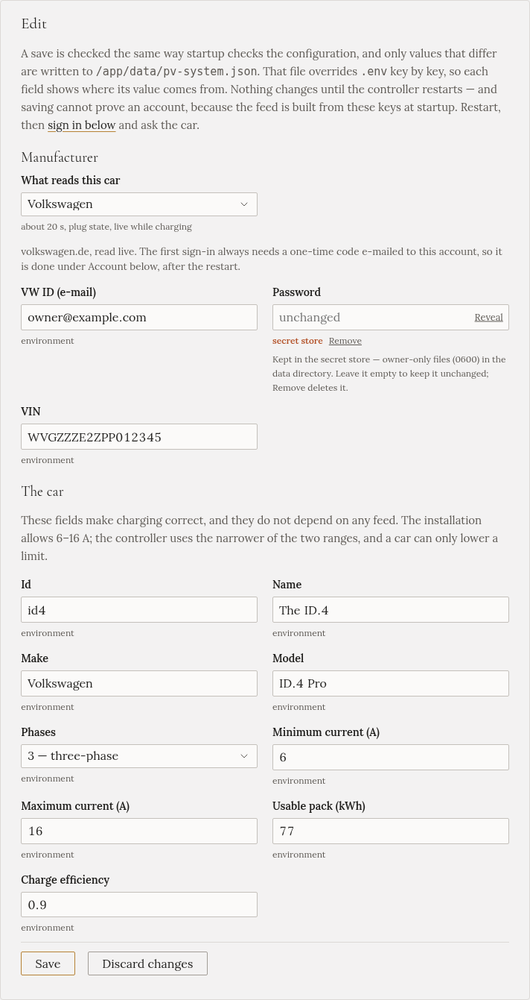
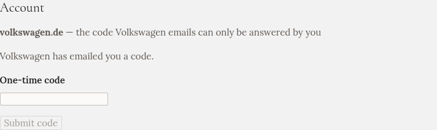

import { Steps, Tabs, TabItem } from '@astrojs/starlight/components';

Na stránce **Auto** řeknete Gleanvoltu dvě věci:

- **Údaje o autě**: velikost baterie, kolika fázemi nabíjí a jaké proudy přijímá. Díky nim je nabíjení
  správné, takže je vyplňte, ať máte jakékoli auto.
- **Odkud se čte stav baterie**, nepovinně. S ním můžete nabíjení zadat v procentech, například „80 %
  do 7:00“, a **Přehled** ukazuje baterii auta. Bez něj vše funguje a nabíjení zadáváte v kWh.

## Auto

Na stránce **Auto** (nebo v kroku průvodce **Auto**) vyplňte:

| Pole | Co zadat |
|---|---|
| **Název**, **Značka**, **Model** | Cokoli; jen se zobrazují |
| **Fáze** | Kolika fázemi nabíjí **auto**. Mnoho menších aut nabíjí jednou fází i z třífázové nabíječky |
| **Minimální proud (A)** | Nejnižší proud, který auto přijme. Obvykle 6, některá auta potřebují 8 |
| **Maximální proud (A)** | Limit palubní nabíječky auta, často 16 nebo 32 |
| **Využitelná baterie (kWh)** | **Využitelná** kapacita baterie, ke které se vztahují procenta auta. Je o něco menší než údaj z prospektu: ID.4 Pro má 77 využitelných z 82 |
| **Účinnost nabíjení** | Nechte 0,9, pokud nevíte lépe |

Klikněte na **Uložit**.

:::caution[Fáze zadejte správně]
Pokud auto nabíjí jednou fází, ale Gleanvolt si myslí, že třemi, jsou všechny výkony třikrát vyšší.
Nabíjení sice funguje, ale plány končí pozdě a na první pohled nic nevypadá špatně. Podívejte se do
příručky k autu.
:::

## Stav baterie

V **Odkud se čtou údaje auta** zvolte výrobce. Stránka pak ukáže, co potřebuje.

<Tabs syncKey="car">
<TabItem label="Volkswagen">

Auta Volkswagen se čtou živě z volkswagen.de, během nabíjení zhruba každých 20 sekund.

<Steps>

1. Zvolte **Volkswagen**. Zadejte e-mail a heslo, které používáte v aplikaci Volkswagen (**VW ID**), a
   **VIN** auta.

   

2. Klikněte na **Uložit** a potom na **Restartovat** (stránka to nabídne).

3. Zpět na stránce **Auto** klikněte v části **Účet** na **Přihlásit**.

4. Volkswagen vám pošle e-mailem kód. Napište ho do pole **Jednorázový kód** a klikněte na **Odeslat kód**.

   

5. Klikněte na **Zeptat se auta** a ověřte, že odpovídá.

</Steps>

Po restartu zůstane Gleanvolt přihlášený. Pokud ho Volkswagen někdy odhlásí, řekne vám to pruh nahoře na
každé stránce a přihlásíte se znovu stejně. Sám to znovu nezkouší, protože opakované přihlašování může
účet zablokovat.

</TabItem>
<TabItem label="Škoda">

Auta Škoda se čtou přes oficiální API Škody, každých 5 až 15 minut.

<Steps>

1. Zvolte **Škoda**, zadejte **VIN** auta a klikněte na **Uložit** a potom na **Restartovat**.

2. V aplikaci **MySkoda** vytvořte pro toto auto **klíč API**.

3. Zpět na stránce **Auto** vložte klíč v části **Účet**. Gleanvolt ho ověří, napíše, do kdy platí, a
   začne auto číst.

</Steps>

Týden před vypršením klíče vám to Gleanvolt připomene. Obnovení je vložení nového klíče.

:::note
Spojení se Škodou je postavené podle zveřejněné dokumentace Škody a na skutečném autě zatím nebylo
vyzkoušené.
:::

</TabItem>
<TabItem label="Audi, SEAT, Cupra, Bentley">

Tato auta se čtou z **portálu VW Group pro EU Data Act**. Jeho údaje bývají 2 až 4 hodiny pozadu za
autem, takže se hodí spíš k plánování než ke sledování nabíjení.

Nejdřív ve webovém prohlížeči:

<Steps>

1. Otevřete [portál EU Data Act](https://eu-data-act.drivesomethinggreater.com/de/en) a přihlaste se
   účtem své značky (myAudi, SEAT nebo Cupra ID a podobně). Odsouhlaste obrazovku se souhlasem.

2. Pokud vaše auto v seznamu portálu není, přidejte ho tam podle VIN.

3. Otevřete **Data clusters → Vehicle overview → Get customised data**. Zvolte **All data** a každých
   **15 minut**. První data mohou přijít za několik hodin až pár dní.

</Steps>

Potom v Gleanvoltu:

<Steps>

1. Na stránce **Auto** zvolte **Audi · SEAT · Cupra · Bentley · užitkové VW**. Vyberte značku a zadejte
   e-mail a heslo účtu. VIN zadejte jen tehdy, když má účet víc aut.

2. Klikněte na **Uložit** a potom na **Restartovat**.

3. Klikněte na **Zeptat se auta**. Když se objeví stav baterie auta, funguje to.

</Steps>

Pokud portál ukáže novou obrazovku se souhlasem nebo bude chtít kód, Gleanvolt přestane číst a řekne
vám to. Přihlaste se do portálu v prohlížeči, vyřešte to tam a Gleanvolt restartujte.

</TabItem>
<TabItem label="Ostatní auta">

Zvolte **Jiný výrobce — jen nabíjení**. Nabíjení funguje úplně stejně; jen ho zadáváte v kWh místo
v procentech.

Pokud stav baterie vašeho auta vidí Home Assistant, může ho Gleanvoltu předávat. To je popsané
v repozitáři, spolu s dalšími pokročilými propojeními.

</TabItem>
</Tabs>

## Heslo je v bezpečí, ale není šifrované

Hesla a klíče, které zadáte, se ukládají do soukromé složky s daty Gleanvoltu, kterou může číst jen
Gleanvolt. Už se nikdy nezobrazí. Kdo by měl kopii té složky, mohl by se přihlásit k účtu vašeho auta,
proto zálohy nikomu nedávejte: viz [Aktualizace, záloha a odinstalace](../../installation/updating/).
