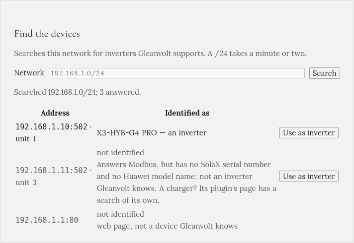

Gleanvolt potřebuje vědět, kde ve vaší domácí síti je střídač. Najde ho za vás tlačítko **Hledat**
v průvodci nastavením. Tato stránka vysvětluje, co ukazuje a co dělat, když ho nenajde. Nabíječka se
nastavuje na vlastní stránce svého pluginu: viz [Vaše nabíječka](../charger/).

## Hledání

V kroku průvodce **Střídač** klikněte na **Hledat**. Gleanvolt zkusí každou adresu v domácí síti, jestli
na ní není zařízení, které zná. Domácí síť zabere minutu nebo dvě.

Každý řádek je jedno zařízení, které odpovědělo:

- **Adresa**: kde v síti je, například `192.168.1.10:502 · unit 1`. Číslo za dvojtečkou je port a unit je
  číslo zařízení na tom portu. Pamatovat si je nemusíte: výběr zařízení je vyplní.
- **Rozpoznáno jako**: model, který zařízení nahlásilo, a zda o sobě říká, že je střídač, nebo nabíječka.
- **nerozpoznáno**: něco odpovědělo, ale není to zařízení, které Gleanvolt zná, třeba váš router.
  Nevšímejte si ho.

U svého střídače klikněte na **Použít jako střídač** a potom pod seznamem na **Uložit**. Nabíječka je
v seznamu také, abyste obě zařízení rozlišili, ale průvodce ji nenastavuje.

:::tip[Hledat můžete i později]
Po nastavení je průvodce stále na `http://gleanvolt.local:8090/wizard`. Otevřete ho a hledejte znovu,
například po výměně zařízení.
:::

## Když nic nenajde

| Co vidíte | Co to znamená | Co dělat |
|---|---|---|
| Nic, nebo jen řádky „nerozpoznáno“ | Modbus TCP (nebo místní API go-e) je vypnutý | Zapněte ho: viz [Příprava střídače a nabíječky](../../installation/preparing-devices/) |
| *Port open, no Modbus reply* | K zařízení je připojené něco jiného | Vypněte integraci Home Assistant, evcc nebo jiný software, který s ním mluví, a hledejte znovu |
| Píše, že prohledal síť 172.x | Gleanvolt běží v kontejneru, který domácí síť nevidí | Do pole **Síť** napište rozsah domácí sítě, například `192.168.1.0/24`, nebo spusťte kontejner v síti hostitele |
| Zařízení je v jiné síti, třeba v oddělené Wi-Fi pro chytrá zařízení | Hledání hledá jen tam, kam mu řeknete | Napište do pole **Síť** rozsah té sítě |

Rozsah v poli **Síť** jsou adresy domácí sítě ve tvaru `192.168.1.0/24`. Pokud adresy vašich zařízení
začínají `192.168.1.`, je to rozsah, který máte napsat.

## Ruční zadání adresy

Pokud adresu střídače znáte, ze seznamu zařízení v routeru nebo od instalačního technika, hledání
nepotřebujete. Vyplňte formulář pod ním:

| Pole | Střídač |
|---|---|
| **Značka** | SolaX nebo Huawei |
| **Adresa** | adresa střídače, například `192.168.1.10` |
| **Port** | 502 |
| **Unit ID** | obvykle 1 |

Značka vyplní svůj obvyklý port a unit ID. Střídač Huawei za EMMA potřebuje ještě **Připojení přes:
EMMA** a jako adresu adresu EMMA.

:::note[Nabíječka zabudovaná v Gleanvoltu]
**Nastavení → Instalace** má stále část **Nabíječka** se zabudovanými ovladači SolaX, Huawei SCharger
a go-e, pro instalace, které je už používají. Nahrazují je pluginy. Nová instalace nechá značku nabíječky
na **Externí plugin** a postupuje podle stránky [Vaše nabíječka](../charger/).
:::

## Při uložení

Gleanvolt ze střídače přečte jednu hodnotu, aby ověřil, že adresa odpovídá a že zařízení je to, za co jste
ho označili:

- Pokud adresa odpovídá jako nabíječka, upozorní vás. Obě používají stejný port, takže adresa nabíječky
  by se připojila bez potíží a potom ukazovala zamrzlou baterii a žádné slunce.
- Pokud střídač neodpoví, zeptá se před uložením. Klikněte na **Přesto uložit**, jen pokud jste si
  adresou jistí.

## Pevné adresy pro zařízení

Adresy přiděluje router a po výpadku proudu může zařízení dát jinou. Gleanvolt by ho pak ztratil.
V nastavení routeru najděte **rezervaci DHCP** (nebo **statický lease**) a rezervujte současnou adresu
pro střídač a také pro nabíječku: její plugin ji musí najít také.
