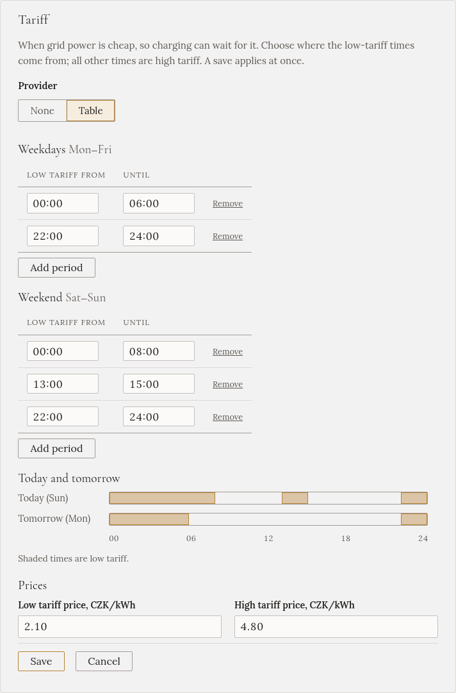

import { Steps } from '@astrojs/starlight/components';

Mnoho domácností platí za elektřinu dvě ceny: **nízký tarif** v určitých hodinách, často v noci, a
**vysoký tarif** po zbytek dne. V Česku ho přepíná distributor signálem **HDO**.

Když zadáte hodiny nízkého tarifu, dva režimy nabíjení na ně umí počkat, než sáhnou do sítě:
**Fast (no battery)** a **Solar + grid**, pokud zaškrtnete jejich volbu **Jen nízký tarif**. Samotné
zadání hodin na nabíjení nic nemění; **Přehled** jen ukazuje, který tarif právě platí.

## Kde najít hodiny nízkého tarifu

Distributor je zveřejňuje pro váš **kód HDO**. Kód je na přijímači HDO vedle elektroměru a ve smlouvě.
ČEZ Distribuce, EG.D i PREdistribuce mají stránku *HDO* nebo *časy spínání*, kam kód zadáte.

## Zadání

<Steps>

1. Otevřete **Nastavení** a najděte **Tarif**. (Nebo krok průvodce **Doplňky**.)

2. U **Zdroj tarifu** zvolte **Tabulka**.

3. V části **Pracovní dny** zadejte období nízkého tarifu pro pondělí až pátek. Pro každé klikněte na
   **Přidat období**. Potom totéž v části **Víkend**. Státní svátky se řídí pracovními dny.

4. Pokud chcete, zadejte **ceny** za kWh. Bez nich se tarif ukazuje bez ceny.

5. Zkontrolujte pruhy **Dnes a zítra**: vybarvené části jsou nízký tarif. Potom klikněte na **Uložit**.

</Steps>

Platí to hned; restart není potřeba.

## Pravidla pro období

- **Zadávejte jen časy nízkého tarifu.** Každý jiný čas je vysoký tarif.
- **Období končí ve stejný den, kdy začíná.** Noční tarif od 22:00 do 06:00 jsou dva řádky:
  **22:00–24:00** a **00:00–06:00**. Gleanvolt je přes půlnoc spojí, takže ve 23:00 napíše „nízký tarif,
  do 06:00“.
- **Období v jednom seznamu se nesmí překrývat.** Navazovat mohou, například 06:00–08:00 a 08:00–10:00.
- **Letní a zimní čas** vyřeší Gleanvolt za vás.
- Pokud vám distributor mění hodiny podle ročního období, upravte tabulku, když se změní.
