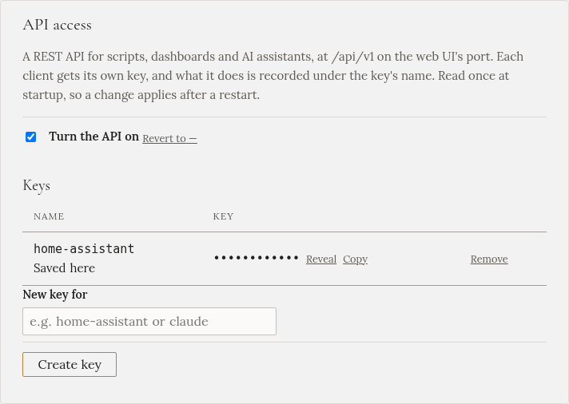

import { Steps } from '@astrojs/starlight/components';

S **integrací Gleanvolt** Home Assistant ukazuje, co Gleanvolt měří a plánuje. Můžete v něm zvolit režim
nabíjení, nastavit, co režim potřebuje, a spustit i zastavit nabíjení. MQTT broker nepotřebujete.
Integrace vyžaduje Gleanvolt 1.2.0 nebo novější.

:::caution[Propojte je jen jedním způsobem]
Gleanvolt se umí k Home Assistantu připojit i přes MQTT (**Nastavení → Home Assistant (MQTT)**). Ten
způsob se hodí, když už broker máte. Pokud jsou zapnuté oba, Gleanvolt se v Home Assistantu objeví
dvakrát. Když tedy nastavíte integraci, nechte **Home Assistant (MQTT)** vypnutý.
:::

## Klíč pro Home Assistant

<Steps>

1. V Gleanvoltu otevřete **Nastavení** a najděte **Přístup k API**. (Nebo krok průvodce **Doplňky**.)

2. Zaškrtněte **Zapnout API**.

3. Do pole **Nový klíč pro** napište `home-assistant` a klikněte na **Vytvořit klíč**. Pod tímto
   názvem protokol Gleanvoltu a historie nabíjení uvádějí, že akci spustil Home Assistant.

4. Klikněte na **Restartovat** v **Nastavení → Stav**.

</Steps>

**Kopírovat** vedle klíče ho uloží do schránky pro další kroky. Zacházejte s ním jako s heslem: Home
Assistant s ním může spustit i zastavit nabíječku.

## Instalace integrace

<Steps>

1. V Home Assistantu otevřete **HACS** a pak **⋮ → Custom repositories**. Přidejte
   `https://github.com/mpospisil/gleanvolt-ha` s typem **Integration**.

2. Najděte v HACS **Gleanvolt**, klikněte na **Download** a restartujte Home Assistant.

3. Otevřete **Nastavení → Zařízení a služby**. Home Assistant Gleanvolt v síti najde a nabídne
   **Nalezen Gleanvolt**. Klikněte na **Přidat** a vložte klíč.

   Pokud ho nenabídne, klikněte na **Přidat integraci**, vyberte **Gleanvolt** a zadejte adresu počítače,
   na kterém Gleanvolt běží (například `gleanvolt.local`), port `8090` a klíč.

</Steps>

Když je něco špatně, formulář řekne co: klíč byl odmítnut, na adrese nic neodpovídá, API je vypnuté,
nebo je Gleanvolt starší než 1.2.0 a je potřeba ho nejdřív [aktualizovat](../../installation/updating/).

## Používání

Gleanvolt se objeví jako jedno zařízení pojmenované podle vaší instalace a jako **Gleanvolt**
v postranním panelu Home Assistantu. Ta stránka funguje jako záložky [Plánu nabíjení](../../using/charging-plan/):

<Steps>

1. Vyberte režim v **Režim ke spuštění**. Pod ním se ukážou jen ovládací prvky a údaje tohoto režimu.

2. Nastavte, co režim potřebuje. U [Fast](../../using/modes/fast/) kolik a kdy, u
   [Targeted](../../using/modes/targeted/) kolik, odjezd a tempo.

3. Klikněte na **Spustit**.

</Steps>

Když Gleanvolt režim spustit nemůže, třeba *Targeted* bez času odjezdu, Home Assistant ukáže důvod od
Gleanvoltu a nic se nespustí.

- **Režim nabíjení** ukazuje, v jakém režimu Gleanvolt je. Volbou režimu tam ho spustíte hned, volbou
  **Off** nabíjení zastavíte.
- **Zastavit nabíjení** zastaví nabíječku a přepne režim na **Off**.
- Co nastavíte pro příští spuštění, drží Home Assistant a posílá to, až když se režim spouští.
- **Blokace vybíjení baterie**, oba přepínače **jen nízký tarif** a **Forecasted: do plna** mění Gleanvolt
  hned, stejně jako stejné ovládací prvky v [Plánu nabíjení](../../using/charging-plan/).
- Senzory ukazují stejné údaje jako [Přehled](../../using/overview/): slunce, síť, baterii, auto a běžící
  plán. Údaje plánu jsou prázdné, dokud jeho režim neběží.

Stejná stránka je i karta: na libovolném dashboardu **Upravit → Přidat kartu → Gleanvolt**. Nic se na
ní nenastavuje.

Home Assistant čte aktuální údaje každých 10 sekund. Změnit to můžete v **Nastavit** u integrace. Když
se Gleanvolt zastaví, zařízení se ukáže jako nedostupné, dokud znovu nenaběhne.

Průvodce nastavením, Nastavení, tarif a předpověď solární energie zůstávají na stránkách Gleanvoltu.
