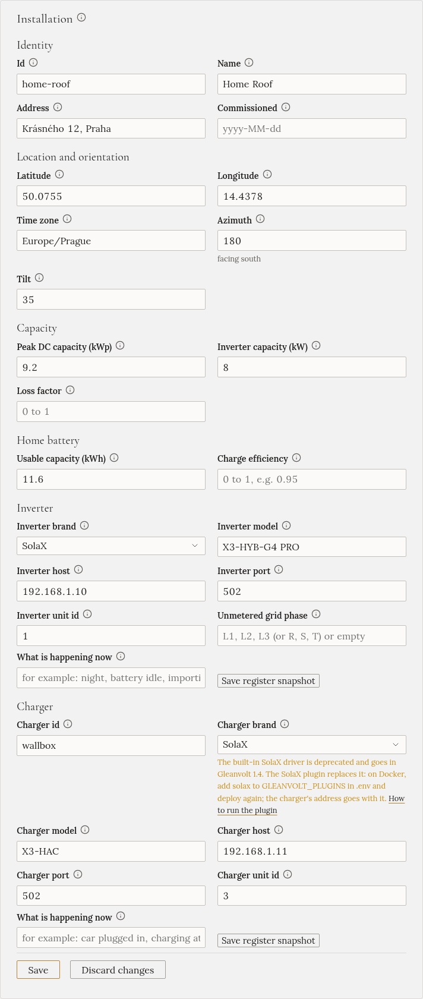
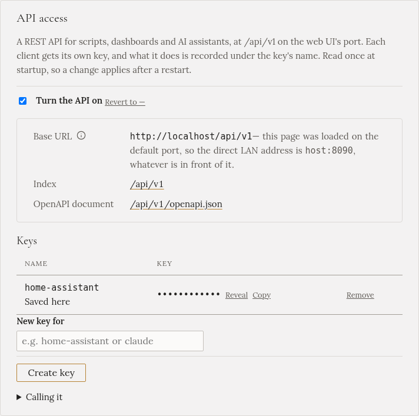
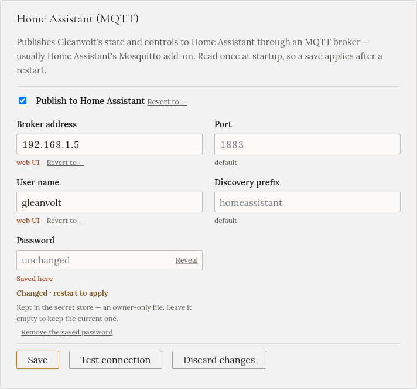
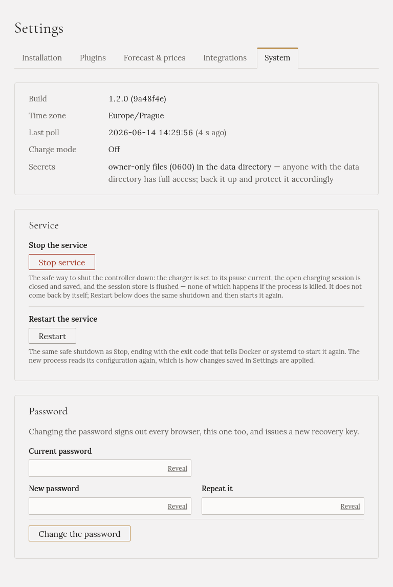

Vše, na co se ptal průvodce nastavením, je i v **Nastavení**, se stejnými poli a stejnými kontrolami.
Má pět záložek v pořadí, v jakém věci nastavujete: **Instalace**, **Externí zdroje dat**, **Předpověď a
ceny**, **Integrace** a **Systém**. Auto má vlastní stránku **Auto**.

## Ukládání a kdy restartovat

Každá sekce má vlastní tlačítko **Uložit**. Gleanvolt hodnoty před uložením zkontroluje: pokud by něco
bránilo Gleanvoltu ve spuštění, nic se neuloží a sekce napíše, co je špatně.

Na některých záložkách změna platí hned. Jiné se načítají, jen když se Gleanvolt spouští:

| Platí hned | Potřebuje restart |
|---|---|
| Externí zdroje dat, Předpověď a ceny, heslo na záložce Systém | Instalace, Integrace, Auto |

Když změna potřebuje restart, nahoře na záložce je napsáno, kolik změn je uložených, ale ještě neplatí,
s odkazem na **Restartovat** na záložce **Systém**. Restart trvá asi půl minuty. Pozastaví probíhající
nabíjení a Gleanvolt se vrátí s vypnutým nabíjením, takže restartujte, když auto nenabíjí.

U každého pole malá poznámka říká, odkud jeho hodnota pochází. Pole, které jste tady změnili, má tlačítko
**Vrátit na …**, které vrátí původní hodnotu.

## Instalace

Váš dům a vaše zařízení.

- **Zatím nenastaveno**: volitelná nastavení, která ještě nemáte, každé s tím, co přidá, a s odkazem na
  něj. Předpověď solární energie je označená jako **doporučeno**: plánují s ní Forecasted a Targeted.
- **Instalace**: název a adresa, poloha a časové pásmo, solární panely, domácí baterie a značka a adresa
  střídače. Střídač znovu vyhledáte v průvodci na `/wizard`: viz [Vyhledání zařízení](../finding-devices/).

  Pole, která potřebujete jen výjimečně, jsou sbalená pod **Pokročilé**: id, datum uvedení do provozu,
  ztrátový koeficient, účinnost nabíjení baterie, [neměřená fáze sítě](../../how-it-works/unmetered-phase/)
  a snímek registrů střídače. **Pokročilé** se otevře samo, když některé z nich čeká na restart nebo když
  bylo uložení odmítnuto.

  

- **Nabíječka**: plugin nabíječky, zda je připojený, a jeho stránka, kde je adresa a nastavení
  nabíječky. Viz [Vaše nabíječka](../charger/).

## Externí zdroje dat

Pro případ, že Gleanvolt bere data od jiných programů (pluginů). Obsahuje jeden token, kterým se
připojují všechny pluginy, adresu Gleanvoltu a řádek pro každý druh dat: jeho hub, zda je připojený
plugin, a odkaz **Otevřít** na stránku pluginu. Název druhu vede na jeho sekci. Řádek **Nabíječka**
ukazuje plugin, který si Gleanvolt pamatuje, s tlačítkem **Zapomenout**, a proč byl naposledy nějaký
plugin odmítnut. Viz kroky pro zdroj Externí v [Tarifu](../grid-tariff/) a
[Předpovědi solární energie](../solar-forecast/), [Vaše nabíječka](../charger/) a část *Přes jiný
program* v [Autě](../car/).

Každá sekce, která bere data z pluginu, ukazuje nejdřív plugin a zda je připojený, pod tím vlastní
stránku pluginu. Odkaz **Otevřít na nové kartě** pod stránkou ji otevře samostatně, pro stránku, která
v Gleanvoltu zůstane prázdná. Zbytek vysvětlují tlačítka (i).

## Předpověď a ceny

Co Gleanvolt čte zvenčí, aby mohl plánovat. Každá změna platí hned po uložení.

- **Předpověď solární energie**: účet Solcast, nebo plugin. Viz [Předpověď slunce](../solar-forecast/).
- **Počasí**: odkud počasí pochází (bez počasí, nebo plugin), a jeho stránka. Viz [Počasí](../weather/).
- **Tarif**: hodiny nízkého tarifu, nebo plugin. Viz [Tarif](../grid-tariff/).

## Integrace

Pro propojení s jiným softwarem. Pokud je nepoužíváte, nechte je vypnuté.

- **Přístup k API**: REST API pro skripty, dashboardy, AI asistenty a integraci Gleanvoltu do Home
  Assistantu, hlavní způsob, jak Home Assistant připojit. Ukazuje adresu API a jeho klíče, jeden pro
  každý program; **Volání** (sbalené) dává příkaz, kterým API vyzkoušíte.

  

- **Home Assistant (MQTT)**: posílá stav a ovládání Gleanvoltu do Home Assistantu přes MQTT broker.
  **Používaná témata** (sbalená) vypisují všechna témata. Viz [Home Assistant](../home-assistant/).

  

- **Telemetrie vozidla**: k čemu je přihlášený MQTT zdroj auta. Zapíná se i s tématem na stránce **Auto**.

## Systém

Zda Gleanvolt běží správně, restart a vaše heslo.

- **Poslední čtení**: kdy Gleanvolt naposledy přečetl střídač a nabíječku. Mělo by to být před pár
  sekundami.
- **Restartovat**: bezpečně Gleanvolt zastaví a znovu spustí. Tak se uplatní změny, které potřebují
  restart.
- **Zastavit službu**: bezpečně Gleanvolt zastaví. Nejdřív pozastaví nabíječku a uloží probíhající
  nabíjení. **Sám se už nevrátí**: musíte ho spustit na počítači, na kterém běží, nebo ten počítač
  restartovat.
- **Heslo**: heslo ke stránce Gleanvoltu. Dostanete nový klíč pro obnovení a všechny prohlížeče se
  odhlásí.

Obě tlačítka služby chtějí potvrzení. Stisknout je může každý, kdo otevře stránku Gleanvoltu a zná heslo.

## Auto

Stránka **Auto** obsahuje údaje o autě a odkud se čte stav jeho baterie. Viz
[Auto a stav jeho baterie](../car/).
