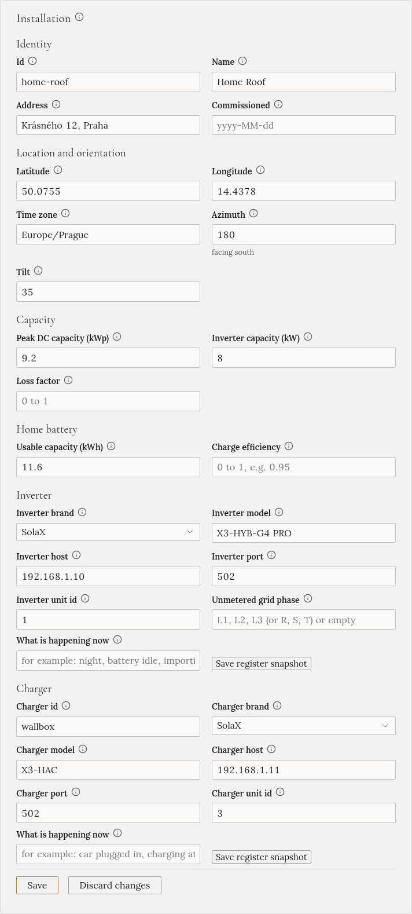
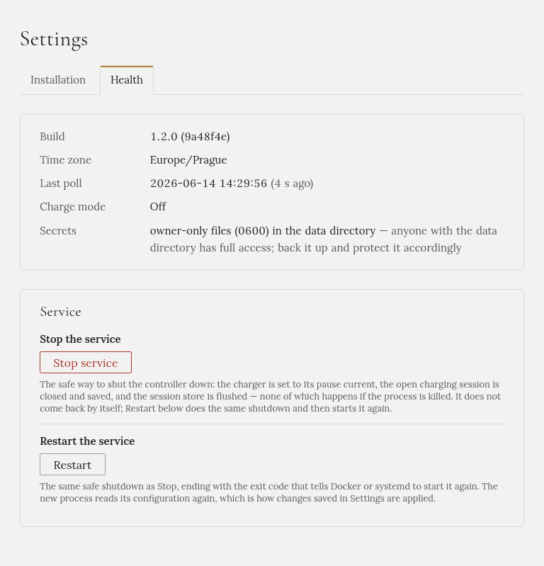

Vše, na co se ptal průvodce nastavením, je i v **Nastavení**, se stejnými poli a stejnými kontrolami.
Nastavení má dvě záložky, **Instalace** a **Stav**. Auto má vlastní stránku **Auto**.

## Ukládání a kdy restartovat

Každá sekce má vlastní tlačítko **Uložit**. Gleanvolt hodnoty před uložením zkontroluje: pokud by něco
bránilo Gleanvoltu ve spuštění, nic se neuloží a sekce napíše, co je špatně.

Některé sekce platí hned. Jiné se načítají, jen když se Gleanvolt spouští:

| Platí hned | Potřebuje restart |
|---|---|
| Předpověď solární energie, Počasí, Tarif, změna hesla | Instalace (zařízení a místo), Auto, Home Assistant, přístup k API |

Když změna potřebuje restart, sekce napíše **Uloženo, zatím neplatí** a vypíše, co se změnilo, s tlačítkem
**Restartovat** vedle. Restart trvá asi půl minuty. Pozastaví probíhající nabíjení a Gleanvolt se vrátí
s vypnutým nabíjením, takže restartujte, když auto nenabíjí.

U každého pole malá poznámka říká, odkud jeho hodnota pochází. Pole, které jste tady změnili, má tlačítko
**Vrátit na …**, které vrátí původní hodnotu.

## Instalace

Odshora dolů:

- **Instalace**: váš dům a vaše zařízení. Název, poloha a časové pásmo, solární panely, domácí baterie a
  značka a adresa střídače a nabíječky. Zařízení znovu vyhledáte v průvodci na `/wizard`: viz
  [Vyhledání zařízení](../finding-devices/).

  

- **Předpověď solární energie**: účet Solcast. Viz [Předpověď slunce](../solar-forecast/).
- **Počasí**: klíč OpenWeatherMap. Viz [Počasí](../weather/).
- **Tarif**: hodiny nízkého tarifu. Viz [Tarif](../grid-tariff/).
- **Změnit heslo**: heslo ke stránce Gleanvoltu. Dostanete nový klíč pro obnovení a všechny prohlížeče se
  odhlásí.
- **Home Assistant (MQTT)** a **Přístup k API**: pro propojení s jiným softwarem. Pokud je nepoužíváte,
  nechte je vypnuté; popisuje je repozitář.

Sekce pro nastavení, která ještě nemáte, jsou vypsané nahoře v části **Zatím nenastaveno**, každá
s odkazem na nastavení.

## Stav

Záložka **Stav** ukazuje, zda Gleanvolt běží správně, a umožňuje ho restartovat nebo zastavit.

- **Poslední čtení**: kdy Gleanvolt naposledy přečetl střídač a nabíječku. Mělo by to být před pár
  sekundami.
- **Restartovat**: bezpečně Gleanvolt zastaví a znovu spustí. Tak se uplatní změny, které potřebují
  restart.
- **Zastavit službu**: bezpečně Gleanvolt zastaví. Nejdřív pozastaví nabíječku a uloží probíhající
  nabíjení. **Sám se už nevrátí**: musíte ho spustit na počítači, na kterém běží, nebo ten počítač
  restartovat.

Obě tlačítka chtějí potvrzení. Stisknout je může každý, kdo otevře stránku Gleanvoltu a zná heslo.

## Auto

Stránka **Auto** obsahuje údaje o autě a odkud se čte stav jeho baterie. Viz
[Auto a stav jeho baterie](../car/).
