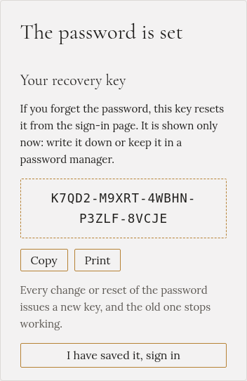
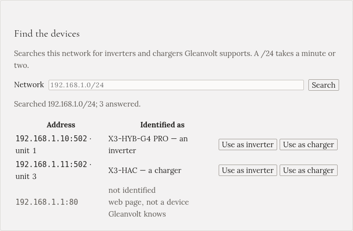
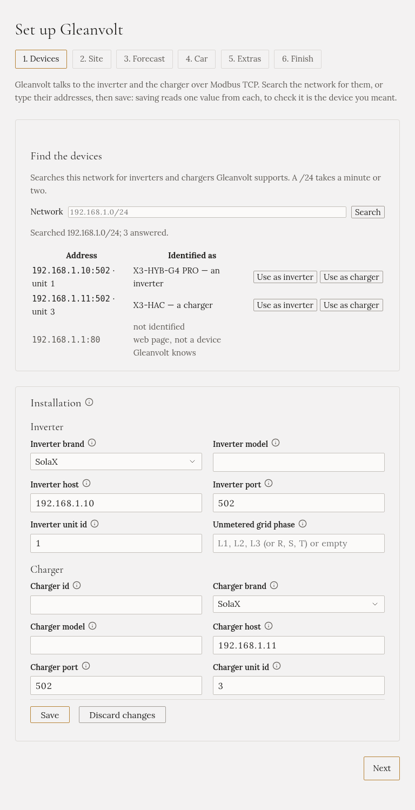
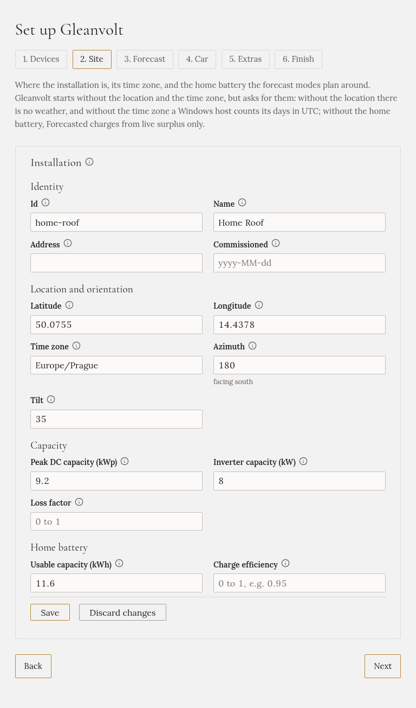
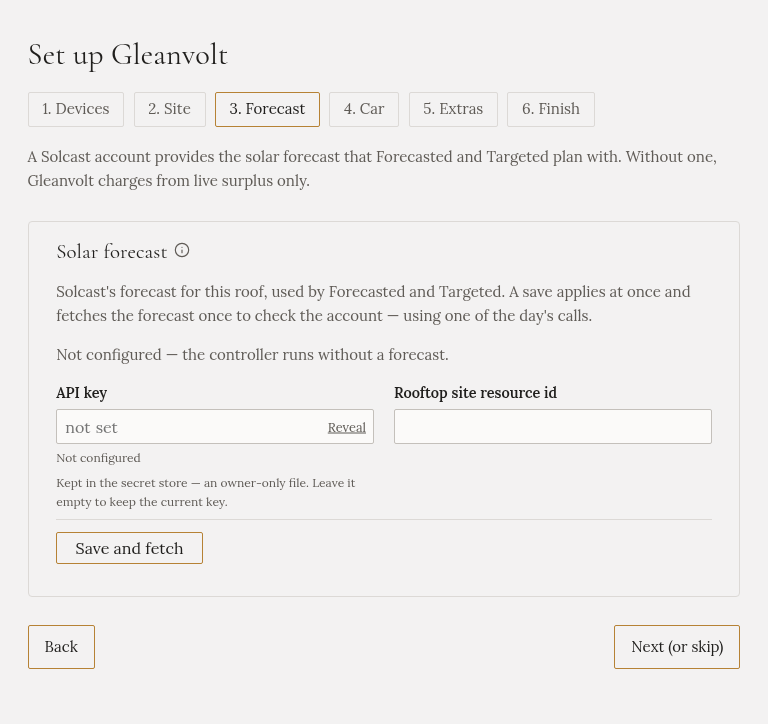
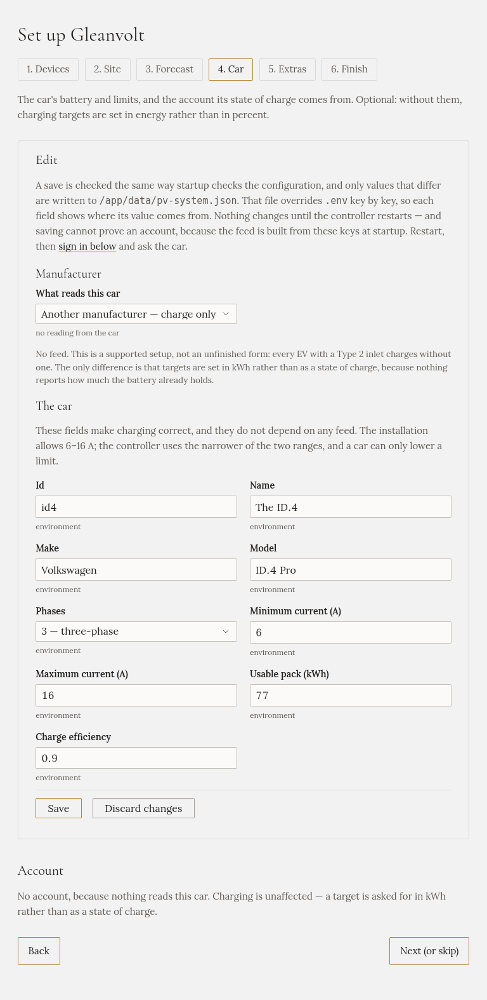
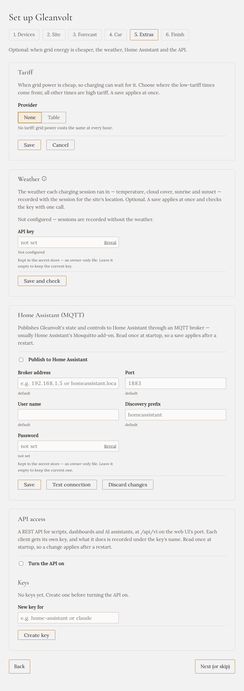
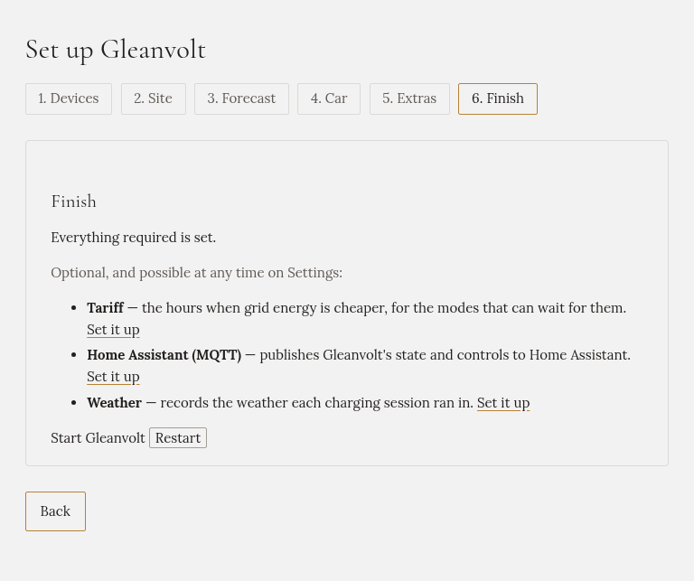

import { Steps } from '@astrojs/starlight/components';

Když Gleanvolt otevřete poprvé, provede vás nastavením. Zvolíte heslo a potom se **průvodce** zeptá na
to, co Gleanvolt potřebuje vědět, po jedné stránce. Trvá to asi deset minut.

Povinné jsou jen první dva kroky: heslo a adresy střídače a nabíječky. Všechno ostatní můžete přeskočit
a doplnit později v **Nastavení**.

## Než začnete

- Gleanvolt je nainstalovaný a běží.
- Střídač a nabíječka jsou zapnuté a připojené k domácí síti.
- **Modbus TCP je zapnutý** v obou. Přes něj s nimi Gleanvolt komunikuje. Viz
  [Příprava střídače a nabíječky](../../installation/preparing-devices/).
- Pokud **Home Assistant** čte váš střídač, vypněte tuto integraci, než budete zařízení hledat. Některé
  střídače přijmou jen jedno spojení najednou.

## Otevřete Gleanvolt

V telefonu nebo počítači ve stejné domácí síti otevřete webový prohlížeč a zadejte
**`http://gleanvolt.local:8090`**.

Pokud se stránka neotevře, použijte místo toho adresu počítače, na kterém Gleanvolt běží, například
`http://192.168.1.20:8090`. Najdete ji v seznamu připojených zařízení ve vašem routeru.

## Nastavte heslo

<Steps>

1. Napište heslo o délce alespoň 8 znaků a zopakujte ho do pole pod ním.

   Gleanvolt má jedno heslo pro celou domácnost, ne pro každého zvlášť. Stránku může otevřít kdokoli
   v domácí síti, takže heslo je to, co brání telefonu návštěvy změnit nabíjení vašeho auta.

   

2. Klikněte na **Nastavit heslo**.

3. Gleanvolt ukáže váš **klíč pro obnovení**. Kdybyste heslo někdy zapomněli, tímto klíčem nastavíte
   nové. Ukáže se jen tentokrát.

   Klikněte na **Kopírovat** a uložte si ho do správce hesel, nebo klikněte na **Tisknout**, nebo si ho
   zapište.

   

4. Klikněte na **Klíč mám uložený, přihlásit se** a přihlaste se novým heslem.

</Steps>

## Průvodce

Průvodce má šest kroků, uvedených nahoře na stránce. Mezi nimi se můžete kdykoli přesouvat.

:::caution[Každý krok uložte]
**Další** jen přejde na další krok. Nejdřív klikněte na **Uložit**, jinak se to, co jste napsali, ztratí.
Co jste uložili, zůstane uložené, i když prohlížeč v půlce zavřete.
:::

### 1. Zařízení

Tady Gleanvoltu řeknete, které zařízení je střídač a které nabíječka.

<Steps>

1. Klikněte na **Hledat**. Gleanvolt prohledá domácí síť a najde střídače a nabíječky, které zná. Trvá
   to minutu nebo dvě.

   

2. V seznamu najděte svůj střídač a klikněte na **Použít jako střídač**. Potom najděte nabíječku a
   klikněte na **Použít jako nabíječku**.

   Sloupec **Rozpoznáno jako** říká, za co se zařízení samo prohlásilo. Gleanvolt nikdy nerozhoduje
   za vás, co je co, a upozorní vás, pokud zvolíte roli, která nesedí.

3. Zkontrolujte formulář pod seznamem. Adresy střídače a nabíječky jsou teď vyplněné.

   

4. Klikněte na **Uložit**. Gleanvolt z každého zařízení přečte jednu hodnotu, aby ověřil, že je to to
   zařízení, které jste mysleli.

5. Klikněte na **Další**.

</Steps>

:::tip[Hledání nic nenašlo?]
- Zkontrolujte, že je ve střídači a nabíječce zapnutý Modbus TCP.
- Vypněte vše ostatní, co je k nim připojené, například integraci SolaX nebo Huawei v Home Assistant,
  a hledejte znovu.
- Pokud Gleanvolt běží v Dockeru, hledání možná vidí jen vlastní síť Dockeru. Do pole **Síť** napište
  rozsah své domácí sítě, například `192.168.1.0/24`, a hledejte znovu.
- Pokud adresy znáte, můžete je do formuláře napsat sami.
:::

:::caution[Nezaměňte střídač a nabíječku]
Obě zařízení odpovídají na stejném portu, takže se k nim Gleanvolt připojí v obou případech. Pokud jsou
prohozené, stav baterie vypadá zamrzle a výkon slunce ukazuje nulu. Před uložením zkontrolujte sloupec
**Rozpoznáno jako**.
:::

Pokud zařízení při ukládání neodpoví, například vypnutá nabíječka, Gleanvolt se před uložením zeptá.
Klikněte na **Přesto uložit**, jen pokud jste si jistí, že je adresa správně.

### 2. Instalace

Kde jsou vaše panely a jak velká je domácí baterie.

<Steps>

1. Vyplňte, co víte:

   - **Zeměpisná šířka** a **Zeměpisná délka** vašeho domu. Gleanvolt je používá pro počasí a pro
     východ a západ slunce. Ve většině online map je uvidíte, když na dům kliknete pravým tlačítkem.
   - **Časové pásmo**, například `Europe/Prague`. Gleanvolt podle něj ví, kdy den začíná a končí.
   - **Využitelná kapacita (kWh)** domácí baterie. Najdete ji v technickém listu baterie nebo
     v aplikaci střídače. Podle ní plánují režimy, které pracují s předpovědí.

   Ostatní pole jsou nepovinná. Vyplňte je, pokud je znáte.

   

2. Klikněte na **Uložit** a potom na **Další**.

</Steps>

Gleanvolt se spustí i bez polohy a časového pásma, ale s nimi funguje lépe.

### 3. Předpověď (nepovinné)

Bezplatný účet **Solcast** dá Gleanvoltu předpověď slunce pro vaši střechu. Dva režimy nabíjení,
Forecasted a Targeted, podle ní plánují dopředu. Bez ní Gleanvolt nabíjí ze slunce, které svítí právě
teď.

Pokud účet máte, vložte jeho **Klíč API** a **ID zdroje střešní instalace (resource id)** a klikněte na
**Uložit a stáhnout**. Pokud ne, klikněte na **Další (nebo přeskočit)**. Můžete ho doplnit později
v **Nastavení**.

### 4. Auto (nepovinné)

Velikost baterie auta, jeho nabíjecí limity a účet, ze kterého se čte stav baterie. S nimi můžete
nabíjení zadat v procentech, například „80 % do 7:00“. Bez nich ho zadáváte v kWh.

Vyplňte, co víte, klikněte na **Uložit** a potom na **Další (nebo přeskočit)**.

### 5. Doplňky (nepovinné)

- **Tarif**: hodiny, kdy je elektřina ze sítě levnější. Některé režimy na ně umí počkat.
- **Počasí**: zaznamená počasí během každého nabíjení.
- **Home Assistant (MQTT)** a **Přístup k API**: pro propojení s jiným softwarem. Pokud je nepoužíváte,
  nechte je vypnuté.

Celý tento krok můžete přeskočit a vrátit se k němu v **Nastavení**.

### 6. Dokončení

Poslední krok zkontroluje, že je nastavené vše potřebné. Pokud něco chybí, napíše co, s odkazem na krok,
kde se to nastavuje.

<Steps>

1. Vedle **Spustit Gleanvolt** klikněte na **Restartovat** a potom na **Ano, restartovat**.

2. Gleanvolt se restartuje. Asi po půl minutě se otevře **Přehled**.

</Steps>

Na Raspberry Pi, počítači s Linuxem, v Dockeru nebo na NAS se Gleanvolt vrátí sám. Ve Windows ho, pokud
se nevrátí, spusťte znovu sami.

Gleanvolt se vždy spouští s vypnutým nabíjením. Nabíječky se nedotkne, dokud nezvolíte režim nabíjení.

## Pozdější změny

Vše, na co se průvodce ptá, je i v **Nastavení**, se stejnými poli. Měnit to tam můžete kdykoli.
