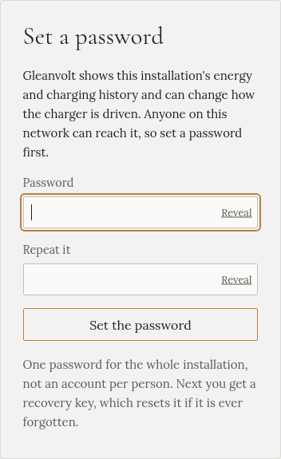
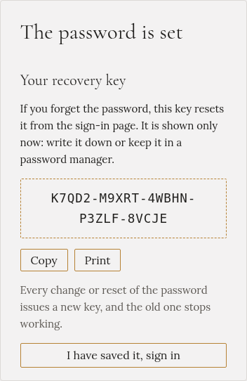
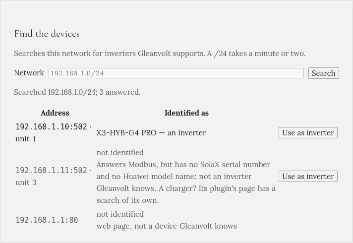
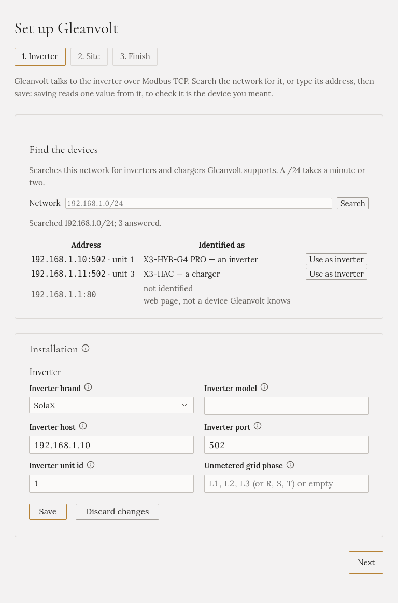
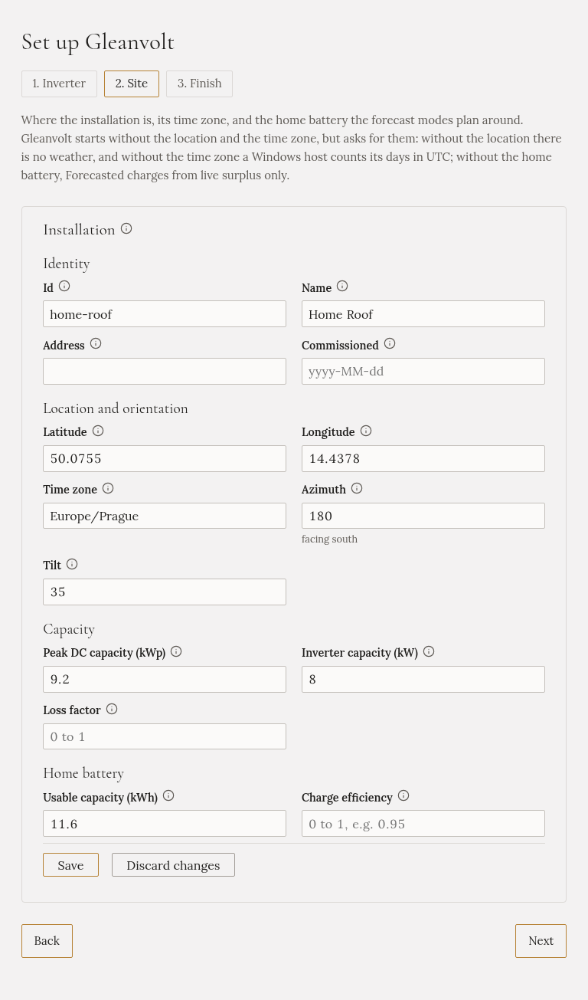
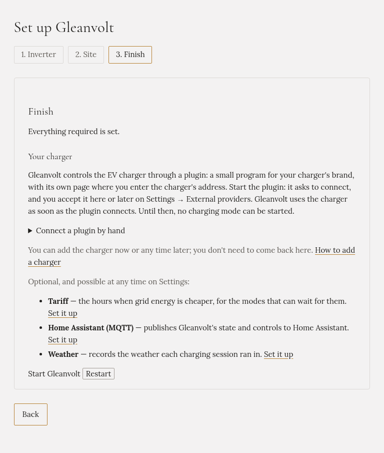

import { Steps } from '@astrojs/starlight/components';

Když Gleanvolt otevřete poprvé, provede vás nastavením. Zvolíte heslo a potom se **průvodce** zeptá na
to, co Gleanvolt potřebuje vědět, po jedné stránce. Trvá to asi pět minut.

Povinné je jen heslo a adresa střídače. Nabíječka není součástí tohoto nastavení: je to plugin s vlastní
stránkou, který přidáte na konci nebo kdykoli později. Předpověď, auto a doplňky jsou v **Nastavení**.

## Než začnete

- Gleanvolt je nainstalovaný a běží.
- Střídač je zapnutý a připojený k domácí síti.
- **Modbus TCP je ve střídači zapnutý.** Přes něj s ním Gleanvolt komunikuje. Viz
  [Příprava střídače a nabíječky](../../installation/preparing-devices/).
- Pokud **Home Assistant** čte váš střídač, vypněte tuto integraci, než budete zařízení hledat. Některé
  střídače přijmou jen jedno spojení najednou.

## Otevřete Gleanvolt

V telefonu nebo počítači ve stejné domácí síti otevřete webový prohlížeč a zadejte
**`http://gleanvolt.local:8090`**.

Pokud se stránka neotevře, použijte místo toho adresu počítače, na kterém Gleanvolt běží, například
`http://192.168.1.20:8090`. Najdete ji v seznamu připojených zařízení ve vašem routeru.

## Nastavte heslo

<Steps>

1. Napište heslo o délce alespoň 8 znaků a zopakujte ho do pole pod ním.

   Gleanvolt má jedno heslo pro celou domácnost, ne pro každého zvlášť. Stránku může otevřít kdokoli
   v domácí síti, takže heslo je to, co brání telefonu návštěvy změnit nabíjení vašeho auta.

   

2. Klikněte na **Nastavit heslo**.

3. Gleanvolt ukáže váš **klíč pro obnovení**. Kdybyste heslo někdy zapomněli, tímto klíčem nastavíte
   nové. Ukáže se jen tentokrát.

   Klikněte na **Kopírovat** a uložte si ho do správce hesel, nebo klikněte na **Tisknout**, nebo si ho
   zapište.

   

4. Klikněte na **Klíč mám uložený, přihlásit se** a přihlaste se novým heslem.

</Steps>

## Průvodce

Průvodce má tři kroky, uvedené nahoře na stránce: **Střídač**, **Instalace** a **Dokončení**. Mezi nimi
se můžete kdykoli přesouvat.

:::caution[Každý krok uložte]
**Další** jen přejde na další krok. Nejdřív klikněte na **Uložit**, jinak se to, co jste napsali, ztratí.
Co jste uložili, zůstane uložené, i když prohlížeč v půlce zavřete.
:::

### 1. Střídač

Tady Gleanvoltu řeknete, které zařízení je váš střídač.

<Steps>

1. Klikněte na **Hledat**. Gleanvolt prohledá domácí síť a najde zařízení, která zná. Trvá to minutu
   nebo dvě.

   

2. V seznamu najděte svůj střídač a klikněte na **Použít jako střídač**.

   Sloupec **Rozpoznáno jako** jmenuje každý střídač, který poznal. Vaše nabíječka odpoví také, jako
   **nerozpoznáno**: tu nevybírejte.

3. Zkontrolujte formulář pod seznamem. Značka, adresa, port a unit ID střídače jsou teď vyplněné.

   

4. Klikněte na **Uložit**. Gleanvolt ze střídače přečte jednu hodnotu, aby ověřil, že je to to
   zařízení, které jste mysleli.

5. Klikněte na **Další**.

</Steps>

:::tip[Hledání nic nenašlo?]
- Zkontrolujte, že je ve střídači zapnutý Modbus TCP.
- Vypněte vše ostatní, co je k němu připojené, například integraci SolaX nebo Huawei v Home Assistant,
  a hledejte znovu.
- Pokud Gleanvolt běží v Dockeru, hledání možná vidí jen vlastní síť Dockeru. Do pole **Síť** napište
  rozsah své domácí sítě, například `192.168.1.0/24`, a hledejte znovu.
- Pokud adresu znáte, můžete ji do formuláře napsat sami.
:::

:::caution[Nevyberte nabíječku]
Nabíječka s Modbusem odpovídá na stejném portu jako střídač, takže se k ní Gleanvolt připojí také. Pokud
ji vyberete jako střídač, stav baterie vypadá zamrzle a výkon slunce ukazuje nulu. Vyberte řádek
rozpoznaný jako střídač.
:::

Pokud střídač při ukládání neodpoví, Gleanvolt se před uložením zeptá. Klikněte na **Přesto uložit**, jen
pokud jste si jistí, že je adresa správně.

### 2. Instalace

Kde jsou vaše panely a jak velká je domácí baterie.

<Steps>

1. Vyplňte, co víte:

   - **Zeměpisná šířka** a **Zeměpisná délka** vašeho domu. Gleanvolt je používá pro počasí a pro
     východ a západ slunce. Ve většině online map je uvidíte, když na dům kliknete pravým tlačítkem.
   - **Časové pásmo**, například `Europe/Prague`. Gleanvolt podle něj ví, kdy den začíná a končí.
   - **Využitelná kapacita (kWh)** domácí baterie. Najdete ji v technickém listu baterie nebo
     v aplikaci střídače. Podle ní plánují režimy, které pracují s předpovědí.

   Ostatní pole jsou nepovinná. Vyplňte je, pokud je znáte.

   

2. Klikněte na **Uložit** a potom na **Další**.

</Steps>

Gleanvolt se spustí i bez polohy a časového pásma, ale s nimi funguje lépe.

### 3. Dokončení

Poslední krok zkontroluje, že je nastavené vše potřebné. Pokud něco chybí, napíše co, s odkazem na krok,
kde se to nastavuje.

**Vaše nabíječka.** Gleanvolt řídí nabíječku přes plugin pro její značku, s vlastní stránkou. Spusťte
plugin podle stránky [Vaše nabíječka](../charger/): token nepotřebuje. Objeví se tady v části **Pluginy
žádající o připojení** a vy kliknete na **Přijmout**. Gleanvolt token vytvoří a předá ho, takže ho nikdy
nekopírujete. Nevyžaduje to přihlášení: dokud není nastavené heslo, může plugin přijmout kdokoli, kdo
Gleanvolt otevře, tady i v Nastavení. Pokud chcete token raději zkopírovat sami, tlačítko **Vytvořit
token** je v části **Připojit plugin ručně**. Můžete to udělat i později: plugin lze spustit kdykoli a Gleanvolt začne
nabíječku používat, jakmile se připojí. Do té doby nelze spustit žádný režim nabíjení.

**Volitelná nastavení.** Seznam ukazuje, co ještě není nastavené, každé s odkazem **Nastavit** tam, kde se
nastavuje: předpověď a tarif v **Nastavení → Předpověď a ceny**, auto na stránce **Auto**. Viz
[Předpověď solární energie](../solar-forecast/), [Tarif](../grid-tariff/), [Počasí](../weather/) a
[Auto a stav jeho baterie](../car/).

<Steps>

1. Vedle **Spustit Gleanvolt** klikněte na **Restartovat** a potom na **Ano, restartovat**.

2. Gleanvolt se restartuje. Asi po půl minutě se otevře **Přehled**.

</Steps>

Na Raspberry Pi, počítači s Linuxem, v Dockeru nebo na NAS se Gleanvolt vrátí sám. Ve Windows ho, pokud
se nevrátí, spusťte znovu sami.

Gleanvolt se vždy spouští s vypnutým nabíjením. Nabíječky se nedotkne, dokud nezvolíte režim nabíjení.

## Pozdější změny

Vše, na co se průvodce ptá, je i v **Nastavení**, se stejnými poli. Měnit to tam můžete kdykoli.
