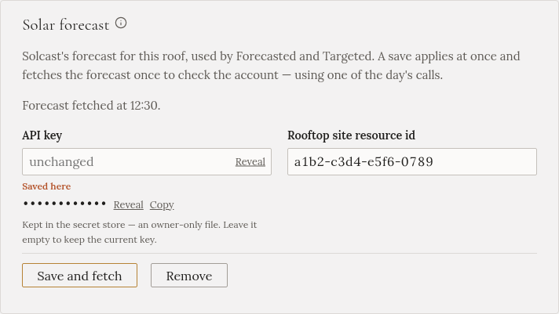

import { Steps } from '@astrojs/starlight/components';

Předpověď říká Gleanvoltu, kolik slunce během dne čekat. Používají ji dva režimy nabíjení:

- **Forecasted** začne nabíjet auto dřív a přitom zajistí, aby domácí baterie byla večer plná.
- **Targeted** naplánuje nabíjení tak, aby skončilo do zadaného času, s co nejvíc sluncem a co nejméně
  ze sítě.

Bez předpovědi Gleanvolt pořád nabíjí ze slunce, které svítí právě teď, a všechny ostatní režimy
fungují jako obvykle. Předpověď poskytuje [Solcast](https://solcast.com/), pro domácí použití zdarma.

## Založení účtu

<Steps>

1. Na [solcast.com](https://solcast.com/) se zaregistrujte do bezplatného plánu pro domácnosti (**home
   user**, také *hobbyist*).

2. Přidejte **rooftop site** (střešní instalaci). Zadejte polohu domu a údaje o panelech:

   - **Capacity**: celkový výkon panelů v kW, například 9,2. Najdete ho v dokumentech od instalačního
     technika nebo v aplikaci střídače.
   - **Azimuth**: kam panely míří. Řiďte se vysvětlením přímo v Solcastu, jeho způsob zápisu se může
     lišit od kompasu.
   - **Tilt**: sklon panelů od vodorovné roviny ve stupních.

   Předpověď je jen tak dobrá, jak dobré jsou tyto údaje.

3. Otevřete vytvořenou instalaci. Najdete u ní **resource id**, kód jako `a1b2-c3d4-e5f6-0789`.

4. Otevřete nastavení účtu a zkopírujte **API key**.

</Steps>

## Zadání do Gleanvoltu

<Steps>

1. Otevřete **Nastavení** a najděte **Předpověď solární energie**. (Nebo krok průvodce **Předpověď**.)

2. Vložte **Klíč API** a **ID zdroje střešní instalace (resource id)**.

3. Klikněte na **Uložit a stáhnout**. Gleanvolt jednou stáhne předpověď, aby účet ověřil. Restart není
   potřeba.

</Steps>

Když to vyšlo, sekce napíše, kdy byla předpověď stažena:

Pokud Solcast klíč odmítne nebo instalaci nezná, sekce to napíše. Zkontrolujte, co jste vložili, a
uložte znovu.

## Denní limit

Bezplatný plán dovoluje **asi deset předpovědí denně**. Gleanvolt stahuje jednu každých 12 hodin a jednu
při každém spuštění. Proto:

- Mnoho restartů za jeden den může denní předpovědi vyčerpat. Další den to zase funguje.
- Pokud Solcast hlásí vyčerpaný limit, nic není rozbité. Počkejte do zítřka.
