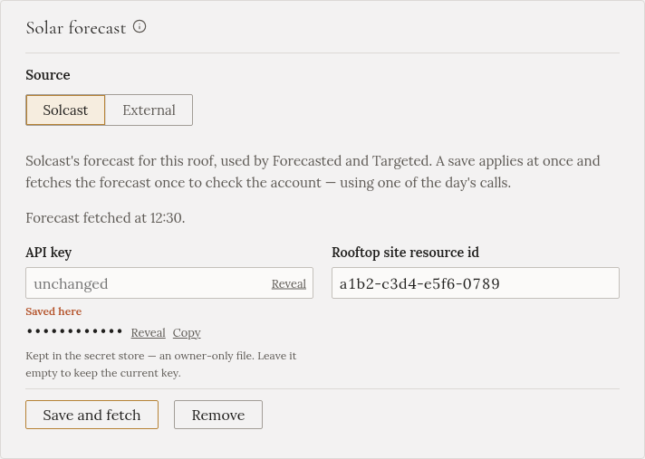
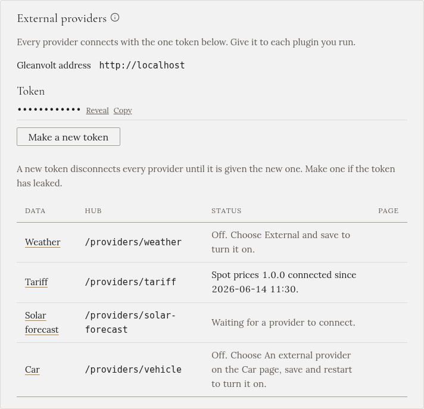
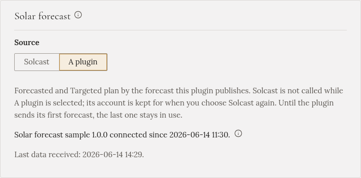

import { Steps } from '@astrojs/starlight/components';

Předpověď říká Gleanvoltu, kolik slunce během dne čekat. Používají ji dva režimy nabíjení:

- **Forecasted** začne nabíjet auto dřív a přitom zajistí, aby domácí baterie byla večer plná.
- **Targeted** naplánuje nabíjení tak, aby skončilo do zadaného času, s co nejvíc sluncem a co nejméně
  ze sítě.

Bez předpovědi Gleanvolt pořád nabíjí ze slunce, které svítí právě teď, a všechny ostatní režimy
fungují jako obvykle. Předpověď poskytuje [Solcast](https://solcast.com/), pro domácí použití zdarma.

## Založení účtu

<Steps>

1. Na [solcast.com](https://solcast.com/) se zaregistrujte do bezplatného plánu pro domácnosti (**home
   user**, také *hobbyist*).

2. Přidejte **rooftop site** (střešní instalaci). Zadejte polohu domu a údaje o panelech:

   - **Capacity**: celkový výkon panelů v kW, například 9,2. Najdete ho v dokumentech od instalačního
     technika nebo v aplikaci střídače.
   - **Azimuth**: kam panely míří. Řiďte se vysvětlením přímo v Solcastu, jeho způsob zápisu se může
     lišit od kompasu.
   - **Tilt**: sklon panelů od vodorovné roviny ve stupních.

   Předpověď je jen tak dobrá, jak dobré jsou tyto údaje.

3. Otevřete vytvořenou instalaci. Najdete u ní **resource id**, kód jako `a1b2-c3d4-e5f6-0789`.

4. Otevřete nastavení účtu a zkopírujte **API key**.

</Steps>

## Zadání do Gleanvoltu

<Steps>

1. Otevřete **Nastavení** a najděte **Předpověď solární energie**. (Nebo krok průvodce **Předpověď**.)

2. Vložte **Klíč API** a **ID zdroje střešní instalace (resource id)**.

3. Klikněte na **Uložit a stáhnout**. Gleanvolt jednou stáhne předpověď, aby účet ověřil. Restart není
   potřeba.

</Steps>

Když to vyšlo, sekce napíše, kdy byla předpověď stažena:

Pokud Solcast klíč odmítne nebo instalaci nezná, sekce to napíše. Zkontrolujte, co jste vložili, a
uložte znovu.

## Denní limit

Bezplatný plán dovoluje **asi deset předpovědí denně**. Gleanvolt stahuje jednu každých 12 hodin a jednu
při každém spuštění. Proto:

- Mnoho restartů za jeden den může denní předpovědi vyčerpat. Další den to zase funguje.
- Pokud Solcast hlásí vyčerpaný limit, nic není rozbité. Počkejte do zítřka.

## Nebo ji nechte dodávat jiný program

Předpověď může místo Solcastu dodávat program mimo Gleanvolt, například takový, který čte jinou
předpovědní službu. Je to zdroj **Externí**. Takový program musí někdo napsat nebo nainstalovat;
Gleanvolt žádný nemá. Vývojáři najdou postup v
[příručce pro zdroje dat](https://github.com/mpospisil/gleanvolt/blob/main/docs/PROVIDERS.md) (anglicky).

<Steps>

1. Otevřete **Nastavení**, najděte **Předpověď solární energie**, u **Zdroj předpovědi** zvolte
   **Externí** a stiskněte **Uložit**.

2. Na záložce **Externí zdroje dat** stiskněte **Vytvořit token** a pak **Kopírovat**.
   Pokud tam token už je, protože ho používá jiný program, zkopírujte ten: všechny programy používají
   stejný token. **Zobrazit** ho ukáže, hned i kdykoli později.

   

3. Předejte programu **Adresu Gleanvoltu** a token.

4. Když se program připojí, **Stav** ho jmenuje a **Poslední data přišla** říká, kdy jeho předpověď
   dorazila. Jmenuje ho i řádek pod tabulkou předpovědi na **Přehledu**.

</Steps>

- **Dokud je zvolen zdroj Externí, Solcast se nevolá.** Účet Solcastu zůstává uložený, takže pro
  návrat stačí zvolit **Solcast**.
- **Když se program odpojí**, Gleanvolt dál plánuje podle předpovědi, kterou program naposledy poslal,
  a **Přehled** napíše, že je od odpojeného programu. Sám se k Solcastu nevrací.
- **Po restartu Gleanvoltu** není žádná předpověď, dokud ji program nepošle. To udělá hned, jak se
  znovu připojí.
- **Na pořadí spuštění nezáleží.** Program se připojuje, dokud Gleanvolt neodpoví, a po restartu nebo
  aktualizaci Gleanvoltu se připojí sám.
- **Když token unikne**, stiskněte **Vytvořit nový token** v části **Externí zdroje dat**. Všechny
  programy se odpojí, dokud jim nový token nepředáte.
- **Volba Solcast** program odpojí a znovu se připojit může, až zase zvolíte **Externí**.
