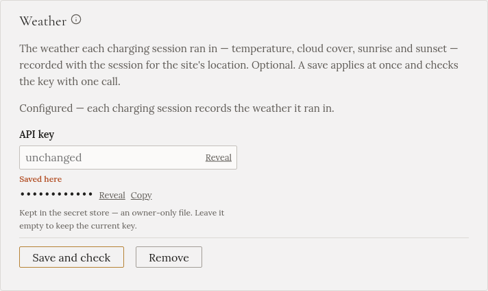

import { Steps } from '@astrojs/starlight/components';

S klíčem pro počasí Gleanvolt zaznamená, jak vypadala obloha na začátku a na konci každého nabíjení:
teplotu, oblačnost, východ a západ slunce. Uvidíte to v historii každého nabíjení a pomůže to vysvětlit
nabíjení, které trvalo déle, než jste čekali.

Je to nepovinné a na samotném nabíjení to nic nemění. Potřebuje to i polohu domu, na kterou se ptá krok
průvodce **Instalace**.

## Získání klíče

<Steps>

1. Na [openweathermap.org](https://openweathermap.org/) si založte bezplatný účet.

2. Otevřete v účtu stránku **API keys** a zkopírujte klíč.

</Steps>

## Zadání do Gleanvoltu

<Steps>

1. Otevřete **Nastavení** a najděte **Počasí**. (Nebo krok průvodce **Doplňky**.)

2. Vložte klíč do pole **Klíč API**.

3. Klikněte na **Uložit a ověřit**. Restart není potřeba.

</Steps>

:::note[Nový klíč může začít fungovat až za pár hodin]
OpenWeatherMap někdy nový klíč chvíli zapíná. Pokud ověření hned po vytvoření selže, klíč zůstane
uložený a začne fungovat sám.
:::

Gleanvolt se ptá na počasí dvakrát za nabíjení, s velkou rezervou v rámci bezplatného plánu.
