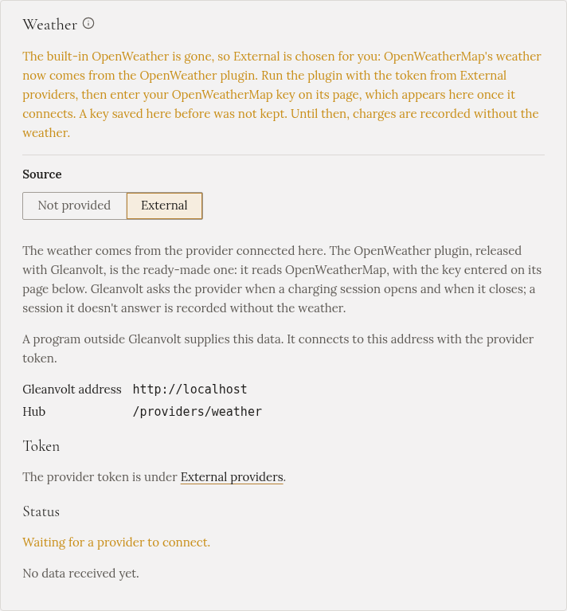
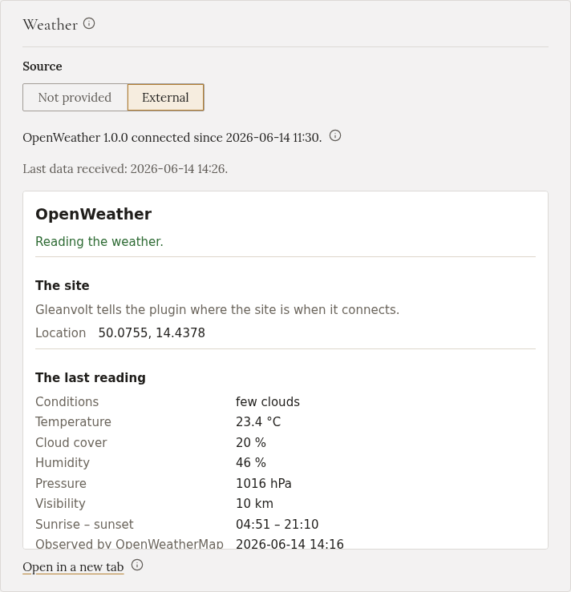

import { Steps } from '@astrojs/starlight/components';

Gleanvolt může zaznamenat, jak vypadala obloha na začátku a na konci každého nabíjení: teplotu,
oblačnost, východ a západ slunce. Uvidíte to v historii každého nabíjení a pomůže to vysvětlit
nabíjení, které trvalo déle, než jste čekali.

Je to nepovinné a na samotném nabíjení to nic nemění. Potřebuje to i polohu domu, na kterou se ptá krok
průvodce **Instalace**.

## Výběr zdroje počasí

Otevřete **Nastavení** a najděte **Počasí** (nebo krok průvodce **Doplňky**). V části **Zdroj počasí**
vyberte:

- **Bez počasí**: počasí se nezaznamenává.
- **OpenWeather**: Gleanvolt se ptá OpenWeatherMap sám, s bezplatným klíčem, který zadáte tady.
- **Externí**: počasí Gleanvoltu posílá samostatný program, například plugin OpenWeather.

Klikněte na **Uložit**. Restart není potřeba.

Pokud jste klíč OpenWeatherMap měli zadaný už dřív, než tato volba vznikla, je vybráno **OpenWeather**.

## OpenWeather

### Získání klíče

<Steps>

1. Na [openweathermap.org](https://openweathermap.org/) si založte bezplatný účet.

2. Otevřete v účtu stránku **API keys** a zkopírujte klíč.

</Steps>

### Zadání do Gleanvoltu

<Steps>

1. V části **Počasí** vyberte **OpenWeather**.

2. Vložte klíč do pole **Klíč API**.

3. Klikněte na **Uložit a ověřit**. Tím se zároveň uloží **OpenWeather** jako zdroj.

</Steps>

:::note[Nový klíč může začít fungovat až za pár hodin]
OpenWeatherMap někdy nový klíč chvíli zapíná. Pokud ověření hned po vytvoření selže, klíč zůstane
uložený a začne fungovat sám.
:::

Gleanvolt se ptá na počasí dvakrát za nabíjení, s velkou rezervou v rámci bezplatného plánu.

## Externí zdroj

Externí zdroj je program, který běží vedle Gleanvoltu a posílá mu počasí. Jedním z nich je plugin
OpenWeather: čte OpenWeatherMap stejně, jen má pro klíč vlastní stránku.

<Steps>

1. V části **Počasí** vyberte **Externí** a klikněte na **Uložit**.

2. Spusťte zdroj s adresou Gleanvoltu a tokenem pro externí zdroje z **Nastavení → Externí zdroje dat**.
   Jak na to, popisuje README pluginu.

3. Jakmile se připojí, objeví se v části **Počasí** jeho vlastní stránka. U pluginu OpenWeather na ní
   zadejte klíč OpenWeatherMap a klikněte na **Uložit a ověřit**.

</Steps>

Gleanvolt se zdroje zeptá, když nabíjení začne a když skončí. Pokud zdroj neběží nebo do 15 sekund
neodpoví, nabíjení se zaznamená bez počasí. Na ničem jiném to nic nemění.
