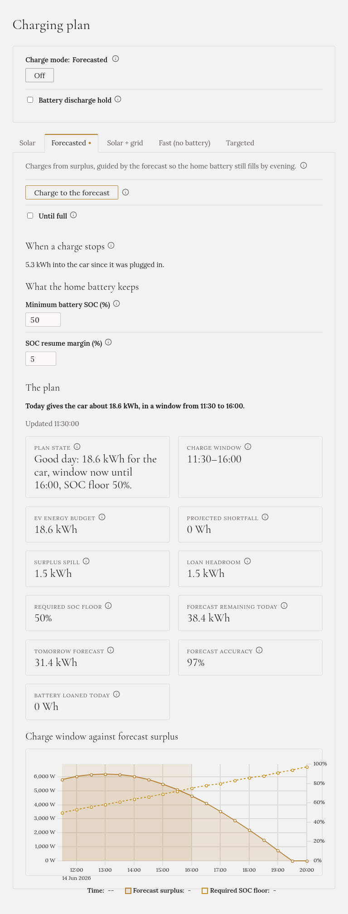

**Blokace vybíjení baterie zabrání domácí baterii, aby se vybíjela.** Slunce pokryje, co může, síť
zbytek a baterie zůstává stranou. Ze slunce se dál může **nabíjet**.

Odkud energie přichází, rozhoduje střídač, ne Gleanvolt. Pro střídač je nabíjející auto jen velký odběr
domu, a ten pokryje z domácí baterie. Blokace střídači řekne, ať to nedělá.

## Kde ji najdete

Nahoře v **Plánu nabíjení**, pod režimem nabíjení: **Blokace vybíjení baterie**. Zaškrtnutím blokaci
zapnete, odškrtnutím ji zrušíte.

:::note[Políčko nevidíte?]
Blokace je jediná funkce, která zapisuje do střídače, proto je po instalaci Gleanvoltu **vypnutá**.
Zapíná se pokročilým nastavením (`BatteryHold__Enabled`), které je popsané v repozitáři. Vyzkoušená je
na SolaX X3-HYB-G4 PRO; na jiných střídačích ji zkoušejte opatrně.
:::

## Kdy se zapne sama

- **Fast (no battery)** ji zapne, když auto začne nabíjet, a vypne, když nabíjení skončí.
- **Targeted** a **Solar + grid** ji zapínají, když auto bere víc, než dává slunce.
- **Solar** a **Forecasted** ji nikdy nezapínají, ale blokace, kterou jste zapnuli vy, platí dál.

## Samostatné použití

Blokace funguje s každým režimem i s nabíjením **Off**:

- S nabíjením **Off** a nabíječkou nastavenou přímo na ní: auto se nabíjí ze slunce a ze sítě a
  baterie zůstane nedotčená.
- Úplně bez auta: aby baterie zůstala plná, například před drahým tarifem nebo plánovaným výpadkem proudu.

## Dobré vědět

- **Restart nepřežije.** Gleanvolt se vždy spouští s vypnutou blokací.
- **U střídače SolaX** blokace do minuty sama vyprší, pokud se Gleanvolt zastaví, takže nemůže zůstat
  viset.
- **Malý odběr zůstává**: z baterie dál odchází asi 50–65 W, vlastní spotřeba střídače.
- **Kontrolujte ji podle výkonu baterie**, ne podle políčka: políčko ukazuje poslední příkaz, který
  Gleanvolt poslal, a střídač ho potvrdit neumí. Při zapnuté blokaci by měl být údaj **Baterie** na
  **Přehledu** blízko nule, nebo nabíjet.
