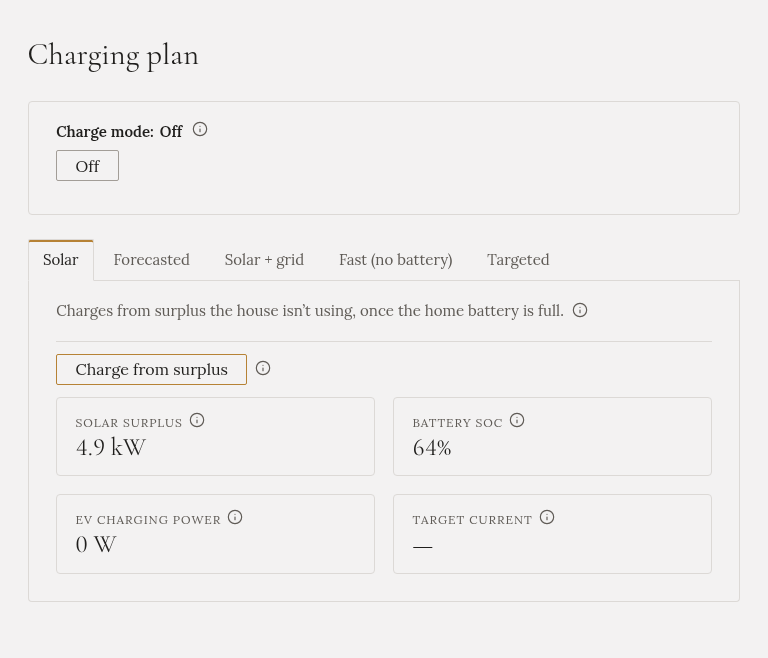

**Plán nabíjení** je místo, kde rozhodujete, jak se auto nabíjí. Nahoře má rámeček a pod ním záložku pro
každý režim nabíjení.

## Rámeček nahoře

- **Režim nabíjení** říká, který režim běží. **Off** znamená, že Gleanvolt nabíječku neřídí.
- Tlačítko **Off** běžící režim zastaví. Nabíječka se pozastaví a nabíjení se uloží.
- **Blokace vybíjení baterie**, pokud je ve vaší instalaci zapnutá: viz
  [Blokace vybíjení baterie](../battery-hold/).

Objevují se tu i zprávy, například když nabíječka odmítne příkaz.

## Záložky

Pro každý režim je jedna záložka: **Solar**, **Forecasted**, **Solar + grid**, **Fast (no battery)** a
**Targeted**. Tečka označuje režim, který běží. Každá záložka má tlačítko pro spuštění režimu, jeho
volby, a během běhu ukazuje, jak se režimu daří.

Kteroukoli záložku můžete otevřít a nastavit její volby, i když běží jiný režim. Tlačítko pro spuštění
na záložce přepne na tento režim.

Nevíte, který zvolit? Viz [Jaký režim zvolit?](../modes/choosing/).

## Co platí pro všechny režimy

- **Gleanvolt se spouští s vypnutým nabíjením.** Po restartu nebo aktualizaci neběží žádný režim, dokud
  ho nespustíte. Jedinou výjimkou je Forecasted s volbou **Do plna**, který po restartu pokračuje.
- **Každý režim skončí sám**, když je auto plné nebo odpojené.
- **Režim restart nepřežije.** Nabíjení naplánované na dnešní noc se ztratí, pokud se Gleanvolt večer
  restartuje. Po restartu ho spusťte znovu.
- **Poslední slovo má ten, kdo stojí u nabíječky.** Pokud někdo během běhu režimu změní nabíječku na ní
  samé nebo v její aplikaci, Gleanvolt ji nechá být, dokud režim znovu nespustíte.
