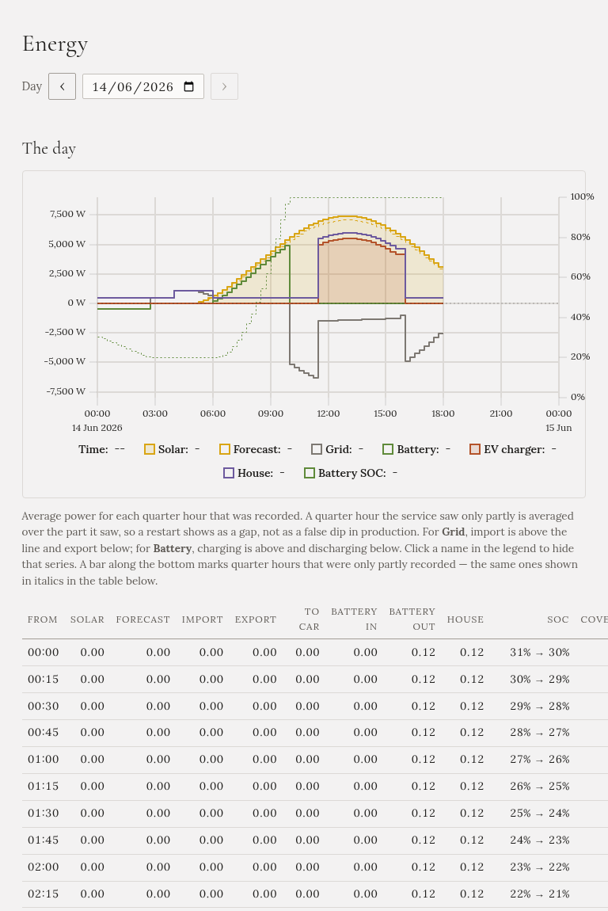

**Energie** ukazuje jeden zaznamenaný den: odkud energie přišla a kam šla, nakreslené jako graf a
vypsané jako tabulka.

## Výběr dne

Použijte pole s datem nebo tlačítka **‹** a **›** vedle něj. Dnešek ukazuje den do této chvíle.

## Graf

Graf ukazuje průměrný výkon v každé čtvrthodině ve wattech:

- **Slunce** a jeho **předpověď** přerušovanou čarou.
- **Síť**: import nad nulou, export pod ní.
- **Baterie**: nabíjení nad nulou, vybíjení pod ní. Stav baterie je tečkovaná čára na pravé ose.
- **Nabíječka**: co bralo auto.
- **Dům**: co spotřeboval dům, bez auta.

Den se kreslí v časovém pásmu vaší instalace. Kliknutím na název v legendě čáru skryjete.

**Mezera je mezera.** Pokud Gleanvolt neběžel, například během aktualizace, zůstane ten úsek prázdný,
místo aby se kreslil, jako by zapadlo slunce. Pás podél spodního okraje označuje čtvrthodiny, které byly
zaznamenané jen zčásti.

## Tabulka

Jeden řádek na čtvrthodinu, v kWh, se součty za den dole:

| Sloupec | Co to je |
|---|---|
| **Slunce**, **Předpověď** | Co vyrobily panely a co čekala předpověď |
| **Import**, **Export** | Nakoupeno ze sítě a prodáno do sítě |
| **Do auta** | Co šlo do auta |
| **Do baterie**, **Z baterie** | Nabíjení a vybíjení domácí baterie |
| **Dům** | Co spotřeboval dům, dopočítané z ostatních údajů |
| **SOC** | Stav domácí baterie na začátku a na konci čtvrthodiny |

Čtvrthodina zaznamenaná jen zčásti je *kurzívou*. Kde žádná předpověď nebyla, je v tabulce pomlčka, ne
nula.
