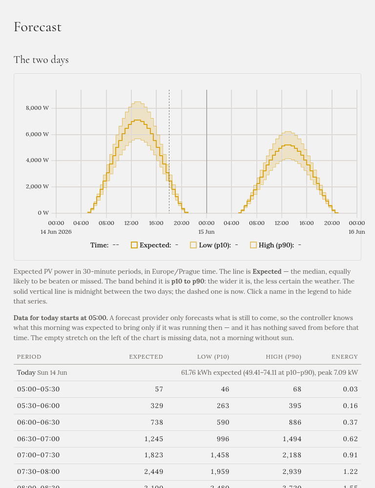

**Předpověď** ukazuje předpověď slunce, se kterou Gleanvolt pracuje, na dnešek a zítřek. Potřebuje
[účet Solcast](../../setting-up/solar-forecast/).

## Graf

- **Čára** je **očekávaný** výkon: se stejnou pravděpodobností bude skutečnost vyšší i nižší.
- **Pás** kolem ní je pravděpodobný rozsah, od zamračenějšího dne (**nízká**, p10) po jasnější
  (**vysoká**, p90). Čím je pás širší, tím je počasí nejistější.
- **Plná svislá čára** je půlnoc mezi oběma dny; **přerušovaná čára** je teď.

## Tabulka

Každý den začíná součty: očekávaná energie, nízký a vysoký odhad a špičkový výkon. Potom jeden řádek na
půlhodinu, s očekávaným, nízkým a vysokým výkonem ve wattech a očekávanou energií v kWh.

## Dobré vědět

- **Stránka nikdy nestahuje novou předpověď.** Ukazuje tu, kterou už Gleanvolt má, a napíše, kdy byla
  stažena. Bezplatný plán Solcast dovoluje asi deset stažení denně.
- **Po restartu může dnešní ráno chybět.** Předpověď pokrývá jen to, co teprve přijde, takže pokud
  Gleanvolt dnes ráno neběžel, neví, co mělo ráno přinést. Stránka to napíše a prázdný úsek v grafu jsou
  chybějící data, ne ráno bez slunce.
- **Zítřek se mění** s každou novou předpovědí, dokud nepřijde.

Stejné denní součty najdete stručně na [Přehledu](../overview/) a co dnešek znamená pro auto, ukazuje
záložka [Forecasted](../modes/forecasted/).
