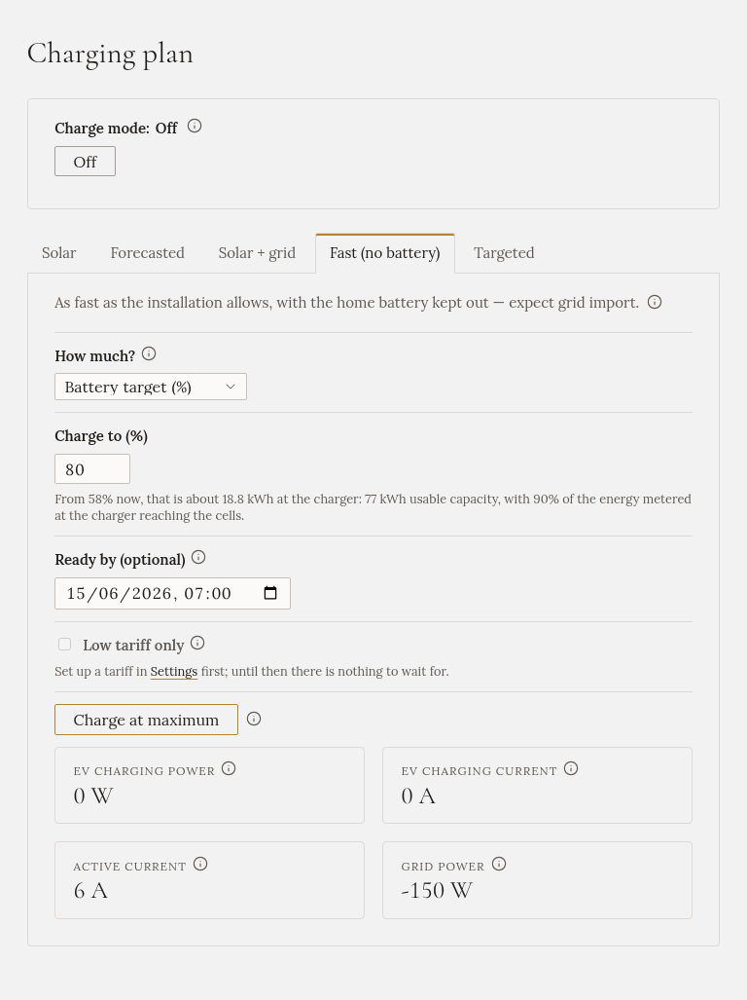

import { Steps } from '@astrojs/starlight/components';

**„Za hodinu odjíždím.“** Auto se nabíjí plným výkonem. Slunce pokryje, co může, síť zbytek a domácí
baterie zůstává stranou.

## Kdy ho zvolit

Když auto potřebujete brzy nabité. Nebo s časem odjezdu, když ho potřebujete do určité doby a chcete, aby
nabíjení skončilo těsně předtím.

## Jak ho spustit

<Steps>

1. V **Plánu nabíjení** otevřete záložku **Fast (no battery)**.

2. U **Kolik?** zvolte:
   - **Dokud auto nepřestane nabíjet**: rozhodne auto a zastaví na svém nabíjecím limitu.
   - **Energie k dobití (kWh)**: pevné množství.
   - **Cílový stav nabití (%)**: úroveň, například 80 %. Potřebuje stav baterie auta: viz
     [Auto a stav jeho baterie](../../../setting-up/car/).

3. Pokud chcete, nastavte **Hotovo do (nepovinné)**: kdy odjíždíte.

4. Klikněte na **Nabíjet naplno**.

</Steps>

## Co dělá

- Nabíječka jede od začátku do konce na **maximální** proud.
- Zapne se [blokace vybíjení baterie](../../battery-hold/), takže domácí baterie auto nenapájí. Pokud chcete,
  aby baterie přece jen pomohla, vypněte blokaci během nabíjení.
- Když je množství dodané nebo auto přestane, režim skončí a nabíjení je zase **Off**.

## S časem odjezdu

Gleanvolt pak začne **co nejpozději**, aby stihl skončit včas, s 15minutovou rezervou. Na 30 kWh při
11 kW do 7:00 začne asi ve 4:00.

**Proč čekat?** Baterie auta stárne rychleji, když stojí na vysokém stavu nabití. Nabíjení těsně před
odjezdem ji drží na 100 % minuty, ne celou noc.

- Čas odjezdu potřebuje zadané množství. U **Dokud auto nepřestane nabíjet** není od čeho počítat zpět.
- Pokud není dost času, začne hned a napíše, o kolik nestihne.
- Pokud auto zapojíte až po plánovaném začátku, začne hned.

## Jen nízký tarif

Pokud máte nastavený [tarif](../../../setting-up/grid-tariff/), zaškrtněte **Jen nízký tarif**. Auto pak
přečká vysoký tarif a začne plným výkonem, když začne nízký. Během čekání je blokace baterie vypnutá, aby
dům nejel ze sítě za vysokou cenu.

## Kdy skončí sám

- Množství je dodané, nebo auto přestane na svém limitu.
- Auto je odpojené.
- Uplyne čas odjezdu.

## Domácí baterie

**Do nabíjení se nezapojuje** (pokud je ve vaší instalaci blokace vybíjení baterie zapnutá). Ze slunce,
které auto nevezme, se dál může nabíjet.

:::caution[Odebírá hodně ze sítě]
Na třech fázích při 16 A je to asi 11 kW, po celé hodiny. Ověřte, že vaše přípojka a hlavní jistič
maximální proud nabíječky snesou.
:::

:::caution[Naplánované nabíjení restart nepřežije]
Pokud se Gleanvolt večer restartuje, nabíjení naplánované na 4:00 se ztratí a ráno auto nabité není. Po
restartu ho spusťte znovu.
:::
