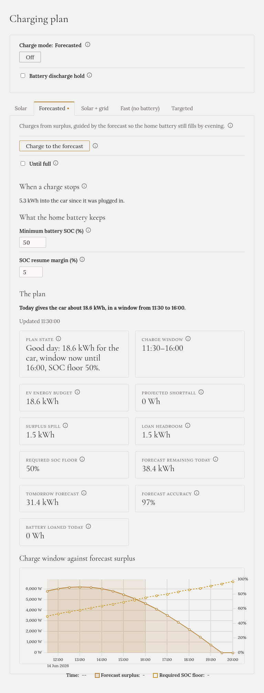

**Auto začne nabíjet dřív než v režimu Solar a domácí baterie je přesto večer plná.** Pro auto se nic
nekupuje ze sítě.

## Kdy ho zvolit

Většinu dní, kdy je auto doma a nespěcháte. Potřebuje [předpověď slunce](../../../setting-up/solar-forecast/);
bez ní funguje jako [Solar](../solar/).

## Jak ho spustit

V **Plánu nabíjení** otevřete záložku **Forecasted** a klikněte na **Nabíjet podle předpovědi**.

## Co dělá

Z předpovědi Gleanvolt spočítá, kolik slunce dnes ještě zbývá, kolik spotřebuje dům a kolik ještě
potřebuje domácí baterie, aby byla do **19:00** plná. Co zbude, dostane auto.

- **Domácí baterie dostane slabé slunce ráno a večer.** Auto ho stejně využít neumí: potřebuje
  alespoň asi 4,1 kW na třech fázích.
- **Auto dostane silné slunce uprostřed dne.**
- **Baterie může autu trochu půjčit.** Když slunci kousek chybí do toho, co auto potřebuje, baterie
  rozdíl dorovná, ale jen v den, kdy předpověď říká, že se jí to vrátí, a nikdy pod 50 %.
- **K večeru auto dostává méně**, aby baterie jistě došla na 100 %.

Plán se přepočítává každých pár sekund a porovnává se s tím, co slunce skutečně dělá. Pokud se předpověď
hodně mýlí, Gleanvolt ji na zbytek dne odloží a chová se jako Solar.

## Co uvidíte

Záložka ukazuje **plán** jednou větou (kolik kWh dnešek dá autu a v jakém okně),
údaje, ze kterých vychází, a graf: předpovězený přebytek, **okno nabíjení** (vybarvené) a úroveň, pod
kterou domácí baterie nesmí klesnout (přerušovaná čára).

Na záložce můžete také nastavit **Minimální SOC baterie (%)**: nejnižší stav, do kterého smí baterie
půjčovat.

## Do plna

Zaškrtněte **Do plna**, pokud chcete nabíjet několik dní. Večer se nabíječka na noc zastaví a ráno
pokračuje se sluncem nového dne. Běží, dokud není auto plné, odpojené, nebo dokud nekliknete na **Off**.
Je to jediný režim, který pokračuje i po restartu Gleanvoltu.

## Kdy skončí sám

- Auto je plné nebo odpojené.
- Dnes už není slunce, ze kterého by šlo auto nabíjet (pokud není zaškrtnuté **Do plna**).

## Domácí baterie

**V 19:00 je plná**, pokud den nemá tak málo slunce, že nestačí ani na baterii a dům. Auto se v tomto
režimu nikdy nenabíjí ze sítě, takže za špatného dne prostě dostane méně.

Chcete konkrétní množství do konkrétního času? Použijte [Targeted](../targeted/), s volbou **Jen slunce**,
pokud se nic nesmí kupovat.
