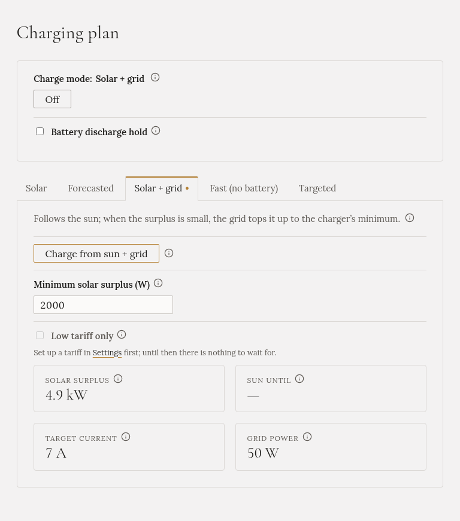

**Auto bere slunce, jak přichází. Když je slunce na auto samo moc slabé, síť ho doplní. Když dnešní
slunce skončí, režim skončí také.**

## Kdy ho zvolit

Když chcete využít dnešní slunce, i slabé nebo za oblačna, a nevadí vám kvůli tomu koupit trochu
elektřiny.

## Jak ho spustit

V **Plánu nabíjení** otevřete záložku **Solar + grid**, zkontrolujte **Minimální solární přebytek (W)** a
klikněte na **Nabíjet ze slunce + sítě**.

## Co dělá

Řídí ho jedno číslo: **minimální solární přebytek**, 2000 W, pokud ho nezměníte.

| Přebytek ze slunce | Co dělá auto | Ze sítě |
|---|---|---|
| Dost na auto samotné (asi 4,1 kW na třech fázích) | Sleduje slunce | Nic |
| Mezi vaším minimem a touto hodnotou | Nabíjí nejnižším proudem, který auto přijme | Rozdíl |
| Pod vaším minimem | Pozastaví se | Nic |

S minimem 2000 W tedy přebytek 3 kW nabíjí auto výkonem asi 4,1 kW a zhruba 1,1 kW se koupí. Čím výš
minimum nastavíte, tím méně se kupuje. Při 4200 W a víc se nekupuje nikdy nic.

Přecházející mrak nabíjení nezastaví: Gleanvolt se řídí průměrem za poslední tři minuty a běžící
nabíjení pokračuje alespoň deset minut.

## Jen nízký tarif

Pokud máte nastavený [tarif](../../../setting-up/grid-tariff/), zaškrtněte **Jen nízký tarif** a režim bude
nabíjet jen v nízkém tarifu. Za slunečného odpoledne ve vysokém tarifu pak auto nedostane nic a slunce
půjde do domácí baterie nebo do sítě.

## Co uvidíte

Záložka ukazuje přebytek, proud, na který je nabíječka nastavená, výkon ze sítě a do kdy předpověď
očekává dost slunce.

## Kdy skončí sám

- Auto je plné nebo odpojené.
- Předpověď už pro dnešek nemá slunce nad vaším minimem.

## Domácí baterie

Auto a domácí baterie se o slunce **dělí**; baterie se neplní jako první. Pokud je ve vaší instalaci
zapnutá [blokace vybíjení baterie](../../battery-hold/), Gleanvolt ji zapne, když síť dorovnává, aby rozdíl
nedorovnávala baterie. Bez ní může baterie část rozdílu pokrýt.
