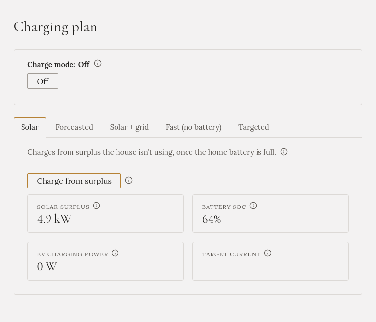

**Auto dostane jen slunce, které dům nepotřebuje, a až když je domácí baterie plná.** Pro auto se nic
nekupuje ze sítě.

## Kdy ho zvolit

Za slunečného dne, když nespěcháte a domácí baterie má přednost.

## Jak ho spustit

V **Plánu nabíjení** otevřete záložku **Solar** a klikněte na **Nabíjet z přebytku**.

## Co dělá

- Čeká, až bude domácí baterie **plná** (95 % a víc). Potom auto dostane **přebytek**: co vyrábějí
  panely, minus co spotřebuje dům.
- Nabíjecí proud sleduje přebytek nahoru i dolů.
- Auto neumí nabíjet z méně než asi **4,1 kW** na třech fázích (1,4 kW na jedné). Když je přebytek menší,
  auto se **pozastaví** a pokračuje, když se slunce vrátí.
- Přecházející mrak nabíjení nezastaví: Gleanvolt se řídí průměrem za poslední tři minuty.
- Když domácí baterie klesne pod 90 %, auto přestane a slunce dostává zase baterie.

## Co uvidíte

Záložka i **Přehled** ukazují přebytek, stav domácí baterie a co bere auto. Když režim čeká na baterii,
**Přehled** to napíše.

## Kdy skončí sám

- Auto je plné nebo odpojené.
- Předpověď už pro dnešek nemá slunce, ze kterého by šlo auto nabít.

## Domácí baterie

Plní se pokaždé první. Auto jí nikdy nekonkuruje.

:::tip
V mnoha dnech je domácí baterie plná až kolem poledne, takže auto dostane jen odpoledne. Pokud chcete,
aby auto začalo dřív, zkuste [Forecasted](../forecasted/).
:::
