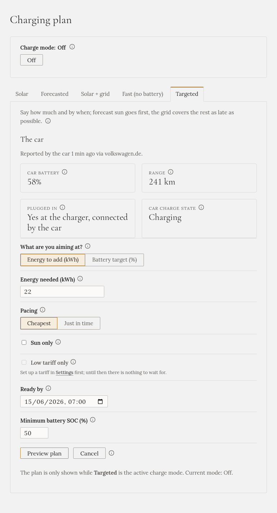
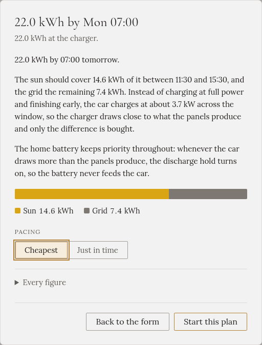

import { Steps } from '@astrojs/starlight/components';

**„22 kWh, nebo 80 %, do 7:00, s co nejmenším odběrem ze sítě.“** Gleanvolt plánuje zpětně od vašeho
odjezdu: nejdřív slunce, síť jen na to, co slunce včas nestihne. Plán uvidíte dřív, než se cokoli spustí.

## Kdy ho zvolit

Když potřebujete určité množství do určité doby a máte hodiny času: přes noc, nebo od rána do večera.
Nejlépe funguje s [předpovědí slunce](../../../setting-up/solar-forecast/).

## Jak ho spustit

<Steps>

1. V **Plánu nabíjení** otevřete záložku **Targeted**. Nahoře ukazuje, co auto naposledy nahlásilo.

2. U **Čeho chcete dosáhnout?** zvolte **Energie k dobití (kWh)** nebo **Cílový stav nabití (%)** a zadejte
   hodnotu. (Volba v procentech se objeví, když auto hlásí stav baterie.)

3. Zvolte **Tempo**: **Nejlevněji**, nebo **Na poslední chvíli** (viz níže).

4. Zaškrtněte **Jen slunce**, pokud se nic nesmí koupit ze sítě, nebo **Jen nízký tarif**, pokud se ze
   sítě smí kupovat jen v nízkém tarifu.

5. Nastavte **Hotovo do**: kdy odjíždíte. Nejvýš 36 hodin dopředu.

6. Pokud chcete, změňte **Minimální SOC baterie (%)**: stav domácí baterie, který auto musí nechat být.

7. Klikněte na **Náhled plánu**.

</Steps>

## Plán si přečtěte dřív, než se spustí

Náhled slovy popíše, jak bude cíl splněn: kolik ze slunce a kdy, kolik ze sítě a kdy, a jakým výkonem
se auto bude nabíjet.

Klikněte na **Spustit tento plán**, nebo na **Zpět k formuláři**, pokud chcete něco změnit.

Pokud cíl nejde splnit ani plným výkonem, náhled napíše, kolik dostanete a jaký čas odjezdu by stačil.

## Co dělá

- **Rozloží nabíjení v čase.** Místo nabíjení plným výkonem a dřívějšího konce ze sítě rozprostře
  nabíjení přes celou dobu, kterou jste mu dali, výkonem, který panely většinou stačí pokrýt. Slunce nad
  tento výkon jde do auta také a sníží výkon pro pozdější dobu.
- **Síť pokrývá jen to, co slunce nestihne**, a co nejpozději.
- **Když je slunce na auto samotné jen o kousek slabé**, může malý rozdíl koupit hned, místo aby celé
  množství kupoval po setmění.
- Plán se přepočítává každých pár sekund, z předpovědi a z toho, co bylo skutečně dodáno.

## Nejlevněji, nebo na poslední chvíli

- **Nejlevněji** dodá množství co nejlevněji a obvykle skončí dlouho před odjezdem.
- **Na poslední chvíli** nabije levně do 80 %, zbytek podrží a nabije ho krátce před odjezdem, aby auto
  nestálo celou noc na vysokém stavu nabití. Může to stát o něco víc a náhled napíše kolik. Potřebuje stav
  baterie auta.

## Jen slunce

S volbou **Jen slunce** se nic nekupuje. Co slunce do odjezdu nestihne, ukáže náhled jako energii, která
bude chybět.

## Jen nízký tarif

S volbou **Jen nízký tarif** auto ve vysokém tarifu čeká, **i když svítí slunce**, stejně jako
[Fast (no battery)](../fast/) se stejnou volbou. Plán počítá jen s hodinami nízkého tarifu do odjezdu. Co
se do nich nevejde, ukáže náhled jako energii, která bude chybět.

Potřebuje tarif nastavený v [Nastavení](../../../setting-up/grid-tariff/). S volbou **Jen slunce** ji nejde
kombinovat: zaškrtnutím Jen slunce se vypne.

## Kdy skončí sám

- Cíl je splněn.
- Uplyne čas odjezdu.
- Auto přestane na svém limitu, nebo je odpojené.

## Domácí baterie

**Má přednost.** Auto dostane jen slunce, které baterie nepotřebuje, a když auto bere víc, než dává
slunce, zapne se [blokace vybíjení baterie](../../battery-hold/) (pokud je ve vaší instalaci zapnutá), aby
baterie auto nenapájela.

:::caution[Cíl restart nepřežije]
Pokud se Gleanvolt přes noc restartuje, nic se nenabíjí a nic vám to neřekne. Po restartu cíl zadejte
znovu.
:::
