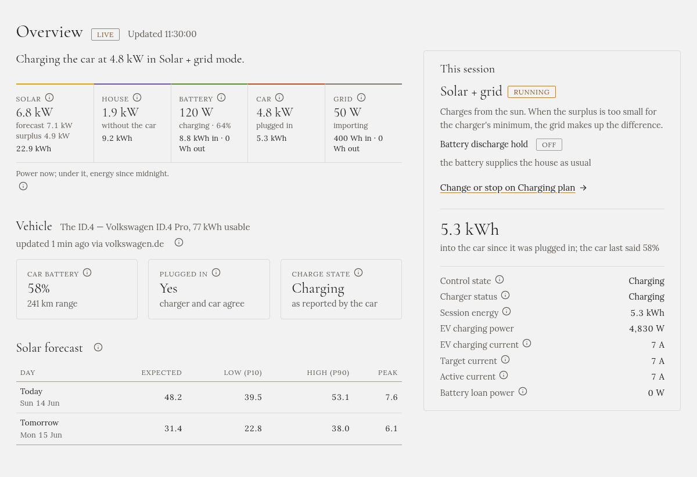

**Přehled** ukazuje, co se děje právě teď: odkud energie přichází, kam odchází a co dělá auto. Jen
ukazuje; nabíjení spustíte nebo zastavíte v [Plánu nabíjení](../charging-plan/).

Stránka se sama obnovuje každých pár sekund. **Živě** vedle nadpisu znamená, že je spojená.

## Věta nahoře

Jedna věta říká, co Gleanvolt dělá, například „Solar + grid: auto se nabíjí výkonem 4,8 kW“, nebo
proč nenabíjí: čeká na slunce, na nízký tarif, nebo je nabíjení vypnuté.

## Pět údajů

| Údaj | Co ukazuje |
|---|---|
| **Slunce** | Kolik teď vyrábějí panely, kolik pro tuto chvíli čekala předpověď, a **přebytek**: co zbývá po spotřebě domu |
| **Dům** | Kolik spotřebuje dům, bez auta |
| **Baterie** | Domácí baterie: nabíjí, nebo vybíjí, a jak je nabitá |
| **Auto** | Kolik teď bere auto a zda je připojené |
| **Síť** | **Import** (nákup ze sítě), nebo **export** (prodej do sítě) |

Pod každým údajem je energie od půlnoci. U každého údaje je **ⓘ**, které ho vysvětlí.

## Vozidlo

Vaše auto a co o sobě naposledy nahlásilo: stav baterie, dojezd, zda je připojené a zda nabíjí. K tomu je
potřeba nastavit čtení stavu baterie auta: viz [Auto a stav jeho baterie](../../setting-up/car/). Bez
toho sekce napíše, že žádný zdroj není nastavený, a nic špatně není.

Pokud se k účtu auta potřebujete znovu přihlásit, řekne vám to pruh nahoře na každé stránce.

## Předpověď solární energie

Předpověď na dnešek a zítřek v kWh: očekávaná hodnota, nízký a vysoký odhad a špičkový výkon. Potřebuje
[účet Solcast](../../setting-up/solar-forecast/).

## Toto nabíjení

Když běží režim nabíjení, pravá část stránky ho ukazuje: režim, krátký popis, blokaci vybíjení baterie a
energii, která zatím přišla do auta. Níže jsou podrobné údaje, například proud, na který je nabíječka
nastavená.

Když žádný režim neběží, je to jeden řádek s odkazem, jak nabíjení spustit.
