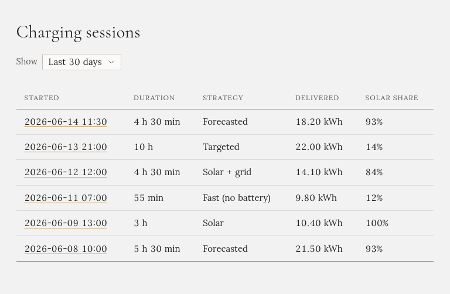
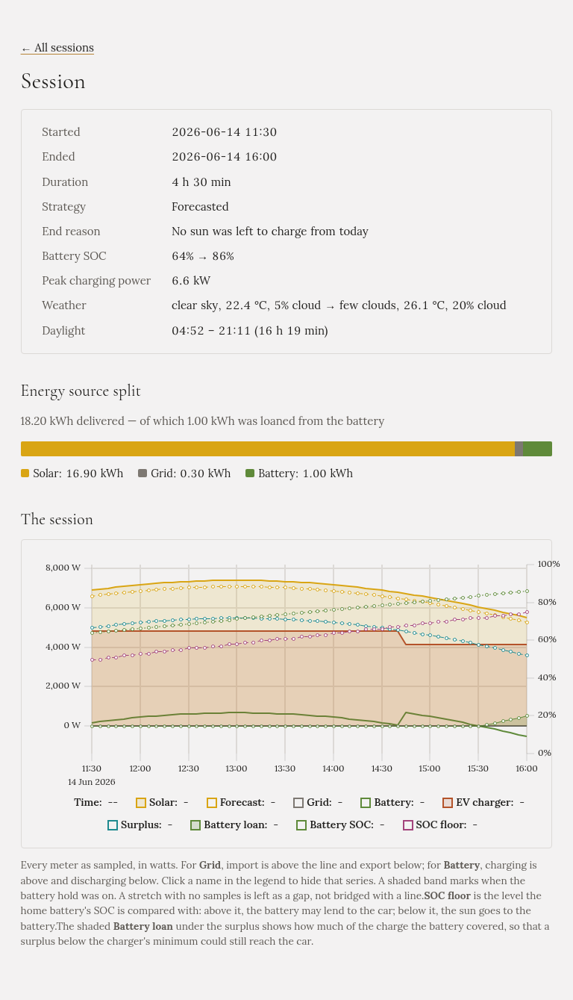

Gleanvolt zaznamená každé nabíjení, které řídí, od chvíle, kdy režim začne auto nabíjet, až do konce.
Seznam je na stránce **Nabíjení**.

## Seznam

Každý řádek je jedno nabíjení:

- **Začátek**: kdy, ve vašem časovém pásmu. Kliknutím ho otevřete.
- **Doba**: jak dlouho trvalo.
- **Režim**: režim nabíjení.
- **Dodáno**: energie, která šla do auta, měřená na nabíječce.
- **Podíl slunce**: kolik z ní pocházelo z vašich panelů.

V **Zobrazit** zvolíte, jak daleko do minulosti seznam sahá.

## Jedno nabíjení

Nahoře:

- **Kdy**, **jak dlouho**, **režim** a **Důvod ukončení**: proč skončilo. Například „Auto dokončilo
  nabíjení“, „Požadovaná energie byla dodána“, „Auto bylo odpojeno“, „Dnes už nezbylo slunce na nabíjení“
  nebo „Řízení nabíjení se přepnulo do režimu Off“.
- Stav **domácí baterie** na začátku a na konci a **Nejvyšší nabíjecí výkon**.
- **Počasí** na začátku a na konci a **Denní světlo** dne, pokud máte nastavené
  [Počasí](../../setting-up/weather/).

**Zdroje energie** ukazují, odkud energie pro auto přišla: ze slunce, ze sítě, nebo z domácí baterie.
V režimu Forecasted je zvlášť uvedená energie, kterou baterie autu **půjčila**.

## Graf

Graf ukazuje celé nabíjení ve wattech:

- **Slunce**, **předpověď**, **síť**, **domácí baterii** a **nabíječku** (auto).
- **Přebytek**: slunce, které dům nepotřeboval.
- **Stav domácí baterie** na pravé ose.
- V režimu Forecasted **mez SOC**, úroveň, nad kterou musí baterie zůstat, a **půjčku z baterie**.
- **Vybarvený pás** tam, kde byla zapnutá blokace vybíjení baterie.
- **Přerušovanou čáru** tam, kde se něco stalo, například změna režimu nebo pozastavení nabíjení. Každá je
  vypsaná pod grafem.

U **Sítě** je import nad nulou a export pod ní. U **Baterie** je nabíjení nad nulou a vybíjení pod ní.
Kliknutím na název v legendě čáru skryjete, a když na graf najedete myší, přečtete hodnoty.

Pokud se četl stav baterie auta, je v grafu i jeho procento.

## Kde se historie uchovává

Nabíjení i historie energie se ukládají na počítači, na kterém Gleanvolt běží, do jeho složky `data`.
Jsou součástí vaší [zálohy](../../installation/updating/).
