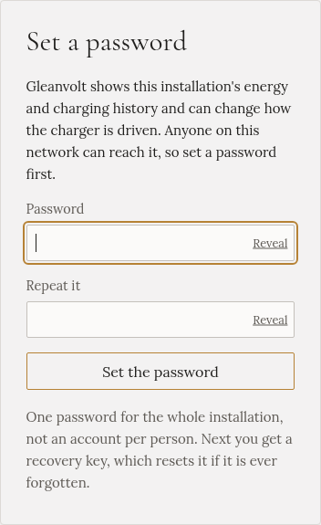

import { Steps } from '@astrojs/starlight/components';

:::caution[Gleanvolt stops when its window closes]
On Windows, Gleanvolt runs in a terminal window. It stops when you close that window, sign out, or
Windows restarts for an update, and then nothing controls the charging. For a computer that runs day and
night, a [Raspberry Pi](../linux/) is the better choice.
:::

## Install

<Steps>

1. Open **Terminal** (or **Command Prompt**): press the Windows key, type `terminal` and press **Enter**.

2. Type this command and press **Enter**:

   ```powershell
   winget install MartinPospisil.Gleanvolt
   ```

   Accept the agreements if asked.

3. Close the terminal and open a new one, so Windows finds the new command. Then start Gleanvolt:

   ```powershell
   gleanvolt
   ```

4. When Windows asks whether to allow Gleanvolt through the firewall, allow it on **private networks**.
   Without that, your phone can't reach it.

5. In a browser on the same PC, open **`http://localhost:8090`**. From your phone, use
   `http://gleanvolt.local:8090`. You'll see the password page:

   

6. Carry on with [the setup wizard](../../setting-up/setup-wizard/).

</Steps>

Leave the terminal window open. To stop Gleanvolt, press **Ctrl+C** in it, or close it.

:::note[After the wizard's Restart]
On Windows nothing restarts Gleanvolt for you. If the page doesn't come back after **Restart** in the
wizard or on Settings, type `gleanvolt` in the terminal again.
:::

## Without winget

Download `gleanvolt-<version>-win-x64.zip` from the
[releases page](https://github.com/mpospisil/gleanvolt/releases), unzip it, and run
`Gleanvolt.Worker.exe` in the `win-x64` folder.

## Where your data is

Gleanvolt keeps its settings and history in a `data` folder next to the program. With winget, that is in
`%LOCALAPPDATA%\Microsoft\WinGet\Packages\`, in the folder whose name starts with
`MartinPospisil.Gleanvolt`. Keep a copy of it before you update: see
[Updating, backup and uninstalling](../updating/).
