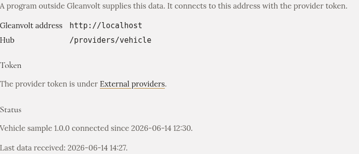
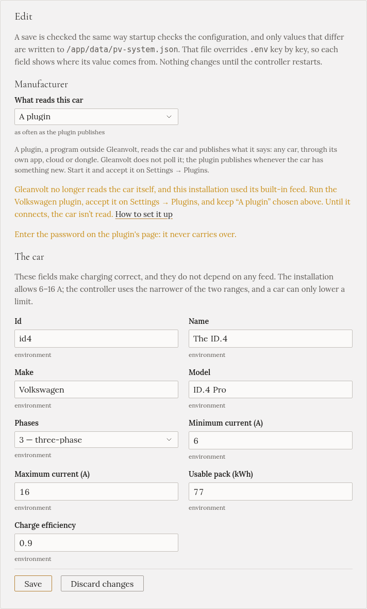

import { Steps, Tabs, TabItem } from '@astrojs/starlight/components';

On the **Car** page you tell Gleanvolt two things:

- **The car itself**: its battery size, how many phases it charges on, and the currents it accepts.
  These make charging correct, so fill them in whatever car you have.
- **Where its battery level comes from**, optionally. With it, you can ask for a charge in percent,
  such as "80 % by 7:00", and the Overview shows the car's battery. Without it, everything works, and you
  ask for a charge in kWh instead.

## The car

On the **Car** page (or the wizard's **Car** step), fill in:

| Field | What to enter |
|---|---|
| **Name**, **Make**, **Model** | Whatever you like; they are shown, never acted on |
| **Phases** | How many phases **the car** charges on. Many smaller cars charge on 1 even from a 3-phase wallbox |
| **Minimum current (A)** | The lowest current the car accepts. Usually 6. Some cars need 8 |
| **Maximum current (A)** | The car's on-board charger limit, often 16 or 32 |
| **Usable pack (kWh)** | The battery's **usable** size, which the car's percentage refers to. It is a little smaller than the size in the brochure: an ID.4 Pro has 77 usable of 82 |
| **Charge efficiency** | Leave it at 0.9 unless you know better |

Press **Save**.

:::caution[Get the phases right]
If the car charges on one phase but Gleanvolt thinks it uses three, every power figure is three times
too high. Charging still works, but plans finish late and nothing looks wrong. Check your car's manual.
:::

## The battery level

Under **What reads this car**, choose **A car plugin**, and run the plugin for your car. Gleanvolt doesn't
read a car itself.

<Tabs syncKey="car">
<TabItem label="A plugin">

A plugin is a small program beside Gleanvolt that reads the car. Gleanvolt's own car plugins are in
[gleanvolt-cars](https://github.com/mpospisil/gleanvolt-cars):

| Plugin | For | Reads |
|---|---|---|
| `volkswagen` | a Volkswagen ID., with your VW ID | live from volkswagen.de |
| `skoda` | a Škoda, with an API key from the MySkoda app | through Škoda's official API, every 5 to 15 minutes |
| `vwgroup` | Audi, SEAT, Cupra, Bentley, VW commercial, or any Group brand | from the VW Group EU Data Act portal, usually 2 to 4 hours behind |

Any other program can be one too: developers can find how to write one in
[the provider guide](https://github.com/mpospisil/gleanvolt/blob/main/docs/PROVIDERS.md#the-vehicle-kind).

<Steps>

1. On the **Car** page, choose **A car plugin** under **What reads this car**. Press **Save**,
   then **Restart**.

   

2. Start the plugin. On a Raspberry Pi installed with the deploy script, add it to `GLEANVOLT_PLUGINS` in
   `.env`, such as `GLEANVOLT_PLUGINS=openweather,solax,volkswagen`, and deploy again. Otherwise, follow its
   own notes in gleanvolt-cars. It asks to connect: accept it under **Settings → Plugins**. See
   [Plugins](../plugins/).

3. Back on the **Car** page, **Plugin** says when the plugin connected and when its last reading arrived.
   The Overview's car card names it too.

   

4. The plugin's own page appears under **Plugin**, inside Gleanvolt. Enter the car's account there: the
   password, or Škoda's API key, and sign in. The page comes from the plugin, not from Gleanvolt, and only
   someone signed in to Gleanvolt can open it. If it stays blank, press **Open in a new tab**.

   

</Steps>

- **The plugin sends readings when the car changes.** Gleanvolt doesn't ask it on a clock. **Ask the
  car** asks it once, and it has a minute to answer.
- **If the plugin disconnects**, the last reading stays and gets older, as with any feed. Gleanvolt
  doesn't switch to another feed by itself.
- **If the plugin's login to the car's account expires**, it says so: a band across every page asks you
  to deal with it, on the plugin's page, and it goes away when the plugin reports it is fine again.
- **Gleanvolt never sends the car anything** through it: no start, no stop, no charge limit.

The MyŠkoda and Data Act plugins haven't been tried on a real car yet. If you have one, see the
"Looking for testers" issues in Gleanvolt's repository.

</TabItem>
<TabItem label="Other cars">

Choose **Nothing — targets in kWh**. Charging works exactly the same; you ask for a charge in kWh
rather than in percent. If a program can read your car, see **A plugin**.

</TabItem>
</Tabs>

## After upgrading from a built-in feed

Earlier versions of Gleanvolt read Volkswagen, Škoda and the VW Group portal themselves. Those built-in feeds
are gone. If you used one, the first start after the upgrade chooses **A car plugin** for you, and the **Car**
page names the plugin to run until it connects:

<Steps>

1. Start that plugin. On a Raspberry Pi installed with the deploy script, deploying again starts it for you
   while your old setting is still in `.env`, and says so. Add it to `GLEANVOLT_PLUGINS` to keep it.

2. Accept it under **Settings → Plugins**.

3. On its page, under **Plugin** on the **Car** page, enter the password, or paste a new API key from the
   MySkoda app. Gleanvolt deleted the ones it kept, and never hands one over. The VIN and user name from
   `.env` are filled in already.

</Steps>

Until the plugin connects, the car isn't read, and you ask for a charge in kWh.

## Where the car's account is kept

The password or key you enter on a plugin's page stays with the plugin, in its own data folder, readable
only by it. Gleanvolt never sees it. Anyone with a copy of that folder could sign in to your car's account,
so keep backups of it private: see [Updating, backup and uninstalling](../../installation/updating/).
