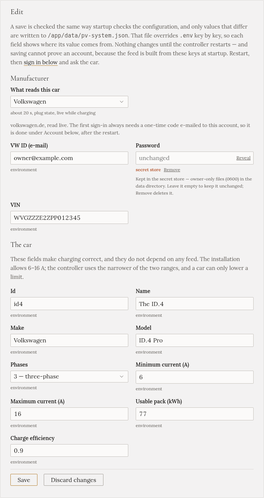
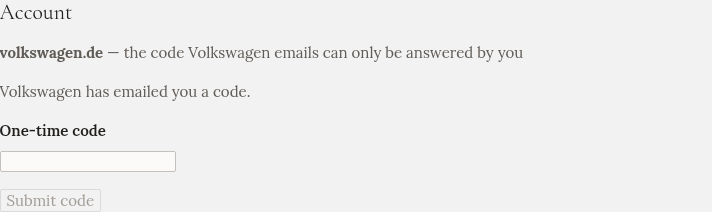

import { Steps, Tabs, TabItem } from '@astrojs/starlight/components';

On the **Car** page you tell Gleanvolt two things:

- **The car itself**: its battery size, how many phases it charges on, and the currents it accepts.
  These make charging correct, so fill them in whatever car you have.
- **Where its battery level comes from**, optionally. With it, you can ask for a charge in percent,
  such as "80 % by 7:00", and the Overview shows the car's battery. Without it, everything works, and you
  ask for a charge in kWh instead.

## The car

On the **Car** page (or the wizard's **Car** step), fill in:

| Field | What to enter |
|---|---|
| **Name**, **Make**, **Model** | Whatever you like; they are shown, never acted on |
| **Phases** | How many phases **the car** charges on. Many smaller cars charge on 1 even from a 3-phase wallbox |
| **Minimum current (A)** | The lowest current the car accepts. Usually 6. Some cars need 8 |
| **Maximum current (A)** | The car's on-board charger limit, often 16 or 32 |
| **Usable pack (kWh)** | The battery's **usable** size, which the car's percentage refers to. It is a little smaller than the size in the brochure: an ID.4 Pro has 77 usable of 82 |
| **Charge efficiency** | Leave it at 0.9 unless you know better |

Press **Save**.

:::caution[Get the phases right]
If the car charges on one phase but Gleanvolt thinks it uses three, every power figure is three times
too high. Charging still works, but plans finish late and nothing looks wrong. Check your car's manual.
:::

## The battery level

Under **What reads this car**, choose your manufacturer. The page then shows what it needs.

<Tabs syncKey="car">
<TabItem label="Volkswagen">

Volkswagen cars are read live from volkswagen.de, about every 20 seconds while charging.

<Steps>

1. Choose **Volkswagen**. Enter the e-mail and password you use for the Volkswagen app (your **VW
   ID**), and the car's **VIN**.

   

2. Press **Save**, then **Restart** (the page offers it).

3. Back on the **Car** page, under **Account**, press **Sign in**.

4. Volkswagen e-mails you a code. Type it in **One-time code** and press **Submit code**.

   

5. Press **Ask the car** to check that it answers.

</Steps>

Gleanvolt stays signed in after a restart. If Volkswagen ever signs it out, a band across the top of
every page tells you, and you sign in again the same way. It doesn't retry by itself, because repeated
sign-ins can get an account locked.

</TabItem>
<TabItem label="Škoda">

Škoda cars are read through Škoda's official API, every 5 to 15 minutes.

<Steps>

1. Choose **Škoda**, enter the car's **VIN**, and press **Save**, then **Restart**.

2. In the **MySkoda** app, create an **API key** for this car.

3. Back on the **Car** page, paste the key under **Account**. Gleanvolt checks it, says until when it is
   valid, and starts reading the car.

</Steps>

A week before the key expires, Gleanvolt reminds you. Renewing it is pasting a new one.

:::note
The Škoda connection is built from Škoda's published documentation and hasn't been tried on a car yet.
:::

</TabItem>
<TabItem label="Audi, SEAT, Cupra, Bentley">

These are read from the **VW Group EU Data Act portal**. Its readings are usually 2 to 4 hours behind
the car, so they suit planning more than watching a charge.

First, in a web browser:

<Steps>

1. Open the [EU Data Act portal](https://eu-data-act.drivesomethinggreater.com/de/en) and sign in with
   your brand's account (myAudi, SEAT or Cupra ID, and so on). Accept the consent screen.

2. If your car isn't in the portal's list, add it there by its VIN.

3. Go to **Data clusters → Vehicle overview → Get customised data**. Choose **All data** and every
   **15 minutes**. The first data can take from a few hours to a couple of days to arrive.

</Steps>

Then in Gleanvolt:

<Steps>

1. On the **Car** page, choose **Audi · SEAT · Cupra · Bentley · VW commercial**. Choose your brand, and
   enter the account's e-mail and password. Enter the VIN only if the account has more than one car.

2. Press **Save**, then **Restart**.

3. Press **Ask the car**. When the car's battery level appears, it works.

</Steps>

If the portal shows a new consent screen or asks for a code, Gleanvolt stops reading and tells you.
Sign in to the portal in a browser, deal with it there, and restart Gleanvolt.

</TabItem>
<TabItem label="Other cars">

Choose **Another manufacturer — charge only**. Charging works exactly the same; you ask for a charge in
kWh rather than in percent.

If Home Assistant can see your car's battery level, it can pass it on to Gleanvolt. That is described in
the repository, with the other advanced integrations.

</TabItem>
</Tabs>

## Your password is kept safe, but not encrypted

The password and keys you enter go into Gleanvolt's private data folder, readable only by Gleanvolt.
They are never shown again. Anyone with a copy of that folder could sign in to your car's account, so
keep backups of it private: see [Updating, backup and uninstalling](../../installation/updating/).
