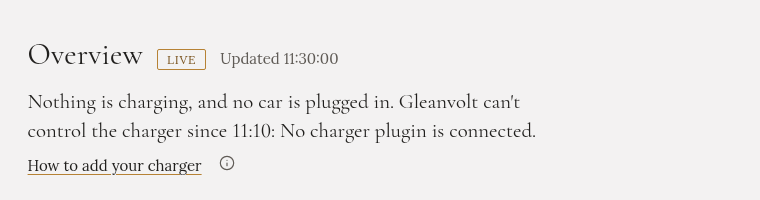

import { Steps, Tabs, TabItem } from '@astrojs/starlight/components';

Gleanvolt doesn't talk to your EV charger itself. A **plugin** does: a small program for your charger's
brand that runs beside Gleanvolt. The plugin talks to the charger, and Gleanvolt tells the plugin what to
do. The plugin has its own page, where you enter the charger's address.

You don't set the charger up in the setup wizard. Start the plugin whenever you like, during setup or months
later. Until it connects, Gleanvolt shows your solar power and your home battery, but no charging mode can
be started, and the Overview links to this page:



## Which plugin

| Your charger | Plugin | Its page |
|---|---|---|
| SolaX X1/X3-HAC, X1/X3-EVC | `solax` | port 8098 |
| Huawei SCharger-7KS-S0, SCharger-22KT-S0 | `huawei` | port 8099 |
| go-e Charger (Gemini, HOMEfix, HOME+; hardware V3 or later) | `goe` | port 8100 |
| Shelly TopAC Portable EV Charger | `shelly` | port 8097 |

Another charger has no plugin yet. Each plugin's notes, such as what to switch on in the charger first, are
in [gleanvolt-chargers](https://github.com/mpospisil/gleanvolt-chargers). See also
[Preparing your devices](../../installation/preparing-devices/). Run only one charger plugin.

## Start the plugin

Start it the way you installed Gleanvolt. Below, `solax` stands for your plugin's name from the table: put
yours in its place, and `Solax` in a file name becomes `Huawei`, `GoE` or `Shelly`.

<Tabs syncKey="install">
<TabItem label="Docker">

Make the plugin's folder, then start it next to Gleanvolt:

```bash
sudo mkdir -p /opt/gleanvolt/plugins/solax
sudo chown 1654:1654 /opt/gleanvolt/plugins/solax
sudo chmod 700 /opt/gleanvolt/plugins/solax

docker run -d --name gleanvolt-plugin-solax --restart unless-stopped --init \
  --network host \
  -v /opt/gleanvolt/plugins/solax:/data \
  ghcr.io/mpospisil/gleanvolt-plugin-solax:latest
```

The folder keeps the charger's address and the plugin's token. If Gleanvolt isn't on port 8090, add
`-e Gleanvolt__Endpoint=http://localhost:<its port>`.

</TabItem>
<TabItem label="NAS">

The file you pasted from [NAS](../../installation/nas/) already has every charger plugin, switched off. In
your NAS's container app, edit the project's file:

1. Find the service `gleanvolt-plugin-solax` and delete its line `profiles: ["solax"]`.
2. Save, and start the project again.

</TabItem>
<TabItem label="Windows">

<Steps>

1. From the [gleanvolt-chargers releases](https://github.com/mpospisil/gleanvolt-chargers/releases),
   download `gleanvolt-plugin-solax-<version>-win-x64.zip`, and unzip it.

2. In a new terminal, go to the unzipped folder and start it:

   ```powershell
   .\Gleanvolt.Plugin.Solax.exe
   ```

</Steps>

Like Gleanvolt, it stops when its window closes, so start it again after Windows restarts. It keeps its
settings in a `data` folder beside it. Its page opens only in a browser on this PC. To open it from your
phone too, add `--Urls=http://0.0.0.0:8098` (your plugin's port) and allow it through the firewall on
private networks.

</TabItem>
<TabItem label="Linux">

With the `.deb`, Docker is the simplest way: see the **Docker** tab. Or download
`gleanvolt-plugin-solax-<version>-linux-arm64.zip` (`linux-x64` on a PC) from the
[gleanvolt-chargers releases](https://github.com/mpospisil/gleanvolt-chargers/releases), unzip it, and in
its folder:

```bash
./Gleanvolt.Plugin.Solax --Urls=http://0.0.0.0:8098
```

Use your plugin's port from the table.

</TabItem>
</Tabs>

The plugin needs no token and no address of Gleanvolt's: it finds Gleanvolt on this computer or your home
network, and asks to be let in. It doesn't matter which of the two starts first.

:::note[Raspberry Pi with the deploy scripts]
Add the plugin to `GLEANVOLT_PLUGINS` in `/opt/gleanvolt/.env` (`GLEANVOLT_PLUGINS=solax`) and deploy.
`EV_CHARGER_HOST` there is the charger's address until you save one on the plugin's page.
:::

## Accept it and set it up

<Steps>

1. **Accept the plugin.** While it waits, a band at the top of every page says so. Under **Settings →
   Plugins**, or on the wizard's **Finish** step, **Plugins asking to connect** lists it: press **Accept**.
   A plugin on another computer shows a code to check first: see
   [Accepting a plugin](../plugins/#accepting-a-plugin).

2. **Enter the charger's address.** The **Charger** section on **Settings** now shows the plugin
   connected, with its page below. Enter the charger's address there, or let the page search for it, and
   save. **Open in a new tab** opens the page on its own.

3. **Check it.** The Overview shows the charger's state. Start a charging mode on the **Charging plan**
   page.

</Steps>

If Gleanvolt turns the plugin away, the **Charger** section says why: see
[If the charger plugin is turned away](../charger-refused/).

## When Gleanvolt loses the charger

If the plugin stops, or reports that it can't reach the charger, for more than 2 minutes, a running
charging mode is **suspended**: Gleanvolt sends nothing and releases the battery hold. The charger then
follows its own settings. When the plugin is back, the mode carries on by itself. The Overview and the
**Charging plan** say what is wrong, and their (i) says where to look. See
[Charging plan](../../using/charging-plan/).

## Moving from the built-in driver

Up to 1.3, Gleanvolt drove SolaX, Huawei and go-e chargers itself. 1.4 removed those built-in drivers:
every charger now has a plugin, and Gleanvolt never connects to the charger itself.

Start the plugin for your charger as above, and accept it. Gleanvolt writes a warning to its log at every
start until the old charger settings are gone; the warning names the plugin. On a Raspberry Pi with the
deploy scripts, the deploy starts the plugin for you, from `EV_CHARGER_HOST` in `/opt/gleanvolt/.env`, and
says which one; add it to `GLEANVOLT_PLUGINS` to silence that.
