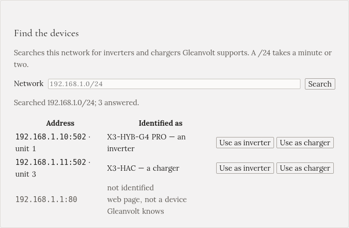

Gleanvolt needs to know where on your home network your inverter and your charger are. The setup
wizard's **Search** finds them for you. This page explains what it shows, and what to do when it doesn't
find them.

## The search

In the wizard's **Devices** step, press **Search**. Gleanvolt checks every address on your home network
for an inverter or a charger it knows. A home network takes a minute or two.

Each row is one device that answered:

- **Address**: where it is on your network, such as `192.168.1.10:502 · unit 1`. The number after the
  colon is the port, and the unit is a device number on that port. You don't need to remember either:
  choosing the device fills them in.
- **Identified as**: the model the device reported, and whether it says it is an inverter or a charger.
- **not identified**: something answered, but it isn't a device Gleanvolt knows, such as your router.
  Ignore it.

Press **Use as inverter** on your inverter's row, and **Use as charger** on your charger's. Then press
**Save** below the list.

:::tip[You can search again later]
After setup, the wizard is still at `http://gleanvolt.local:8090/wizard`. Open it to search again, for
example after you replace a device.
:::

## When it finds nothing

| What you see | What it means | What to do |
|---|---|---|
| Nothing, or only "not identified" rows | Modbus TCP (or go-e's local API) is off | Turn it on: see [Preparing your inverter and charger](../../installation/preparing-devices/) |
| *Port open, no Modbus reply* | Something else is connected to the device | Stop Home Assistant's integration, evcc or other software that talks to it, then search again |
| It says it searched a 172.x network | Gleanvolt runs in a container that can't see your home network | Type your home network's range in **Network**, such as `192.168.1.0/24`, or run the container on the host network |
| The device is on another network, such as a separate IoT Wi-Fi | The search only looks where you tell it | Type that network's range in **Network** |

The range in **Network** is your home network's addresses, written like `192.168.1.0/24`. If your
devices' addresses start with `192.168.1.`, that is the range to type.

## Typing the addresses yourself

If you know the addresses, from your router's list of devices or from your installer, you don't need the
search. Fill in the form below it:

| Field | Inverter | Charger |
|---|---|---|
| **Brand** | SolaX or Huawei | SolaX, Huawei SCharger or go-e |
| **Host** | the inverter's address, such as `192.168.1.10` | the charger's address |
| **Port** | 502 | 502 (go-e: 80) |
| **Unit id** | usually 1 | as the charger's settings show it |

The brand fills in its usual port and unit id. A Huawei inverter behind an EMMA also needs
**Connected through: EMMA**, and the EMMA's address as the host.

## When you save

Gleanvolt reads one value from each device, to check that the address answers and that the device is
what you said:

- If the inverter's address answers like a charger, or the other way round, it warns you. Both use the
  same port, so swapped addresses would connect fine and then show a frozen battery and no sun.
- If a device doesn't answer, for example a charger that is switched off, it asks before it saves. Press
  **Save anyway** only if you are sure the address is right.

## Give your devices fixed addresses

Your router hands out addresses, and it can give a device a new one after a power cut. Gleanvolt would
then lose it. In your router's settings, look for **DHCP reservation** or **static lease**, and reserve
the current address for the inverter and for the charger.
