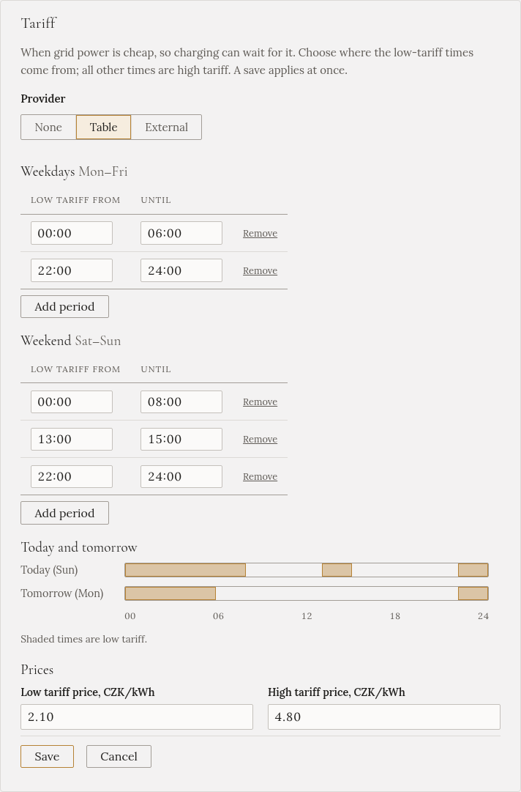
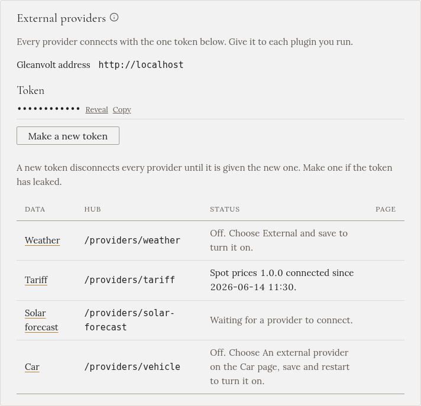
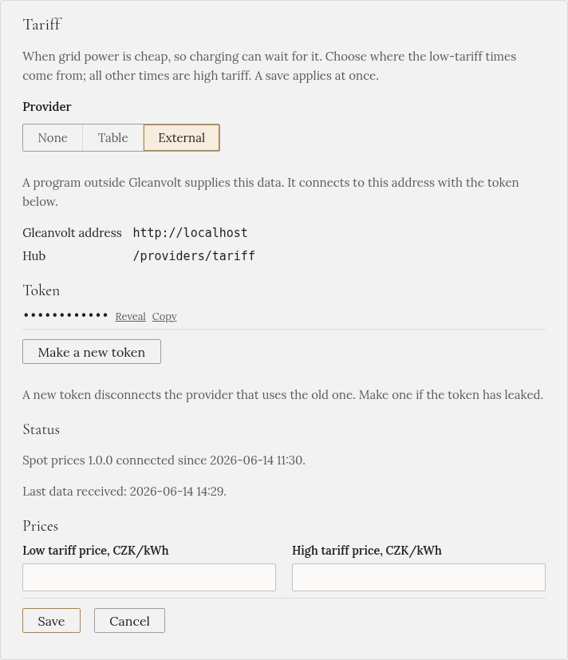

import { Steps } from '@astrojs/starlight/components';

Many homes pay two prices for electricity: a **low tariff** at certain hours, often at night, and a
**high tariff** the rest of the time. In the Czech Republic this is the distributor's **HDO**.

If you enter your low-tariff hours, two charging modes can wait for them before they use the grid:
**Fast (no battery)** and **Solar + grid**, when you tick their **Low tariff only** option. Entering the
hours on their own changes nothing about charging; the Overview just shows which tariff applies now.

## Find your low-tariff hours

Your distributor publishes them for your **HDO code**. The code is on the HDO receiver next to your
electricity meter, and in your contract. ČEZ Distribuce, EG.D and PREdistribuce each have a page called
*HDO* or *časy spínání* where you type it in.

## Enter them

<Steps>

1. Open **Settings**, and find **Tariff**. (Or the setup wizard's **Extras** step.)

2. Under **Provider**, choose **Table**.

3. Under **Weekdays**, enter the low-tariff periods for Monday to Friday. Press **Add period** for each
   one. Then do the same under **Weekend**. Public holidays follow the weekday list.

4. Optionally, enter the **prices** per kWh. Without them, the tariff is shown without a price.

5. Check the **Today and tomorrow** bars: the shaded parts are low tariff. Then press **Save**.

</Steps>

It applies straight away; there is no need to restart.

## Rules for the periods

- **Enter only the low-tariff times.** Every other time is high tariff.
- **A period ends on the same day it starts.** A night tariff from 22:00 to 06:00 is two rows:
  **22:00–24:00** and **00:00–06:00**. Gleanvolt joins them across midnight, so at 23:00 it says
  "Low tariff, until 06:00".
- **Periods in one list must not overlap.** Touching is fine, such as 06:00–08:00 and 08:00–10:00.
- **Summer and winter time are handled** for you.
- If your distributor changes your hours with the season, change the table when they do.

## Or let another program supply it

If your tariff changes in ways a table cannot hold, such as day-ahead spot prices, a program outside
Gleanvolt can supply it instead. This is the **External** provider. Somebody has to write or install
that program; Gleanvolt does not come with one. Developers can find how to write one in
[the provider guide](https://github.com/mpospisil/gleanvolt/blob/main/docs/PROVIDERS.md).

<Steps>

1. Open **Settings**, find **Tariff**, choose **External** under **Provider**, and press **Save**.

2. Further down the page, under **External providers**, press **Make a token**, then **Copy**. If
   a token is already there because another program uses it, copy that one: every program uses the
   same token. **Reveal** shows it, now or any time later.

   

3. Give the program the **Gleanvolt address** and the token.

4. When the program connects, **Status** names it, and **Last data received** says when its tariff
   arrived. The Overview's tariff line names it too.

</Steps>

- **If the program disconnects, or Gleanvolt restarts**, Gleanvolt keeps using the tariff the program
  last sent, until its last time slot ends. After that there is no tariff restriction until the
  program is back.
- **Starting order doesn't matter.** The program keeps trying until Gleanvolt answers, so it can be
  started before Gleanvolt, and it reconnects by itself after Gleanvolt restarts or is updated.
- **If the token leaks**, press **Make a new token** under **External providers**. Every program is
  disconnected until you give it the new token.
- **Choosing Table or None** disconnects the program, and it can't connect again until you choose
  **External**.
