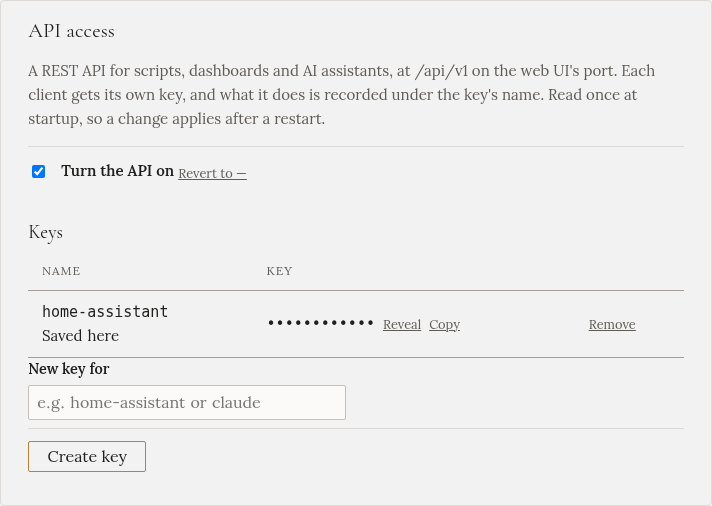

import { Steps } from '@astrojs/starlight/components';

With the **Gleanvolt integration**, Home Assistant shows what Gleanvolt measures and plans, and you can
pick a charge mode, set what that mode needs, and start and stop charging. You don't need an MQTT
broker. It needs Gleanvolt 1.2.0 or later.

:::caution[Use one way to connect, not both]
Gleanvolt can also connect to Home Assistant over MQTT (**Settings → Home Assistant (MQTT)**). That way
suits a home that already runs a broker. If both are on, Gleanvolt shows up in Home Assistant twice. So
if you set up the integration, leave **Home Assistant (MQTT)** off.
:::

## Make a key for Home Assistant

<Steps>

1. In Gleanvolt, open **Settings** and find **API access**. (Or the setup wizard's **Extras** step.)

2. Tick **Turn the API on**.

3. Type `home-assistant` in **New key for**, and press **Create key**. The name is what Gleanvolt's log
   and each charge's history show as the source of anything Home Assistant starts.

4. Press **Restart** on **Settings → Health**.

</Steps>

**Copy** next to the key puts it on the clipboard for the next steps. Treat it like a password: with it,
Home Assistant can start and stop the charger.

## Install the integration

<Steps>

1. In Home Assistant, open **HACS**, then **⋮ → Custom repositories**. Add
   `https://github.com/mpospisil/gleanvolt-ha` with the type **Integration**.

2. Find **Gleanvolt** in HACS, press **Download**, and restart Home Assistant.

3. Open **Settings → Devices & services**. Home Assistant finds Gleanvolt on your network and offers
   **Gleanvolt discovered**. Press **Add** and paste the key.

   If it isn't offered, press **Add integration**, choose **Gleanvolt**, and enter the address of the
   computer Gleanvolt runs on (for example `gleanvolt.local`), the port `8090` and the key.

</Steps>

If something is wrong, the form says what: the key was refused, nothing answered at that address, the
API is switched off, or Gleanvolt is older than 1.2.0 and needs [updating](../../installation/updating/)
first.

## Using it

Gleanvolt appears as one device, named after your installation, and as **Gleanvolt** in Home
Assistant's sidebar. The sidebar page works like the [Charging plan](../../using/charging-plan/)'s tabs:

<Steps>

1. Pick a mode in **Mode to start**. Only that mode's controls and figures show below it.

2. Set what the mode needs. For [Fast](../../using/modes/fast/), how much and when. For
   [Targeted](../../using/modes/targeted/), how much, the departure and the pacing.

3. Press **Start**.

</Steps>

If Gleanvolt can't start it, for example *Targeted* without a departure time, Home Assistant shows
Gleanvolt's reason and nothing starts.

- **Charge mode** shows the mode Gleanvolt is in. Choosing a mode there starts it straight away, and
  **Off** stops charging.
- **Stop charging** stops the charger and sets the mode to **Off**.
- What you set for the next start is kept in Home Assistant, and sent only when a mode starts.
- **Battery discharge hold**, the two **low tariff only** switches and **Forecasted until full** change
  Gleanvolt straight away, like the same controls on the [Charging plan](../../using/charging-plan/).
- The sensors show the same figures as the [Overview](../../using/overview/): solar, grid, battery, the
  car and the running plan. A plan's figures are empty while its mode isn't running.

The same page is also a card: on any dashboard, **Edit → Add card → Gleanvolt**. It needs no
settings.

Home Assistant reads the live figures every 10 seconds. You can change that under **Configure** on the
integration. If Gleanvolt stops, the device shows as unavailable until it is back.

The setup wizard, Settings, the tariff and the solar forecast stay in Gleanvolt's own pages.
