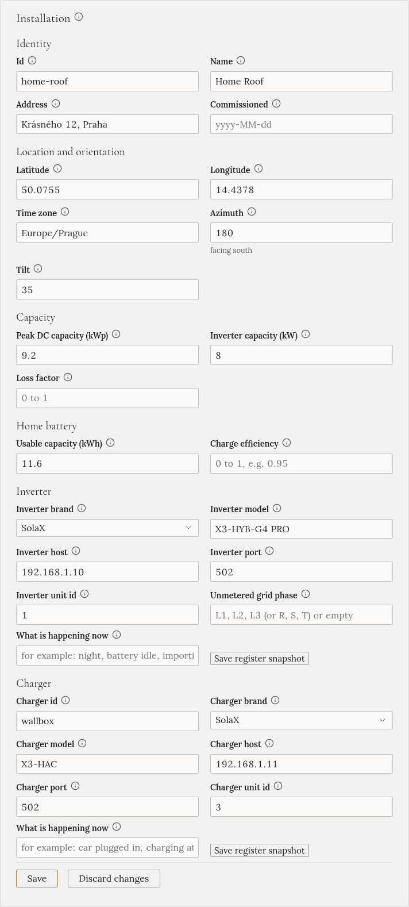
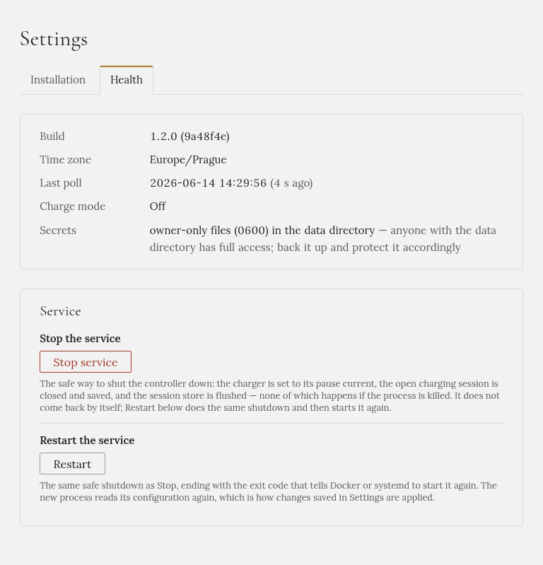

Everything the setup wizard asked for is also on **Settings**, with the same fields and the same checks.
Settings has two tabs, **Installation** and **Health**. The car is on its own **Car** page.

## Saving, and when to restart

Each section has its own **Save** button. Gleanvolt checks the values before it saves them: if something
would stop Gleanvolt from starting, nothing is saved, and the section says what is wrong.

Some sections apply at once. Others are read only when Gleanvolt starts:

| Applies at once | Needs a restart |
|---|---|
| Solar forecast, Weather, Tariff, Change password | Installation (the devices and the site), Car, Home Assistant, API access |

When a change needs a restart, the section says **Saved, not applied** and lists what changed, with a
**Restart** button next to it. Restarting takes about half a minute. It pauses a charge in progress, and
Gleanvolt comes back with charging **off**, so restart when the car isn't charging.

Next to each field, a small note says where its value comes from. A field you changed here has a
**Revert** button that puts the original back.

## Installation

From top to bottom:

- **Installation**: your home and your devices. The name, the location and the time zone, the solar
  panels, the home battery, and the inverter's and the charger's brand and address. To search for the
  devices again, open the wizard at `/wizard`: see [Finding your devices](../finding-devices/).

  

- **Solar forecast**: the Solcast account. See [Solar forecast](../solar-forecast/).
- **Weather**: the OpenWeatherMap key. See [Weather](../weather/).
- **Tariff**: your low-tariff hours. See [Grid tariff](../grid-tariff/).
- **Change password**: the password for the Gleanvolt page. You get a new recovery key, and every
  browser is signed out.
- **Home Assistant (MQTT)** and **API access**: for connecting other software. Leave them off if you
  don't use them; they are described in the repository.

Sections for settings you haven't set up yet are listed at the top, under **Not set up yet**, each with a
link to set it up.

## Health

The **Health** tab shows whether Gleanvolt is running properly, and lets you restart or stop it.

- **Last poll**: when Gleanvolt last read the inverter and the charger. It should be a few seconds ago.
- **Restart**: stops Gleanvolt safely and starts it again. This is how changes that need a restart are
  applied.
- **Stop service**: stops Gleanvolt safely. The charger is paused and the current charge is saved first.
  **It does not come back by itself**: you have to start it on the computer it runs on, or restart that
  computer.

Both buttons ask you to confirm. Anyone who can open the Gleanvolt page and knows the password can press
them.

## Car

The **Car** page holds the car's details and where its battery level comes from. See
[Your car and its battery level](../car/).
