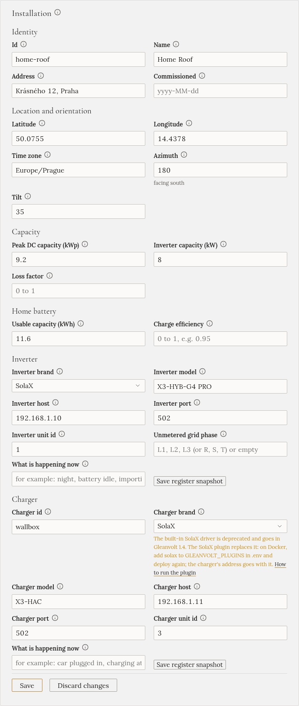

Everything the setup wizard asked for is also on **Settings**, with the same fields and the same checks.
It has five tabs, in the order you set things up: **Installation**, **External providers**, **Forecast &
prices**, **Integrations** and **System**. The car is on its own **Car** page.

## Saving, and when to restart

Each section has its own **Save** button. Gleanvolt checks the values before it saves them: if something
would stop Gleanvolt from starting, nothing is saved, and the section says what is wrong.

Some tabs apply a change at once. Others are read only when Gleanvolt starts:

| Applies at once | Needs a restart |
|---|---|
| External providers, Forecast & prices, the password on System | Installation, Integrations, Car |

When a change needs a restart, the top of the tab says how many changes are saved but not yet running,
with a link to **Restart** on the **System** tab. Restarting takes about half a minute. It pauses a charge
in progress, and Gleanvolt comes back with charging **off**, so restart when the car isn't charging.

Next to each field, a small note says where its value comes from. A field you changed here has a
**Revert** button that puts the original back.

## Installation

Your home and your devices.

- **Not set up yet**: the optional settings you haven't set up, each with what it adds and a link to it.
  The solar forecast is marked **recommended**: Forecasted and Targeted plan with it.
- **Installation**: the name and address, the location and time zone, the solar panels, the home
  battery, and the inverter's brand and address. To search for the inverter again, open the wizard at
  `/wizard`: see [Finding your devices](../finding-devices/).

  Fields you rarely need are folded under **Advanced**: the id, the commissioning date, the loss factor,
  the battery's charge efficiency, the [unmetered grid phase](../../how-it-works/unmetered-phase/), and
  the inverter's register snapshot. **Advanced** opens by itself when one of them is waiting for a
  restart, or when a save was refused.

  

- **Charger**: the charger plugin, whether it is connected, and its page, where the charger's address
  and settings are. See [Your charger](../charger/).

## External providers

For when this Gleanvolt takes data from other programs (plugins). It holds the one token every plugin
connects with, Gleanvolt's address, and a row for each kind of data: its hub, whether a plugin is
connected, and an **Open** link to the plugin's page. The kind's name leads to its section. The
**Charger** row shows the plugin Gleanvolt remembers, with **Forget**, and why a plugin was last turned
away. See the External steps in [Grid tariff](../grid-tariff/) and [Solar forecast](../solar-forecast/),
[Your charger](../charger/), and *Through another program* in [Your car](../car/).

Each section that takes its data from a plugin shows the plugin and whether it is connected first, then
the plugin's own page. The **Open in a new tab** link under the page opens it on its own, for a page
that stays blank inside Gleanvolt. The (i) buttons explain the rest.

## Forecast & prices

What Gleanvolt reads from outside your home to plan with. Each applies as soon as you save it.

- **Solar forecast**: the Solcast account, or a plugin. See [Solar forecast](../solar-forecast/).
- **Weather**: where the weather comes from (none, or a plugin), and its page. See [Weather](../weather/).
- **Tariff**: your low-tariff hours, or a plugin. See [Grid tariff](../grid-tariff/).

## Integrations

For connecting other software. Leave them off if you don't use them.

- **Home Assistant (MQTT)**: publishes Gleanvolt's state and controls to Home Assistant through an MQTT
  broker. **Topics in use** (folded) lists every topic. See [Home Assistant](../home-assistant/).

  

- **Vehicle telemetry**: what the car's MQTT feed is subscribed to. It is turned on, with its topic, on
  the **Car** page.
- **API access**: a REST API for scripts, dashboards and AI assistants. It shows the API's address and
  its keys, one per program; **Calling it** (folded) gives a command to try it.

## System

Whether Gleanvolt is running properly, the restart, and your password.

- **Last poll**: when Gleanvolt last read the inverter and the charger. It should be a few seconds ago.
- **Restart**: stops Gleanvolt safely and starts it again. This is how changes that need a restart are
  applied.
- **Stop service**: stops Gleanvolt safely. The charger is paused and the current charge is saved first.
  **It does not come back by itself**: you have to start it on the computer it runs on, or restart that
  computer.
- **Password**: the password for the Gleanvolt page. You get a new recovery key, and every browser is
  signed out.

Both service buttons ask you to confirm. Anyone who can open the Gleanvolt page and knows the password
can press them.

## Car

The **Car** page holds the car's details and where its battery level comes from. See
[Your car and its battery level](../car/).
