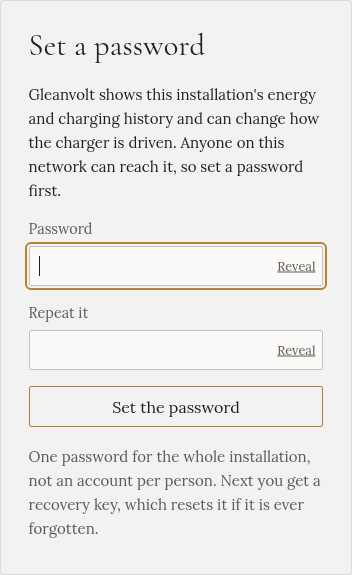
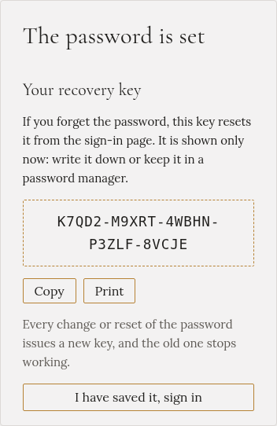
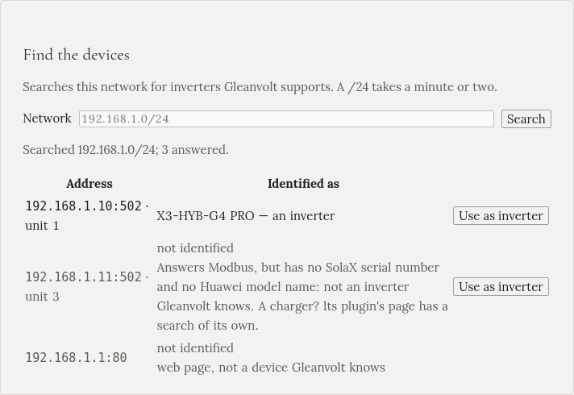
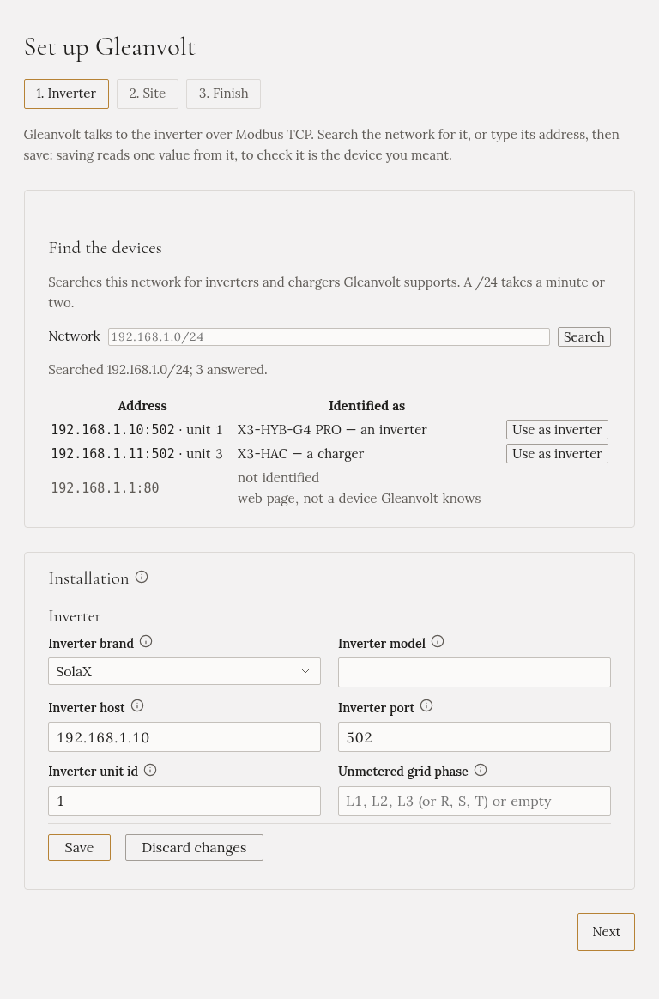
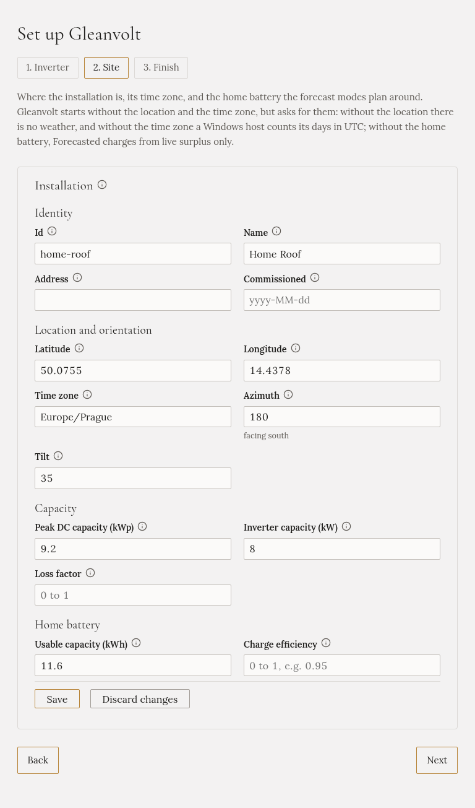
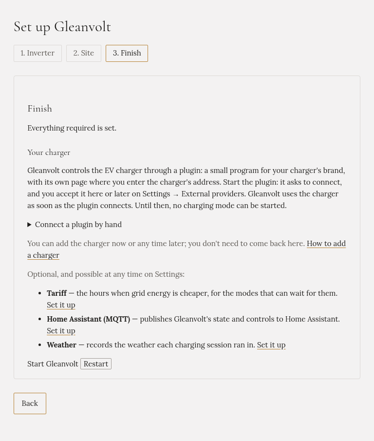

import { Steps } from '@astrojs/starlight/components';

The first time you open Gleanvolt, it walks you through its setup. You choose a password, then a
**wizard** asks for what Gleanvolt needs to know, one page at a time. It takes about five minutes.

Only the password and your inverter's address are required. Your charger isn't part of this setup: it
is a plugin with its own page, which you can add at the end or any time later. The forecast, the car
and the extras are on **Settings**.

## Before you start

- Gleanvolt is installed and running.
- Your inverter is switched on and connected to your home network.
- **Modbus TCP is turned on** in the inverter. This is how Gleanvolt talks to it. See
  [Preparing your inverter and charger](../../installation/preparing-devices/).
- If **Home Assistant** is reading your inverter, stop that integration while you search for the
  devices. Some inverters accept only one connection at a time.

## Open Gleanvolt

On a phone or a computer in the same home network, open a web browser and go to
**`http://gleanvolt.local:8090`**.

If the page doesn't open, use the address of the computer Gleanvolt runs on instead, for example
`http://192.168.1.20:8090`. Your router's list of connected devices shows it.

## Set a password

<Steps>

1. Type a password of at least 8 characters, and type it again below.

   Gleanvolt has one password for the whole household, not one per person. Anyone in your home network
   can open the page, so the password is what stops a guest's phone from changing how your car charges.

   

2. Press **Set the password**.

3. Gleanvolt shows your **recovery key**. If you ever forget the password, this key lets you set a new
   one. It is shown only this once.

   Press **Copy** and keep it in your password manager, or press **Print**, or write it down.

   

4. Press **I have saved it, sign in**, and sign in with your new password.

</Steps>

## The wizard

The wizard has three steps, listed at the top of the page: **Inverter**, **Site** and **Finish**. You
can move between them at any time.

:::caution[Save each step]
**Next** only moves to the next step. Press **Save** first, or what you typed is lost. What you have
saved stays saved, even if you close the browser halfway through.
:::

### 1. Inverter

Here you tell Gleanvolt which device is your inverter.

<Steps>

1. Press **Search**. Gleanvolt looks through your home network for the devices it knows. This takes a
   minute or two.

   

2. In the list, find your inverter and press **Use as inverter**.

   The **Identified as** column names each inverter it recognised. Your charger answers too, as
   **not identified**: don't pick it.

3. Check the form below the list. The inverter's brand, address, port and unit id are now filled in.

   

4. Press **Save**. Gleanvolt reads one value from the inverter, to check that it is the device you
   meant.

5. Press **Next**.

</Steps>

:::tip[The search finds nothing?]
- Make sure Modbus TCP is turned on in the inverter.
- Stop anything else that is connected to it, such as Home Assistant's SolaX or Huawei integration,
  and search again.
- If Gleanvolt runs in Docker, the search may only see Docker's own network. Type your home network's
  range in **Network**, for example `192.168.1.0/24`, and search again.
- If you know the address, you can type it into the form yourself.
:::

:::caution[Don't pick the charger]
A charger with Modbus answers on the same port as the inverter, so Gleanvolt connects to it either way.
If the charger is chosen as the inverter, the battery level looks frozen and the solar power shows zero.
Pick the row identified as an inverter.
:::

If the inverter doesn't answer when you save, Gleanvolt asks before it saves. Press **Save anyway** only
if you are sure the address is right.

### 2. Site

Where your solar panels are, and how big your home battery is.

<Steps>

1. Fill in what you know:

   - **Latitude** and **Longitude** of your home. Gleanvolt uses them for the weather and for the
     sunrise and sunset. In most online maps, right-click your house to see them.
   - **Time zone**, for example `Europe/Prague` or `Europe/Berlin`. Gleanvolt uses it to know when a
     day starts and ends.
   - **Usable capacity (kWh)** of your home battery. The battery's data sheet, or your inverter's app,
     shows it. The forecast-based charging modes use it to plan.

   The other fields are optional. Fill them in if you know them.

   

2. Press **Save**, then **Next**.

</Steps>

Gleanvolt starts without the location and the time zone, but it works better with them.

### 3. Finish

The last step checks that everything required is set. If something is missing, it says what, with a
link to the step where you set it.

**Your charger.** Gleanvolt controls the charger through a plugin for its brand, with its own page.
Start the plugin, as in [Your charger](../charger/): it needs no token. It shows up here under **Plugins
asking to connect**, and you press **Accept**. Gleanvolt creates the token and hands it over, so you
never copy it. This needs no sign-in: anyone who can open Gleanvolt can accept a plugin, here and on
Settings, until a password is set. If you would rather give a plugin the token yourself, **Make the token** is under
**Connect a plugin by hand**. You can also do all of this later: the plugin can be started at any time, and Gleanvolt uses
the charger as soon as it connects. Until then, no charging mode can be started.

**Optional settings.** The list shows what isn't set up yet, each with a **Set it up** link to where
it lives: the solar forecast and the tariff on **Settings → Forecast & prices**, the car on the **Car** page. See
[Solar forecast](../solar-forecast/), [Grid tariff](../grid-tariff/), [Weather](../weather/) and
[Your car and its battery level](../car/).

<Steps>

1. Next to **Start Gleanvolt**, press **Restart**, then **Yes, restart it**.

2. Gleanvolt restarts. After about half a minute, the **Overview** opens.

</Steps>

On a Raspberry Pi, a Linux computer, Docker or a NAS, Gleanvolt comes back by itself. On Windows, if
it doesn't come back, start it again yourself.

Gleanvolt always starts with charging **off**. It doesn't touch the charger until you choose a
charging mode.

## Changing something later

Everything the wizard asks for is also on **Settings**, with the same fields. Change it there at any
time.
