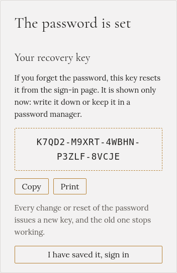
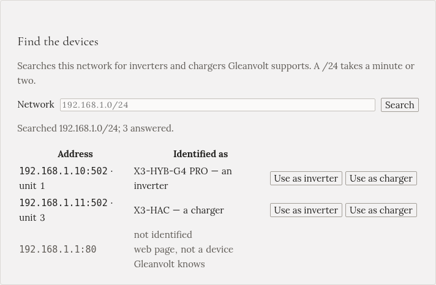
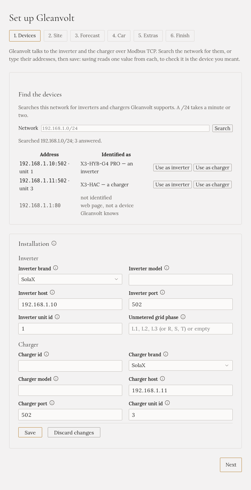
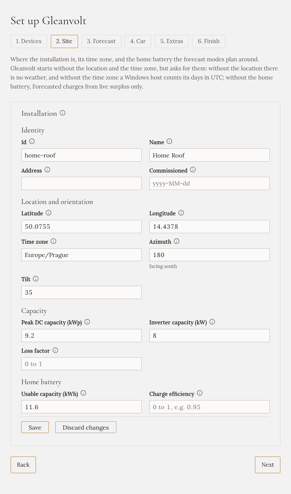
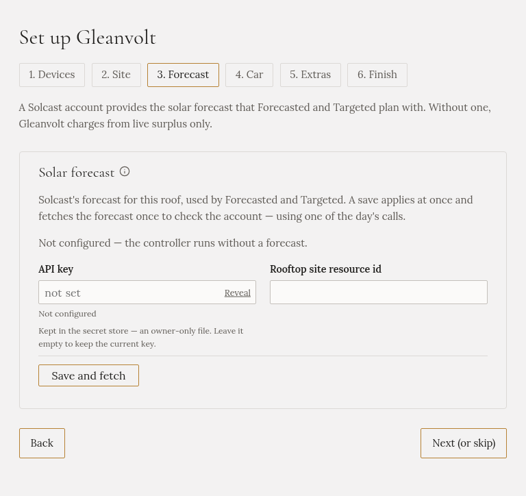
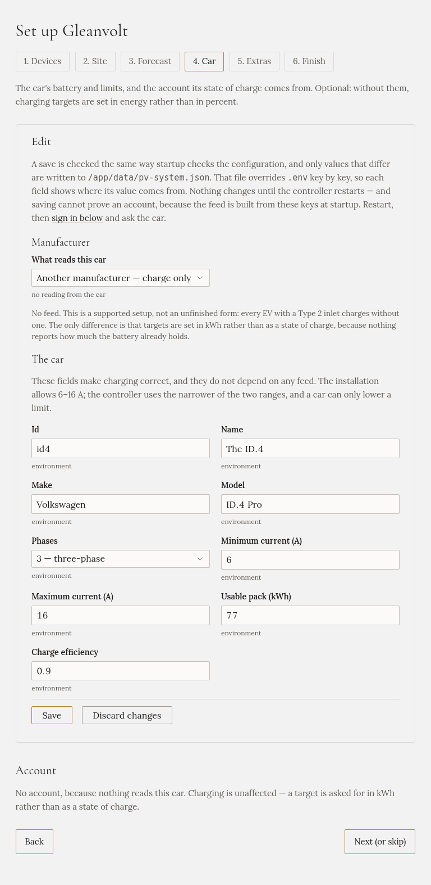
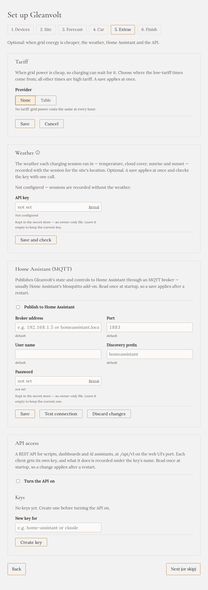
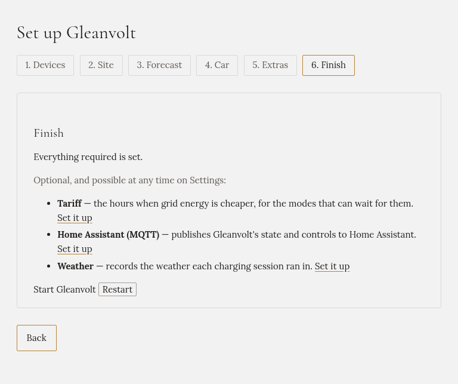

import { Steps } from '@astrojs/starlight/components';

The first time you open Gleanvolt, it walks you through its setup. You choose a password, then a
**wizard** asks for what Gleanvolt needs to know, one page at a time. It takes about ten minutes.

Only the first two steps are required: the password, and the addresses of your inverter and your
charger. Everything else can be skipped and added later on **Settings**.

## Before you start

- Gleanvolt is installed and running.
- Your inverter and your charger are switched on and connected to your home network.
- **Modbus TCP is turned on** in both. This is how Gleanvolt talks to them. See
  [Preparing your inverter and charger](../../installation/preparing-devices/).
- If **Home Assistant** is reading your inverter, stop that integration while you search for the
  devices. Some inverters accept only one connection at a time.

## Open Gleanvolt

On a phone or a computer in the same home network, open a web browser and go to
**`http://gleanvolt.local:8090`**.

If the page doesn't open, use the address of the computer Gleanvolt runs on instead, for example
`http://192.168.1.20:8090`. Your router's list of connected devices shows it.

## Set a password

<Steps>

1. Type a password of at least 8 characters, and type it again below.

   Gleanvolt has one password for the whole household, not one per person. Anyone in your home network
   can open the page, so the password is what stops a guest's phone from changing how your car charges.

   

2. Press **Set the password**.

3. Gleanvolt shows your **recovery key**. If you ever forget the password, this key lets you set a new
   one. It is shown only this once.

   Press **Copy** and keep it in your password manager, or press **Print**, or write it down.

   

4. Press **I have saved it, sign in**, and sign in with your new password.

</Steps>

## The wizard

The wizard has six steps, listed at the top of the page. You can move between them at any time.

:::caution[Save each step]
**Next** only moves to the next step. Press **Save** first, or what you typed is lost. What you have
saved stays saved, even if you close the browser halfway through.
:::

### 1. Devices

Here you tell Gleanvolt which device is your inverter and which is your charger.

<Steps>

1. Press **Search**. Gleanvolt looks through your home network for inverters and chargers it knows.
   This takes a minute or two.

   

2. In the list, find your inverter and press **Use as inverter**. Then find your charger and press
   **Use as charger**.

   The **Identified as** column says what each device reported itself as. Gleanvolt never decides for
   you which is which, and warns you if you pick a role that doesn't match.

3. Check the form below the list. The inverter's and the charger's addresses are now filled in.

   

4. Press **Save**. Gleanvolt reads one value from each device, to check that it is the device you
   meant.

5. Press **Next**.

</Steps>

:::tip[The search finds nothing?]
- Make sure Modbus TCP is turned on in the inverter and the charger.
- Stop anything else that is connected to them, such as Home Assistant's SolaX or Huawei integration,
  and search again.
- If Gleanvolt runs in Docker, the search may only see Docker's own network. Type your home network's
  range in **Network**, for example `192.168.1.0/24`, and search again.
- If you know the addresses, you can type them into the form yourself.
:::

:::caution[Don't swap the inverter and the charger]
Both answer on the same port, so Gleanvolt connects to them either way. If they are swapped, the
battery level looks frozen and the solar power shows zero. Check the **Identified as** column before
you save.
:::

If a device doesn't answer when you save, for example a charger that is switched off, Gleanvolt asks
before it saves. Press **Save anyway** only if you are sure the address is right.

### 2. Site

Where your solar panels are, and how big your home battery is.

<Steps>

1. Fill in what you know:

   - **Latitude** and **Longitude** of your home. Gleanvolt uses them for the weather and for the
     sunrise and sunset. In most online maps, right-click your house to see them.
   - **Time zone**, for example `Europe/Prague` or `Europe/Berlin`. Gleanvolt uses it to know when a
     day starts and ends.
   - **Usable capacity (kWh)** of your home battery. The battery's data sheet, or your inverter's app,
     shows it. The forecast-based charging modes use it to plan.

   The other fields are optional. Fill them in if you know them.

   

2. Press **Save**, then **Next**.

</Steps>

Gleanvolt starts without the location and the time zone, but it works better with them.

### 3. Forecast (optional)

A free **Solcast** account gives Gleanvolt a solar forecast for your roof. Two charging modes,
Forecasted and Targeted, use it to plan ahead. Without it, Gleanvolt charges from the sunshine there is
right now.

If you have an account, paste its **API key** and the **Rooftop site resource id**, then press
**Save and fetch**. If not, press **Next (or skip)**. You can add it later on **Settings**.

### 4. Car (optional)

Your car's battery size and charging limits, and the account its battery level comes from. With them,
you can ask for a charge in percent, such as "80 % by 7:00". Without them, you ask in kWh instead.

Fill in what you know, press **Save**, then **Next (or skip)**.

### 5. Extras (optional)

- **Tariff**: the hours when electricity from the grid is cheaper. Some modes can wait for them.
- **Weather**: records the weather during each charge.
- **Home Assistant (MQTT)** and **API access**: for connecting other software. Leave them off if you
  don't use them.

You can skip this whole step and come back to it on **Settings**.

### 6. Finish

The last step checks that everything required is set. If something is missing, it says what, with a
link to the step where you set it.

<Steps>

1. Next to **Start Gleanvolt**, press **Restart**, then **Yes, restart it**.

2. Gleanvolt restarts. After about half a minute, the **Overview** opens.

</Steps>

On a Raspberry Pi, a Linux computer, Docker or a NAS, Gleanvolt comes back by itself. On Windows, if
it doesn't come back, start it again yourself.

Gleanvolt always starts with charging **off**. It doesn't touch the charger until you choose a
charging mode.

## Changing something later

Everything the wizard asks for is also on **Settings**, with the same fields. Change it there at any
time.
