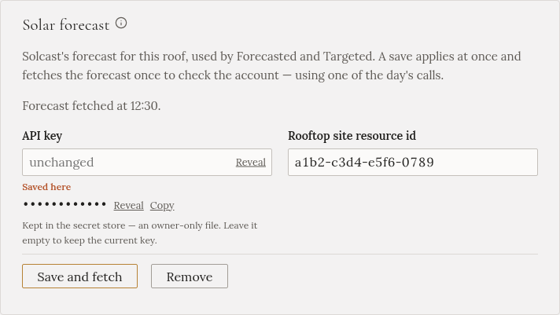

import { Steps } from '@astrojs/starlight/components';

A solar forecast tells Gleanvolt how much sun to expect over the day. Two charging modes use it:

- **Forecasted** starts charging the car earlier, while making sure the home battery is still full by
  the evening.
- **Targeted** plans a charge to finish by a set time, using as much sun and as little grid as it can.

Without a forecast, Gleanvolt still charges from the sunshine there is right now, and every other mode
works as usual. The forecast comes from [Solcast](https://solcast.com/), which is free for home use.

## Get an account

<Steps>

1. Go to [solcast.com](https://solcast.com/) and register for the free **home user** plan (also called
   *hobbyist*).

2. Add a **rooftop site**. Enter your home's location and your panels' details:

   - **Capacity**: the panels' total power in kW, such as 9.2. Your installer's papers or the inverter's
     app show it.
   - **Azimuth**: which way the panels face. Follow Solcast's own explanation of the number, as its
     convention may differ from a compass.
   - **Tilt**: the panels' angle from flat, in degrees.

   The forecast is only as good as these numbers.

3. Open the site you created. Its **resource id** is shown there, a code like `a1b2-c3d4-e5f6-0789`.

4. Open your account settings and copy your **API key**.

</Steps>

## Enter it in Gleanvolt

<Steps>

1. Open **Settings**, and find **Solar forecast**. (Or the setup wizard's **Forecast** step.)

2. Paste the **API key** and the **Rooftop site resource id**.

3. Press **Save and fetch**. Gleanvolt fetches the forecast once, to check the account. There is no need
   to restart.

</Steps>

When it worked, the section says when the forecast was fetched:

If Solcast refuses the key or doesn't know the site, the section says so. Check what you pasted and save
again.

## About the daily limit

The free plan allows **about ten forecasts a day**. Gleanvolt fetches one every 12 hours, and one each
time it starts. So:

- Restarting Gleanvolt many times in one day can use up the day's forecasts. It works again the next
  day.
- If Solcast says the limit is reached, nothing is broken. Wait until tomorrow.
