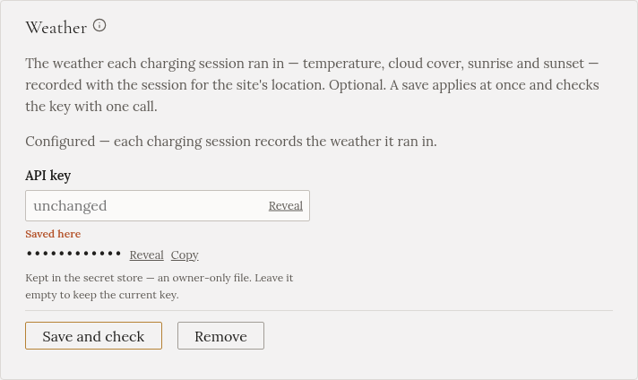

import { Steps } from '@astrojs/starlight/components';

With a weather key, Gleanvolt records what the sky was doing at the start and the end of each charge:
the temperature, the clouds, sunrise and sunset. You see it in each charge's history, which helps
explain a charge that took longer than expected.

It is optional, and changes nothing about how the car charges. It also needs your home's location, which
the setup wizard's **Site** step asks for.

## Get a key

<Steps>

1. Go to [openweathermap.org](https://openweathermap.org/) and create a free account.

2. Open your account's **API keys** page and copy the key.

</Steps>

## Enter it in Gleanvolt

<Steps>

1. Open **Settings**, and find **Weather**. (Or the setup wizard's **Extras** step.)

2. Paste the key in **API key**.

3. Press **Save and check**. There is no need to restart.

</Steps>

:::note[A new key can take a couple of hours]
OpenWeatherMap sometimes takes a while to switch on a new key. If the check fails straight after you
created it, the key is still saved, and starts working on its own.
:::

Gleanvolt asks for the weather twice per charge, well within the free plan.
