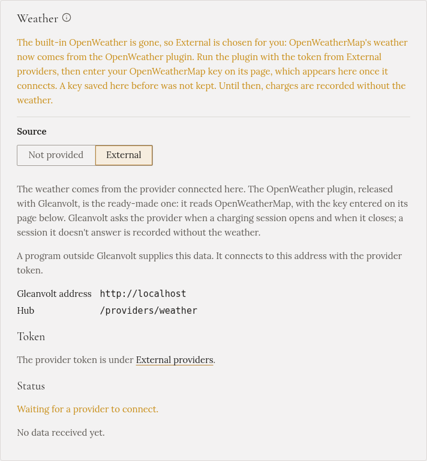

import { Steps, Tabs, TabItem } from '@astrojs/starlight/components';

Gleanvolt can record what the sky was doing at the start and the end of each charge: the temperature,
the clouds, sunrise and sunset. You see it in each charge's history, which helps explain a charge that
took longer than expected.

It is optional, and changes nothing about how the car charges. It also needs your home's location, which
the setup wizard's **Site** step asks for.

## Choose where the weather comes from

Open **Settings → Forecast & prices** and find **Weather**. Under **Source**, choose:

- **Not provided**: no weather is recorded.
- **A plugin**: a separate program sends the weather to Gleanvolt. The OpenWeather plugin, which comes
  with Gleanvolt, is the ready-made one: it reads the weather from OpenWeatherMap. See
  [Plugins](../plugins/).

Press **Save**. There is no need to restart.

## Record the weather with the OpenWeather plugin

### Get an OpenWeatherMap key

<Steps>

1. Go to [openweathermap.org](https://openweathermap.org/) and create a free account.

2. Open your account's **API keys** page and copy the key.

</Steps>

:::note[A new key can take a couple of hours]
OpenWeatherMap sometimes takes a while to switch on a new key. If the check fails straight after you
created it, the key is still saved, and starts working on its own.
:::

### Connect the plugin

<Steps>

1. Under **Weather**, choose **A plugin** and press **Save**.

2. Start the plugin: see [Run the OpenWeather plugin](#run-the-openweather-plugin) below.

3. Accept it under **Settings → Plugins**, when it asks to connect.

4. Once it connects, its own page appears under **Weather**. Enter the OpenWeatherMap key there and
   press **Save and check**.

</Steps>


Gleanvolt asks the plugin when a charge starts and when it ends, and the plugin asks OpenWeatherMap at
most once every 10 minutes, well within the free plan. If the plugin isn't running or doesn't answer
within 15 seconds, that charge is recorded without the weather. Nothing else is affected.

## If you used OpenWeather in Gleanvolt before

Gleanvolt used to ask OpenWeatherMap itself, with the key entered under **Weather**. That is gone: the
weather from OpenWeatherMap now comes only through the OpenWeather plugin. After the update, Gleanvolt
chooses **A plugin** for you and says so under **Weather**, until the plugin connects:



The key you saved in Gleanvolt is not kept. Start the plugin as below, and enter your key again on its
page. Until then, charges are recorded without the weather.

## Run the OpenWeather plugin

The OpenWeather plugin comes with each Gleanvolt release, as a container and as a download. Use the same
version as your Gleanvolt. Start it as shown for your installation below. It needs no token: it asks to
connect, and you accept it under **Settings → Plugins**. Under **Weather**, choose **A plugin** and press
**Save**; the plugin's page appears there once it connects.

<Tabs syncKey="install">
<TabItem label="Docker">

Make the plugin's folder, then start it next to Gleanvolt:

```bash
sudo mkdir -p /opt/gleanvolt/plugins/openweather
sudo chown 1654:1654 /opt/gleanvolt/plugins/openweather
sudo chmod 700 /opt/gleanvolt/plugins/openweather

docker run -d --name gleanvolt-plugin-openweather --restart unless-stopped --init \
  --network host \
  -v /opt/gleanvolt/plugins/openweather:/data \
  ghcr.io/mpospisil/gleanvolt-plugin-openweather:latest
```

The folder keeps the OpenWeatherMap key and the plugin's token, and only the plugin can read it. If Gleanvolt isn't on port
8090, add `-e Gleanvolt__Endpoint=http://localhost:<its port>`.

</TabItem>
<TabItem label="NAS">

The file you pasted from [NAS](../../installation/nas/) already has the plugin, switched off. In your
NAS's container app, edit the project's file:

1. Delete the line `profiles: ["openweather"]`.
2. Save, and start the project again.

</TabItem>
<TabItem label="Windows">

<Steps>

1. From the [releases page](https://github.com/mpospisil/gleanvolt/releases), download
   `gleanvolt-plugin-openweather-<version>-win-x64.zip` for your Gleanvolt's version, and unzip it.

2. In a new terminal, go to the `gleanvolt-plugin-openweather` folder and start it:

   ```powershell
   .\Gleanvolt.Plugin.OpenWeather.exe
   ```

</Steps>

Like Gleanvolt, it stops when its window closes. Its page opens only in a browser on this PC. To open it
from your phone too, add `--Urls=http://0.0.0.0:8096` and allow it through the firewall on private
networks.

</TabItem>
<TabItem label="Linux">

With the `.deb`, Docker is the simplest way: see the **Docker** tab. Or download
`gleanvolt-plugin-openweather-<version>-linux-arm64.zip` (`linux-x64` on a PC), unzip it, and in its
folder:

```bash
./Gleanvolt.Plugin.OpenWeather --Urls=http://0.0.0.0:8096
```

It runs until you stop it, and doesn't start with the computer.

</TabItem>
</Tabs>

The plugin's page uses port 8096 on the same computer as Gleanvolt. Gleanvolt opens it under the same
name you opened Gleanvolt at, so `gleanvolt.local` and the address both work.

If you make a new token, the plugin disconnects and asks to connect again: accept it again.

