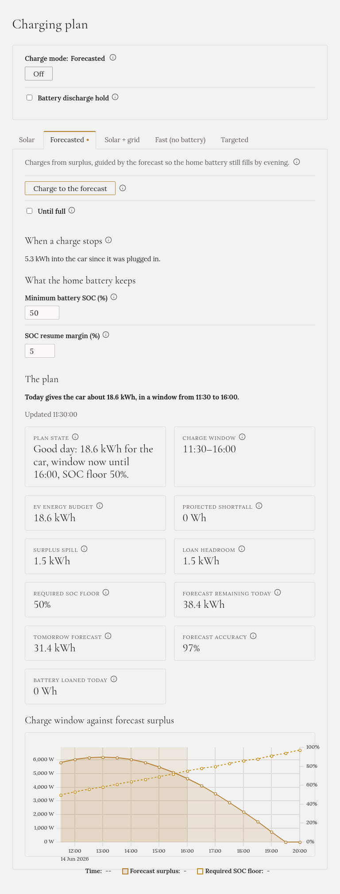

**The battery discharge hold stops the home battery from discharging.** The sun covers what it can, the
grid covers the rest, and the battery is left alone. It can still **charge** from the sun.

Your inverter, not Gleanvolt, decides where power comes from. To the inverter, a charging car is just a
large house load, and it covers it from the home battery. The hold tells the inverter not to.

## Where to find it

At the top of **Charging plan**, under the charge mode: **Battery discharge hold**. Tick it to switch
the hold on, untick it to release it.

:::note[You don't see the switch?]
The hold is the only feature that writes to your inverter, so it is **off** when Gleanvolt is installed.
Turning it on is an advanced setting (`BatteryHold__Enabled`), described in the repository. It has been
tested on a SolaX X3-HYB-G4 PRO; on other inverters, try it with care.
:::

## When it is switched on for you

- **Fast (no battery)** switches it on when the car starts charging, and off when the charge ends.
- **Targeted** and **Solar + grid** switch it on while the car takes more than the sun gives.
- **Solar** and **Forecasted** never switch it on, but a hold you switched on still applies.

## Using it on its own

The hold works with any mode, and with charging **Off**:

- With charging **Off**, and the charger set at the wallbox: the car charges from the sun and the grid,
  and the battery is untouched.
- With no car at all: to keep the battery full, for example before an expensive tariff or a planned
  power cut.

## Good to know

- **It doesn't survive a restart.** Gleanvolt always starts with the hold off.
- **On a SolaX inverter**, the hold lapses within a minute if Gleanvolt stops, so it can't get stuck.
- **A small trickle remains**: about 50–65 W still leaves the battery, which is the inverter's own use.
- **Check it on the battery's power**, not on the switch: the switch shows the last command Gleanvolt
  sent, which the inverter can't confirm. With the hold on, the Overview's **Battery** figure should be
  near zero or charging.
