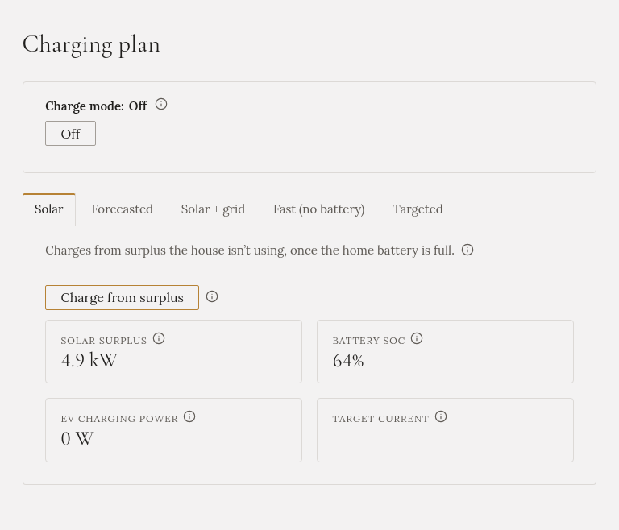

**Charging plan** is where you decide how the car charges. It has a box at the top, and a tab for each
charging mode.

## The box at the top

- **Charge mode** says which mode is running. **Off** means Gleanvolt isn't controlling the charger.
- The **Off** button stops the running mode. The charger is paused and the session is saved.
- **Battery discharge hold**, if it is turned on for your installation: see
  [Battery discharge hold](../battery-hold/).

Messages appear here too, for example when the charger refuses a command.

## The tabs

There is one tab per mode: **Solar**, **Forecasted**, **Solar + grid**, **Fast (no battery)** and
**Targeted**. A dot marks the mode that is running. Each tab has the mode's start button and its
options, and shows how the mode is doing while it runs.

You can open any tab and set its options while another mode runs. Pressing a tab's start button
switches to that mode.

Not sure which to choose? See [Which mode should I choose?](../modes/choosing/).

## Things that are true for every mode

- **Gleanvolt starts with charging off.** After a restart or an update, no mode runs until you start one.
  The only exception is Forecasted with **Until full**, which carries on after a restart.
- **Every mode stops by itself** when the car is full or unplugged.
- **A mode doesn't survive a restart.** A charge planned for tonight is lost if Gleanvolt restarts this
  evening. Start it again afterwards.
- **Someone at the wallbox has the last word.** If the charger is changed on the wallbox or in its app
  while a mode runs, Gleanvolt leaves it alone until you start a mode again.
