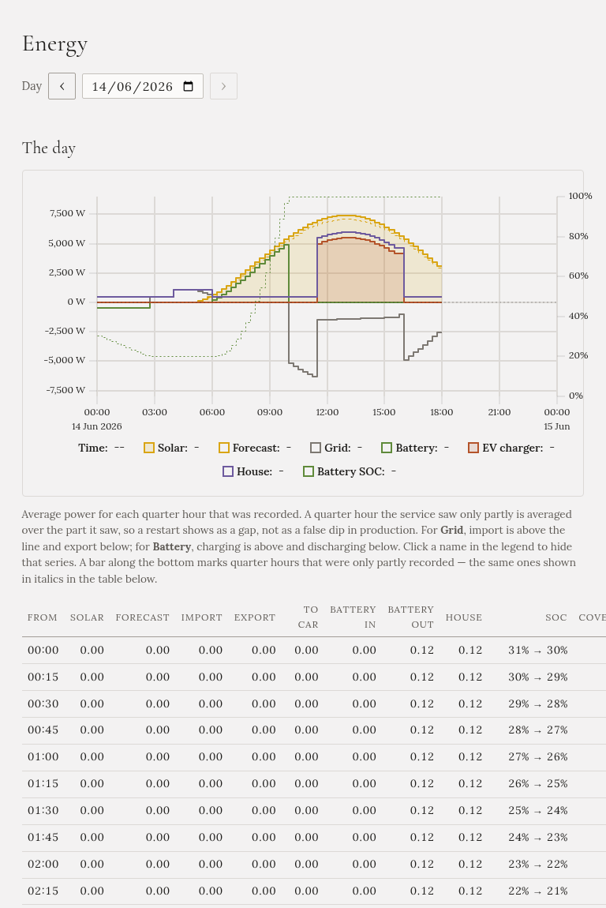

**Energy** shows one recorded day: where your energy came from and where it went, drawn as a chart and
printed as a table.

## Choosing the day

Use the date box, or the **‹** and **›** buttons next to it. Today shows the day so far.

## The chart

The chart shows average power in each quarter hour, in watts:

- **Solar**, and the **forecast** for it as a dashed line.
- **Grid**: buying is above zero, selling below.
- **Battery**: charging is above zero, discharging below. The battery's level is the dotted line, on the
  right-hand scale.
- **EV charger**: what the car took.
- **House**: what the house used, without the car.

The day is drawn in your installation's time zone. Click a name in the legend to hide that line.

**A gap is a gap.** If Gleanvolt wasn't running, for example during an update, that stretch is left
empty rather than drawn as if the sun had gone out. A band along the bottom marks quarter hours that were
only partly recorded.

## The table

One row per quarter hour, in kWh, with the day's totals at the bottom:

| Column | What it is |
|---|---|
| **Solar**, **Forecast** | What the panels made, and what the forecast expected |
| **Import**, **Export** | Bought from and sold to the grid |
| **To car** | What went into the car |
| **Battery in**, **Battery out** | The home battery charging and discharging |
| **House** | What the house used, worked out from the other figures |
| **SOC** | The home battery's level at the start and end of the quarter hour |

A quarter hour that was only partly recorded is shown in *italics*. Where there was no forecast, the
table shows a dash rather than zero.
