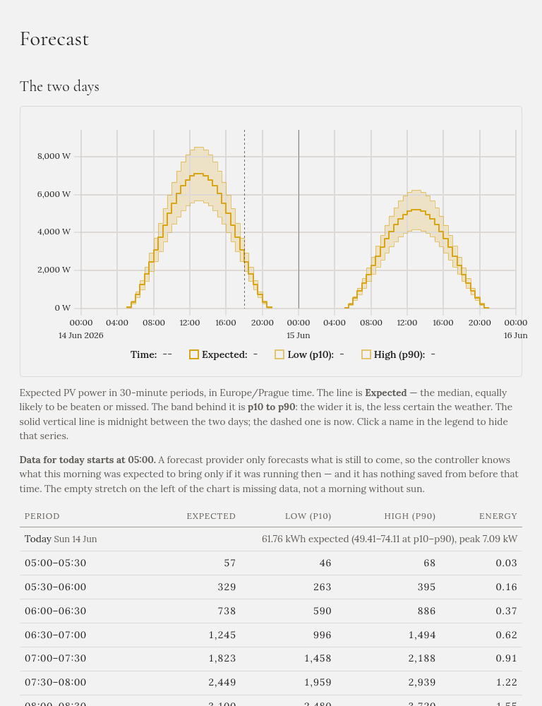

**Forecast** shows the solar forecast Gleanvolt is working with, for today and tomorrow. It needs a
[Solcast account](../../setting-up/solar-forecast/).

## The chart

- **The line** is the **expected** power: as likely to be beaten as missed.
- **The band** around it is the likely range, from a cloudier day (**low**, p10) to a clearer one
  (**high**, p90). The wider the band, the less certain the weather.
- **The solid vertical line** is midnight between the two days; **the dashed line** is now.

## The table

Each day starts with its totals: the expected energy, the low and high estimates, and the peak power.
Then one row per half hour, with the expected, low and high power in watts, and the expected energy in
kWh.

## Good to know

- **The page never fetches a new forecast.** It shows the one Gleanvolt already has, and says when it was
  fetched. The free Solcast plan allows about ten fetches a day.
- **After a restart, this morning may be missing.** A forecast only covers what is still to come, so if
  Gleanvolt wasn't running this morning, it doesn't know what this morning was expected to bring. The page
  says so, and the empty stretch on the chart is missing data, not a morning without sun.
- **Tomorrow changes** with each new forecast, until the day comes.

The [Overview](../overview/) has the same day totals at a glance, and the
[Forecasted](../modes/forecasted/) tab shows what today means for the car.
