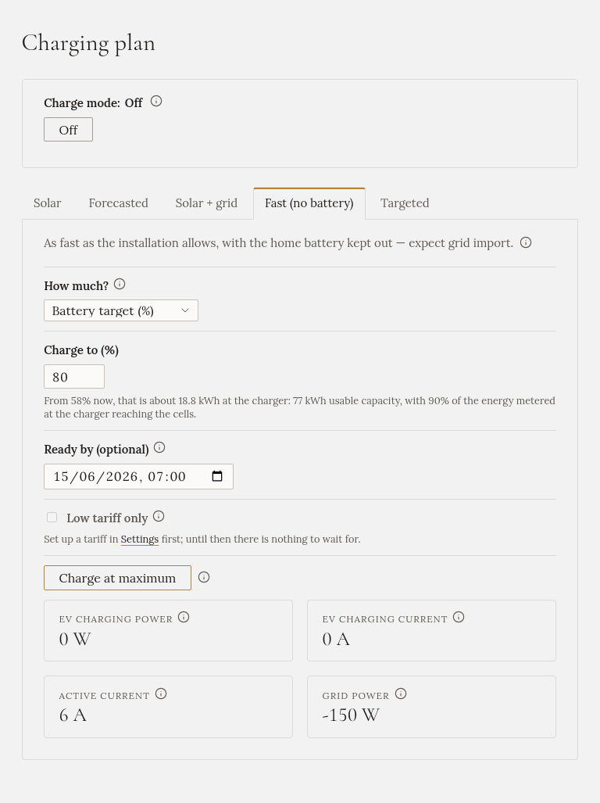

import { Steps } from '@astrojs/starlight/components';

**"I'm leaving in an hour."** The car charges at full power. The sun covers what it can, the grid covers
the rest, and the home battery is kept out of it.

## When to choose it

When you need the car charged soon. Or with a departure time, when you need it by a certain time and
want the charge to finish just before.

## How to start it

<Steps>

1. On **Charging plan**, open the **Fast (no battery)** tab.

2. Under **How much?**, choose:
   - **Until the car stops**: the car decides, and stops at its own charge limit.
   - **Energy to add (kWh)**: a fixed amount.
   - **Battery target (%)**: a level, such as 80 %. This needs the car's battery level: see
     [Your car and its battery level](../../../setting-up/car/).

3. Optionally, set **Ready by**: when you're leaving.

4. Press **Charge at maximum**.

</Steps>

## What it does

- The charger runs at its **maximum** current from start to finish.
- The [battery discharge hold](../../battery-hold/) is switched on, so the home battery doesn't feed the
  car. If you want the battery to help after all, switch the hold off while it charges.
- When the amount is reached or the car stops, it stops, and charging is **Off** again.

## With a departure time

Gleanvolt then starts **as late as it can** and still finish in time, with 15 minutes to spare. For
30 kWh at 11 kW by 07:00, it starts at about 04:00.

**Why wait?** A car battery ages faster when it sits at a high level. Charging just before you leave
keeps it at 100 % for minutes, not all night.

- A departure time needs an amount. With **Until the car stops** there is nothing to work back from.
- If there isn't enough time, it starts at once and tells you how much it will fall short.
- If you plug in after the planned start, it starts at once.

## Low tariff only

If you have set up a [grid tariff](../../../setting-up/grid-tariff/), tick **Low tariff only**. The car
then waits through the high tariff and charges at full power when the low tariff starts. The battery
hold is off while it waits, so the house isn't run from the grid at the high price.

## When it stops by itself

- The amount is delivered, or the car stops at its own limit.
- The car is unplugged.
- The departure time passes.

## The home battery

**It is kept out of the charge** (if the battery discharge hold is turned on for your installation).
It can still charge from any sun the car doesn't take.

:::caution[It draws a lot from the grid]
On three phases at 16 A this is about 11 kW, for hours. Make sure your supply and main breaker allow
the charger's maximum current.
:::

:::caution[A planned charge doesn't survive a restart]
If Gleanvolt restarts in the evening, a charge planned for 04:00 is lost, and the car isn't charged in
the morning. Start it again after a restart.
:::
