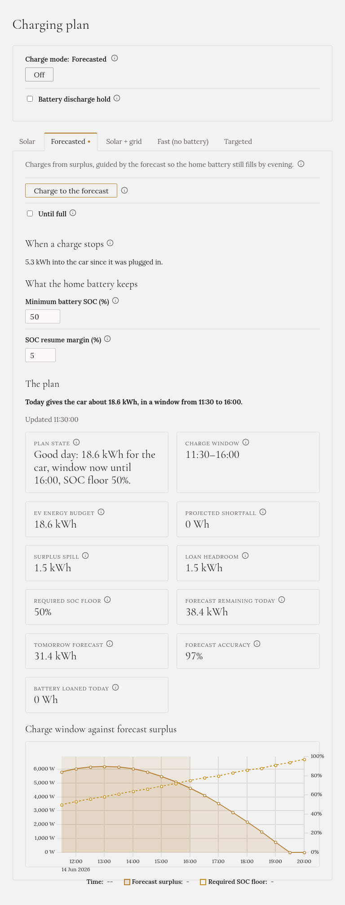

**The car starts charging earlier than in Solar, and the home battery is still full by the evening.**
No electricity is bought for the car.

## When to choose it

On most days when the car is at home and you're not in a hurry. It needs a
[solar forecast](../../../setting-up/solar-forecast/); without one, it works like [Solar](../solar/).

## How to start it

On **Charging plan**, open the **Forecasted** tab and press **Charge to the forecast**.

## What it does

From the forecast, Gleanvolt works out how much sun is left today, how much the house will use, and how
much the home battery still needs to be full by **19:00**. What's left over goes to the car.

- **The home battery gets the weak sun of the morning and the evening.** The car can't use it anyway: it
  needs at least about 4.1 kW on three phases.
- **The car gets the strong sun in the middle of the day.**
- **The battery may lend a little to the car.** When the sun is just short of what the car needs, the
  battery tops it up, but only on a day the forecast says it can pay back, and never below 50 %.
- **As the evening approaches, the car gets less**, so the battery is sure to reach 100 %.

The plan is recalculated every few seconds, and checked against what the sun really does. If the
forecast turns out badly wrong, Gleanvolt drops it for the rest of the day and behaves like Solar.

## What you'll see

The tab shows **the plan** in one sentence, such as "Today gives the car about 18.6 kWh, in a window
from 11:30 to 16:00", the figures behind it, and a chart: the forecast surplus, the **charge window**
(shaded), and the level the home battery must not go below (dashed line).

On the tab you can also set **Minimum battery SOC**: the lowest level the battery may lend down to.

## Until full

Tick **Until full** to charge over several days. In the evening the charger stops for the night, and in
the morning it carries on with the new day's sun. It continues until the car is full, unplugged, or you
press **Off**. It is the one mode that also continues after Gleanvolt restarts.

## When it stops by itself

- The car is full, or unplugged.
- There is no more sun today that could charge the car (unless **Until full** is ticked).

## The home battery

**It is full by 19:00**, unless the day doesn't have enough sun even for the battery and the house. The
car is never charged from the grid in this mode, so on a poor day the car simply gets less.

Want a specific amount by a specific time? Use [Targeted](../targeted/), with **Sun only** if nothing
may be bought.
