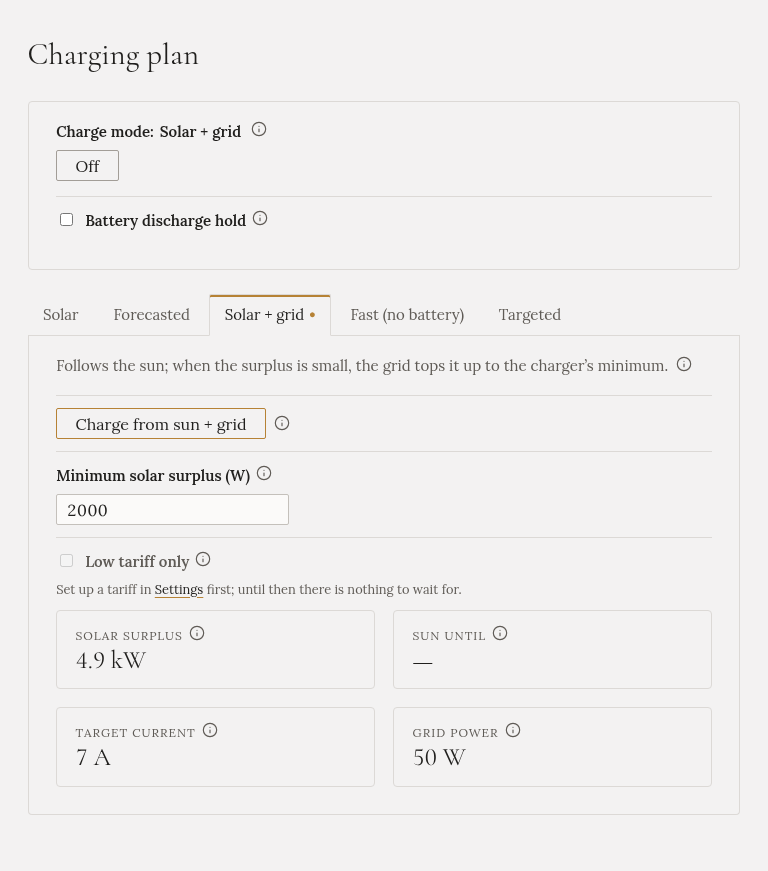

**The car takes the sun as it comes. When the sun is too weak for the car alone, the grid tops it up.
When the day's sun is over, it stops.**

## When to choose it

When you want to use today's sun, even a weak or cloudy sun, and don't mind buying a little electricity
to do it.

## How to start it

On **Charging plan**, open the **Solar + grid** tab, check **Minimum solar surplus**, and press
**Charge from sun + grid**.

## What it does

One number steers it: the **minimum solar surplus**, 2000 W unless you change it.

| The sun's surplus | What the car does | From the grid |
|---|---|---|
| Enough for the car alone (about 4.1 kW on three phases) | Follows the sun | Nothing |
| Between your minimum and that | Charges at the lowest current the car accepts | The difference |
| Below your minimum | Pauses | Nothing |

So with the minimum at 2000 W, a 3 kW surplus charges the car at about 4.1 kW, and about 1.1 kW is
bought. The higher you set the minimum, the less is bought. Set it to 4200 W or more and it never buys
anything.

A passing cloud doesn't stop it: Gleanvolt looks at the average of the last three minutes, and a
running charge continues for at least ten minutes.

## Low tariff only

If you have set up a [grid tariff](../../../setting-up/grid-tariff/), tick **Low tariff only** to
charge only in the low tariff. On a sunny afternoon in the high tariff, the car then gets nothing, and
the sun goes to the home battery or the grid.

## What you'll see

The tab shows the surplus, the current the charger is set to, the grid power, and until when the
forecast expects enough sun.

## When it stops by itself

- The car is full, or unplugged.
- The forecast has no more sun today above your minimum.

## The home battery

The car and the home battery **share** the sun; the battery isn't filled first. If the
[battery discharge hold](../../battery-hold/) is turned on for your installation, Gleanvolt switches it
on while the grid tops up, so the battery doesn't make up the difference. Without it, the battery may
cover part of the gap.
