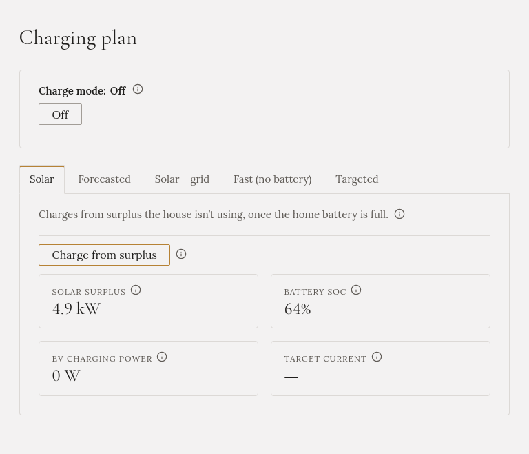

**The car gets only the sun the house doesn't need, and only once the home battery is full.** No
electricity is bought for the car.

## When to choose it

On a sunny day when you're in no hurry, and the home battery comes first.

## How to start it

On **Charging plan**, open the **Solar** tab and press **Charge from surplus**.

## What it does

- It waits until the home battery is **full** (95 % or more). Then the car gets the **surplus**: what the
  panels make, minus what the house uses.
- The charging current follows the surplus, up and down.
- A car can't charge on less than about **4.1 kW** on three phases (1.4 kW on one phase). When the
  surplus is smaller, the car **pauses** and continues when the sun comes back.
- A passing cloud doesn't stop it: Gleanvolt looks at the average of the last three minutes.
- If the home battery drops below 90 %, the car stops and the battery gets the sun again.

## What you'll see

The tab and the Overview show the surplus, the home battery level, and what the car takes. While it
waits for the battery, the Overview says so.

## When it stops by itself

- The car is full, or unplugged.
- The forecast has no more sun today that could charge the car.

## The home battery

It is filled first, every time. The car never competes with it.

:::tip
On many days the home battery is only full around midday, so the car gets the afternoon only. If you
want the car to start earlier, try [Forecasted](../forecasted/).
:::
