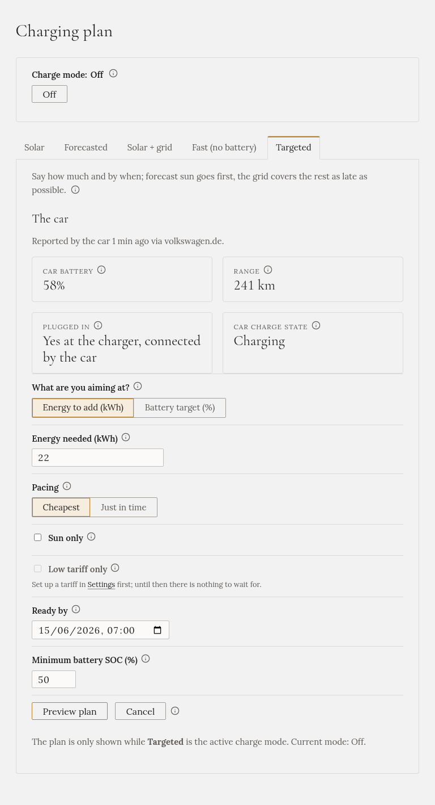
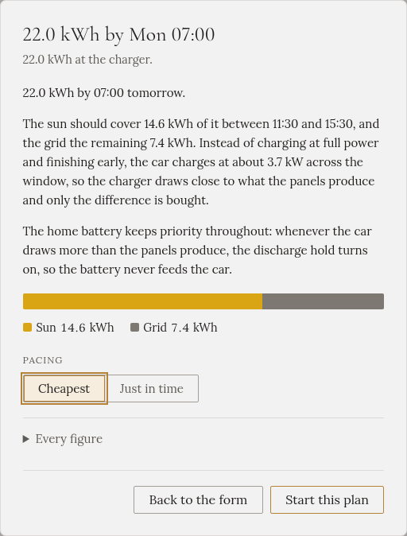

import { Steps } from '@astrojs/starlight/components';

**"22 kWh, or 80 %, by 07:00, with as little grid as possible."** Gleanvolt plans backwards from your
departure: the sun first, the grid only for what the sun can't bring in time. You see the plan before
anything starts.

## When to choose it

When you need a certain amount by a certain time, and have hours to spare: overnight, or from the morning
to the evening. It works best with a [solar forecast](../../../setting-up/solar-forecast/).

## How to start it

<Steps>

1. On **Charging plan**, open the **Targeted** tab. At the top, it shows what the car last reported.

2. Under **What are you aiming at?**, choose **Energy to add (kWh)** or **Battery target (%)**, and enter
   the amount. (The percent option appears when the car reports its battery level.)

3. Choose the **Pacing**: **Cheapest** or **Just in time** (see below).

4. Tick **Sun only** if nothing may be bought from the grid, or **Low tariff only** if it may be
   bought only in the low tariff.

5. Set **Ready by**: when you're leaving. At most 36 hours ahead.

6. Optionally, change **Minimum battery SOC**: the home battery level the car must leave alone.

7. Press **Preview plan**.

</Steps>

## Read the plan before it starts

The preview says, in words, how the target will be met: how much from the sun and when, how much from
the grid and when, and how fast the car will charge.

Press **Start this plan** to start, or **Back to the form** to change something.

If the target can't be met even at full power, the preview says how much you'll get, and the departure
time that would be enough.

## What it does

- **It paces the charge.** Rather than charging at full power and finishing early on grid, it spreads
  the charge over the time you gave it, at a rate the panels can mostly match. Sun above that rate goes
  into the car too, and lowers the rate for later.
- **The grid covers only what the sun can't**, as late as possible.
- **When the sun is just too weak** for the car alone, it may buy the small difference now, instead of
  buying the whole amount after dark.
- The plan is recalculated every few seconds, from the forecast and from what has really been delivered.

## Cheapest or just in time

- **Cheapest** delivers the amount as cheaply as possible, and usually finishes long before you leave.
- **Just in time** charges up to 80 % the cheap way, then holds the rest back and charges it shortly
  before you leave, so the car doesn't sit at a high level all night. This can cost a little more, and
  the preview says how much. It needs the car's battery level.

## Sun only

With **Sun only**, nothing is bought. Whatever the sun can't bring by the departure is shown in the
preview as a **shortfall**.

## Low tariff only

With **Low tariff only**, the car waits through the high tariff, **even when the sun is shining**,
just like [Fast (no battery)](../fast/) with the same option. The plan counts only on the low-tariff
hours before you leave. Whatever doesn't fit in them is shown in the preview as a **shortfall**.

It needs a tariff, set up on [Settings](../../../setting-up/grid-tariff/). It can't be combined with
**Sun only**: ticking Sun only turns it off.

## When it stops by itself

- The target is reached.
- The departure time passes.
- The car stops at its own limit, or is unplugged.

## The home battery

**It keeps its priority.** The car only gets the sun the battery doesn't need, and when the car draws
more than the sun gives, the [battery discharge hold](../../battery-hold/) is switched on (if it is
turned on for your installation), so the battery doesn't feed the car.

:::caution[A target doesn't survive a restart]
If Gleanvolt restarts overnight, nothing charges and nothing tells you. Start the target again after a
restart.
:::
