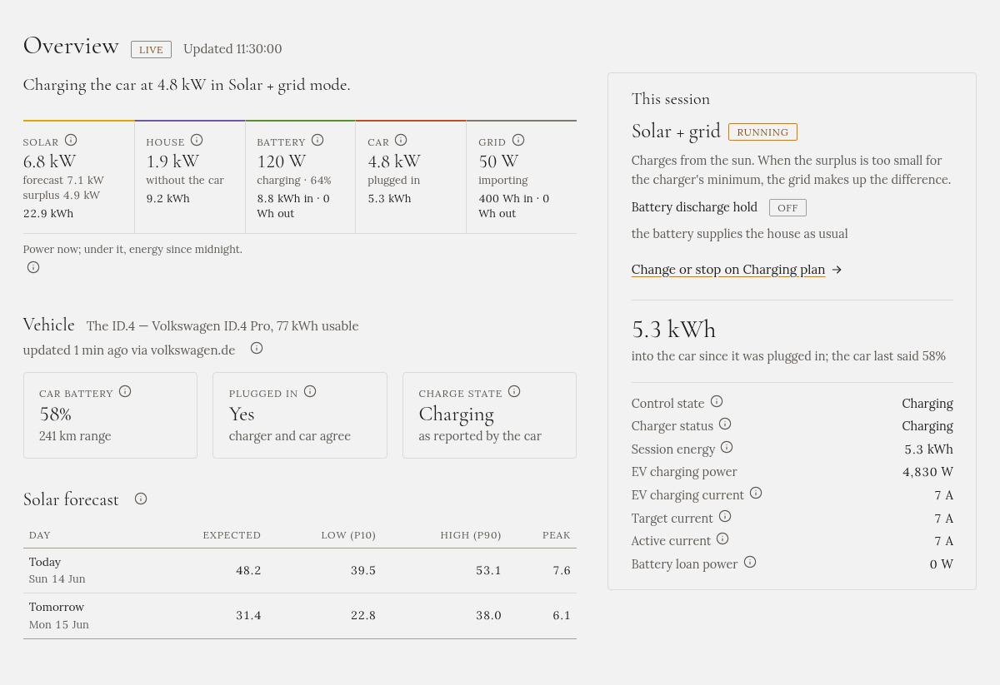

The **Overview** shows what is happening right now: where the power comes from, where it goes, and
what the car is doing. It only shows; to start or stop charging, use the
[Charging plan](../charging-plan/).

The page updates by itself every few seconds. **LIVE** next to the title means it is connected.

## The sentence at the top

One sentence says what Gleanvolt is doing, such as "Charging the car at 4.8 kW in Solar + grid mode",
or why it isn't charging: waiting for the sun, waiting for low tariff, or charging is off.

## The five figures

| Figure | What it shows |
|---|---|
| **Solar** | What the panels produce now, what the forecast expected for this moment, and the **surplus**: what is left after the house |
| **House** | What the house uses, not counting the car |
| **Battery** | The home battery: charging or discharging, and its level |
| **Car** | What the car takes now, and whether it is plugged in |
| **Grid** | **Importing** (buying) or **exporting** (selling) |

Under each figure is the energy since midnight. Every figure has an **ⓘ** that explains it.

## Vehicle

Your car, and what it last reported about itself: battery level, range, whether it is plugged in, and
whether it is charging. This needs the car's battery level to be set up: see
[Your car and its battery level](../../setting-up/car/). Without that, the section says no feed is
configured, and nothing is wrong.

If the car's account needs you to sign in again, a band across the top of every page says so.

## Solar forecast

The forecast for today and tomorrow, in kWh: the expected value, a low and a high estimate, and the
peak power. This needs a [Solcast account](../../setting-up/solar-forecast/).

## This session

While a charging mode runs, the right-hand side shows it: the mode, a short description, the battery
discharge hold, and the energy delivered into the car so far. Below are the detailed figures, such as
the current the charger is set to.

When no mode is running, it is one line with a link to start charging.
