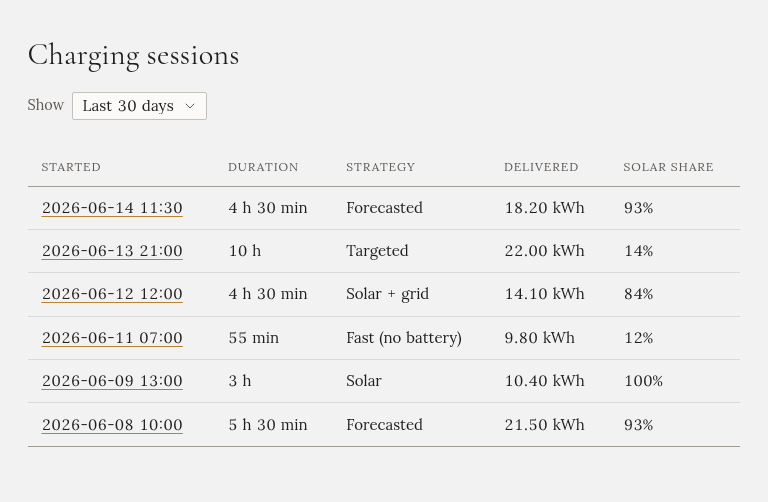
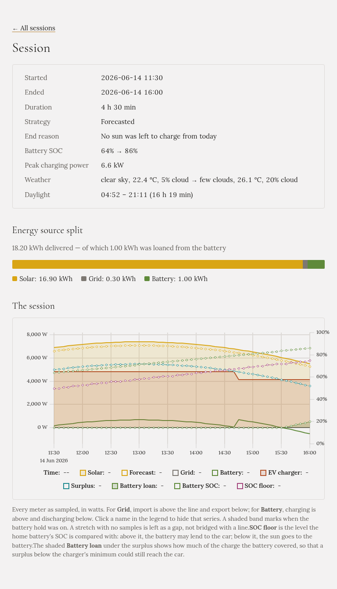

Gleanvolt records every charge it controls, from the moment a mode starts charging the car until it
stops. **Sessions** lists them.

## The list

Each row is one charge:

- **Started**: when, in your time zone. Click it to open the charge.
- **Duration**: how long it ran.
- **Strategy**: the charging mode.
- **Delivered**: the energy that went into the car, measured at the charger.
- **Solar share**: how much of it came from your own panels.

Use **Show** to choose how far back the list goes.

## One charge

At the top:

- **When**, **how long**, the **mode**, and the **end reason**: why it stopped. For example "The car
  finished charging", "The energy asked for was delivered", "The car was unplugged", "No sun was left to
  charge from today", or "Charge control was switched to Off".
- The **home battery** level at the start and the end, and the **peak charging power**.
- The **weather** at the start and the end, and the day's **daylight**, if you have set up
  [Weather](../../setting-up/weather/).

**Energy source split** shows where the car's energy came from: the sun, the grid, or the home battery.
In Forecasted mode, energy the battery **lent** to the car is mentioned separately.

## The chart

The chart shows the whole charge, in watts:

- **Solar**, the **forecast**, the **grid**, the **home battery** and the **EV charger** (the car).
- The **surplus**: the sun the house didn't need.
- The **home battery level**, on the right-hand scale.
- In Forecasted mode, the **SOC floor**, the level the battery must stay above, and the **battery loan**.
- A **shaded band** where the battery discharge hold was on.
- A **dashed line** where something happened, such as the mode changing or the charge pausing. Each one is
  listed under the chart.

For **Grid**, buying is above the zero line and selling below. For **Battery**, charging is above and
discharging below. Click a name in the legend to hide that line, and point at the chart to read the
values.

If the car's battery level was being read, its percentage is drawn too.

## How long history is kept

Charges and the energy history are kept on the computer Gleanvolt runs on, in its `data` folder. They
are part of your [backup](../../installation/updating/).
